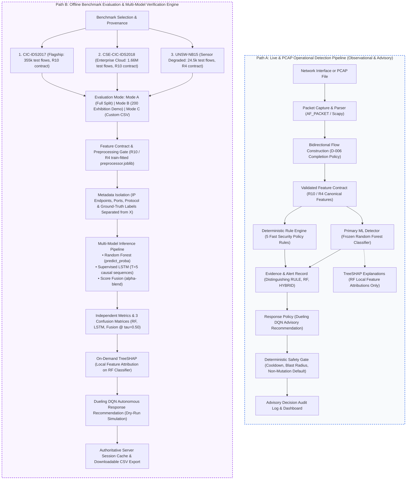
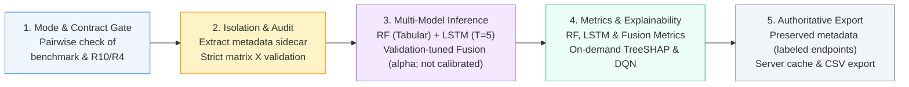

# XRL-IDARS

**Explainable Reinforcement Learning Based Intrusion Detection and Autonomous Response System**

XRL-IDARS is a research framework for network-flow intrusion detection and controlled autonomous response. It couples tabular and temporal machine learning detection (Random Forest + LSTM score fusion) with TreeSHAP feature attributions, context-aware reinforcement learning response policies (Dueling DQN), and deterministic safety constraints with atomic transaction rollback to prevent self-inflicted denial-of-service and unauthorized network mutations.

---

## 🎯 Viva & Presentation Hub (Quick Links)

Essential documentation, presentation scripts, and defense runbooks for final year project evaluations:

| Document | Purpose & Key Contents |
|----------|------------------------|
| [🛡️ **Attack-Family & Response Audit**](docs/ATTACK_FAMILY_AND_RESPONSE_AUDIT.md) | **Audit Addendum**: Forensic audit of binary vs. family detection, 6D DQN causal state, and advisory mode |
| [🧪 **Comprehensive Test Report**](docs/TEST_REPORT.md) | **573 Passing Tests**: Test suite breakdown, microsecond latencies, SHA-256 model verification, 100% pass |
| [📈 **Research Evaluation Report**](docs/RESEARCH_EVALUATION.md) | **Empirical Findings**: Multi-model metrics, per-family error stratification, and CostOptimal vs. DQN baseline |
| [📝 **Implementation & Continuation Log**](docs/IMPLEMENTATION_LOG.md) | **Forensic Audit Log**: Chronological actions, commit history, technology evaluations, and decisions |
| [🏛️ **Authoritative Architecture**](docs/ARCHITECTURE.md) | **Core System Blueprint**: 12-section architecture, live RF + Rules vs. offline LSTM/fusion, data flows, and safety constraints |
| [🔬 **Research Design & Rationale**](docs/RESEARCH_DESIGN.md) | **Academic Grounding**: RQs, design choices, DRL/XAI literature citations (2024-2026), and limitations |
| [📊 **Implementation Status Scorecard**](docs/IMPLEMENTATION_STATUS.md) | **Verified Subsystem Matrix**: Implemented, tested, and verified components with empirical evidence |
| [📦 **Model & Artifact Cryptographic Audit**](docs/MODEL_ARTIFACT_AUDIT.md) | **Checkpoints & Provenance**: Expected schemas, preprocessor matching, single-pass invariant, and UNSW-NB15 R4 resolution |
| [📏 **Research Evaluation Protocol**](docs/EVALUATION_PROTOCOL.md) | **Scientific Rigor**: Policy A splits, metrics formulas, DQN cost matrix, latency protocol, and reproduction commands |
| [✅ **Acceptance & Benchmark Audit**](docs/ACCEPTANCE_AUDIT.md) | **Verification Report**: PASS/FAIL/UNVERIFIED scorecard, empirical benchmark results, and runtime measurements |
| [🚀 **Start Here — Exhibition & Viva Guide**](docs/EXHIBITION_GUIDE.md) | **Primary Exhibition Runbook**: Prerequisites, launch commands, 5-7 min viva demo sequence, and troubleshooting |
| [⚙️ **System Mechanics & Flow Policies**](docs/HOW_IT_WORKS.md) | Full end-to-end explanation: D-006 flow policy, R10 feature contracts, and frozen model pipeline |

---

## System Architecture

XRL-IDARS consists of two decoupled execution paths:
1. **Live & PCAP Detection Pipeline**: Streams authentic packets/flows through pure-Python capture and demuxing, canonical feature extraction (R10/R4), dual tabular/sequence inference (RF + LSTM), TreeSHAP feature attribution, and context-aware mitigation policy recommendations governed by deterministic safety constraints.
2. **Offline CSV Evaluation Workbench**: Evaluates user-supplied or external flow CSVs against frozen preprocessors and models with strict contract pairing, target leakage isolation, mathematical row accounting, and authoritative server-side export.



> [!IMPORTANT]
> **Path Separation Invariant**:
> The CSV evaluation path is strictly an **offline research verification tool**. It never feeds predictions back into live detection, does not retrain models, does not rewrite historical benchmark artifacts, and cannot be used to claim live production accuracy. Live network monitoring is strictly observational (zero packet dropping or firewall mutations).

---

## Offline CSV Evaluation & Exhibition Demo Workflow

For empirical verification of research checkpoints and held-out test splits, the workbench provides a multi-model evaluation engine supporting three distinct operational modes:

1. **Mode B — Fixed Exhibition Subset (Recommended Demo)**:
   - **Provenance**: Deterministic 200-flow exhibition samples drawn from the canonical held-out test splits (seed 42), each restricted to one real source file:
     - **CIC-IDS2017**: 166 Benign, 34 Attack (28 DoS Hulk, 5 DoS GoldenEye, 1 DoS Slowhttptest), R10 contract, source file `Wednesday-workingHours.pcap_ISCX.csv`.
     - **CSE-CIC-IDS2018**: 166 Benign, 34 Attack (34 DDoS LOIC-HTTP), R10 contract, source file `Thuesday-20-02-2018_TrafficForML_CICFlowMeter.csv`.
     - **UNSW-NB15**: 166 Benign, 34 Attack (18 Exploits, 10 Fuzzers, 4 Reconnaissance, 1 Generic, 1 DoS), R4 contract, source file `UNSW_NB15_testing-set.csv`.
   - **Metadata**: Source file and real timestamps (where the source table provides them) are preserved. The distributable feature tables contain no IP addresses, so endpoints are synthetic RFC 5737 documentation addresses for display only (`192.0.2.X -> 198.51.100.X`), and protocol is shown as `N/A`; this is recorded in each demo JSON's `metadata_provenance`.
   - **Evaluation**: Evaluates RF, LSTM ($T=5$, initial 4 flows marked `WARM_UP`, 196 aligned flows), and Score Fusion independently.
   - **Inspection**: On-demand TreeSHAP explanation and Dueling DQN response recommendations (`ALLOW`, `ALERT`, `RATE_LIMIT`, `ISOLATE`).
2. **Mode A — Full Held-Out Test Evaluation**:
   - **Provenance**: Evaluates the complete authoritative test split across all 3 benchmark datasets:
     - **CIC-IDS2017**: 355,833 aligned test flows (R10)
     - **CSE-CIC-IDS2018**: 1,662,419 aligned test flows (R10)
     - **UNSW-NB15**: 24,496 aligned test flows (R4)
   - **Metrics**: Computes separate Accuracy, Precision, Recall, F1, and ROC-AUC for RF, LSTM, and Fusion alongside 3 confusion matrices.
3. **Mode C — Custom CSV Upload / Paste**:
   - Evaluates user-supplied external network flow CSV files matching the dataset's feature contract (R10 or R4) with strict ground-truth isolation and non-finite row accounting.



Supported benchmark and feature-contract pairings:
- **`cicids2017`**: Strictly requires **`R10`** (10 canonical flow features).
- **`cse2018`**: Strictly requires **`R10`** (10 canonical flow features).
- **`unswnb15`**: Strictly requires **`R4`** (4 canonical flow features: duration, packet rate, byte rate, mean packet length).

All ground-truth labels must strictly resolve to binary benign/attack values (integers `0`/`1`, floats `0.0`/`1.0`, or canonical strings such as `BENIGN`, `DDoS`, `DoS Hulk`, `PortScan`). Unknown strings, ambiguous numbers, or missing values raise explicit validation errors.

---

## Key Components

| Component | Description |
|---|---|
| **Dataset & Preprocessing** | Leakage-safe split pipeline, chunked streaming audits, and canonical feature contracts (R10 / R4). |
| **Random Forest** | Low-latency tabular flow classifier for statistical traffic patterns. |
| **Supervised LSTM** | Sequence model ($T=5$) capturing multi-flow temporal dependencies. |
| **RF + LSTM Fusion** | Linear score blend balancing spatial and temporal signals (not probability calibration). |
| **SHAP Explainability** | TreeSHAP feature attributions explaining classification drivers. |
| **DQN Response Policy** | Context-aware Dueling DQN policy with Prioritized Experience Replay. |
| **Live Packet/Flow Processing** | Pure-Python PCAP replay and streaming bidirectional flow construction. |
| **Safety Gate** | Deterministic non-bypassable constraints (cooldowns, blast-radius limits, critical host exemptions). |
| **Transaction & Rollback** | Pre-action state snapshots, watchdog TTL monitoring, and automated compensation rollback. |
| **Custom CSV Evaluation Engine** | Ad-hoc evaluation of external or user-provided CSV network flows against frozen models with strict contract pairing, target leakage isolation, non-finite row accounting, and authoritative export. |
| **Isolated Laboratory Validation** | Controlled evaluation in virtualized Linux network namespaces (`10.200.1.0/24`) with zero host network mutations. |

---

## Research Results

### How to read these numbers

All figures below are **in-domain, random-split, seed-42** results on the frozen held-out
test populations. They are **upper bounds**, not future-day or production performance.
Read them as three separate per-dataset results, never as a pooled average: the datasets
use different feature contracts and have different attack prevalence.

| Dataset | Attack prevalence in test | Majority-class accuracy |
|---|---:|---:|
| CIC-IDS2017 | 18.2% (64,820 / 355,833) | 81.78% |
| CSE-CIC-IDS2018 | 11.3% (187,161 / 1,662,419) | 88.74% |
| UNSW-NB15 | 45.0% | 54.98% |

Accuracy is therefore dominated by the benign majority. **F1 and PR-AUC are the primary
metrics** here; PR-AUC is the honest summary under class imbalance.

### Primary benchmarks (10-feature R10 contract, seed 42, aligned test population)

| Dataset | Model | Accuracy | **F1** | **PR-AUC** | ROC-AUC | N |
|:---|:---|:---:|:---:|:---:|:---:|---:|
| CIC-IDS2017 | Random Forest | 0.9815 | 0.9512 | 0.9824 | 0.9968 | 355,833 |
| CIC-IDS2017 | Supervised LSTM | 0.9867 | 0.9633 | 0.9904 | 0.9974 | 355,833 |
| CIC-IDS2017 | **Fusion ($\alpha$=0.50)** | 0.9906 | **0.9745** | **0.9947** | 0.9989 | 355,833 |
| CSE-CIC-IDS2018 | Random Forest | 0.9723 | 0.8861 | 0.9676 | 0.9902 | 1,662,419 |
| CSE-CIC-IDS2018 | **LSTM (fusion $\alpha$=0.00)** | 0.9912 | **0.9603** | **0.9865** | 0.9966 | 1,662,419 |

> **On CSE-CIC-IDS2018 the validation-tuned fusion weight collapses to $\alpha = 0.00$.**
> The "fusion" is the LSTM alone and the RF contributes nothing, so this is reported as an
> **LSTM** result, not an RF+LSTM result. On the largest benchmark the two components are
> not complementary.

### Auxiliary benchmark (degraded 4-feature R4 contract)

| Dataset | Model | Accuracy | F1 | PR-AUC | ROC-AUC | N |
|:---|:---|:---:|:---:|:---:|:---:|---:|
| UNSW-NB15 | Random Forest | 0.8590 | 0.8548 | 0.9323 | 0.9487 | 24,496 |
| UNSW-NB15 | **Fusion ($\alpha$=0.60)** | 0.8996 | 0.8970 | 0.9538 | 0.9674 | 24,496 |

UNSW-NB15 cannot supply 6 of the 10 R10 features (no TCP flags and no packet-length std in
the Argus exporter) and shows ~19% false alarms on benign traffic. It is reported separately
and **never averaged** with the R10 benchmarks. Cross-dataset transfer collapses by 0.52–0.95
F1 in every direction.

### The result that matters most: future-day holdout

A strict temporal holdout on CSE-CIC-IDS2018 leaves the detector with **F1 0.0113** on
future traffic, versus 0.8861 on the random split. **Treat the random-split numbers as an
in-domain ceiling, not as deployment evidence.** Full detail in
[Temporal Holdout](#temporal-holdout-cse-cic-ids2018-gap-p06) below.

### Multi-Seed Robustness (Seeds 42 / 123 / 456)

Each benchmark was re-run end-to-end with three seeds (population std); seed 42 reproduces the frozen artifacts exactly. Fusion detector, mean ± std:

| Dataset | Accuracy | F1 | ROC-AUC |
|:---|:---:|:---:|:---:|
| CIC-IDS2017 | 0.9903 ± 0.0005 | 0.9735 ± 0.0016 | 0.9986 ± 0.0002 |
| CSE-CIC-IDS2018 | 0.9912 ± 0.0001 | 0.9602 ± 0.0004 | 0.9965 ± 0.0000 |
| UNSW-NB15 | 0.8988 ± 0.0008 | 0.8963 ± 0.0006 | 0.9674 ± 0.0004 |

Full RF / LSTM / Fusion table: [`reports/generated/multi_seed_report.md`](reports/generated/multi_seed_report.md). Per-seed records: `results/experiments/<EXP>/seed_<n>/`.

### Bootstrap Uncertainty (Seed 42)

Per-seed 95% bootstrap intervals from the frozen held-out predictions (B=1000; threshold metrics on the full test population, ROC-AUC on a fixed 100k stratified sample). These quantify **test-set sampling uncertainty**, not training-seed variance:

| Dataset | Model | F1 [95% CI] | ROC-AUC [95% CI] |
|:---|:---|:---:|:---:|
| CIC-IDS2017 | Random Forest | 0.9512 [0.9500, 0.9524] | 0.9968 [0.9965, 0.9971] |
| CIC-IDS2017 | Fusion ($\alpha=0.50$) | 0.9745 [0.9737, 0.9754] | 0.9989 [0.9987, 0.9991] |
| CSE-CIC-IDS2018 | Random Forest | 0.8861 [0.8851, 0.8872] | 0.9902 [0.9893, 0.9914] |
| CSE-CIC-IDS2018 | Fusion ($\alpha=0.00$) | 0.9603 [0.9597, 0.9610] | 0.9966 [0.9962, 0.9972] |
| UNSW-NB15 | Random Forest | 0.8548 [0.8502, 0.8599] | 0.9487 [0.9462, 0.9511] |
| UNSW-NB15 | Fusion ($\alpha=0.60$) | 0.8970 [0.8930, 0.9009] | 0.9674 [0.9654, 0.9693] |

Full table: [`reports/generated/bootstrap_ci_report.md`](reports/generated/bootstrap_ci_report.md).

> [!NOTE]
> **Evaluation Population Reconciliation & Metric Accounting Across All Benchmarks**:
> Evaluated populations strictly distinguish between **tabular held-out test sets** and **sequence-aligned test slices**:
>
> | Benchmark | Raw Rows | Cleaned Modeling Rows | Test Split (Tabular) | Capture Files | Dropped Boundary Warm-Up ($T-1=4$) | Sequence-Aligned Test Slice |
> |:---|:---:|:---:|:---:|:---:|:---:|:---:|
> | **CIC-IDS2017** | 2,830,743 | 1,779,322 | **355,865** | 8 files | 32 rows | **355,833** |
> | **CSE-CIC-IDS2018** | 16,233,002 | 8,312,295 | **1,662,459** | 10 files | 40 rows | **1,662,419** |
> | **UNSW-NB15** | 257,673 | 122,520 | **24,504** | 2 files | 8 rows | **24,496** |
>
> 1. **Tabular Evaluation ($N_{\text{tabular}}$):** Random Forest evaluates all valid, non-finite rows without sequence warm-up losses:
>    - CIC-IDS2017 RF: $\text{TP}=64,180, \text{TN}=285,094, \text{FP}=5,951, \text{FN}=640 \implies \sum = 355,865$ ($\text{Acc}=0.9815, \text{F1}=0.9512$).
>    - CSE-CIC-IDS2018 RF: $\text{TP}=179,297, \text{TN}=1,437,059, \text{FP}=38,239, \text{FN}=7,864 \implies \sum = 1,662,459$ ($\text{Acc}=0.9723, \text{F1}=0.8861$).
>    - UNSW-NB15 RF: $\text{TP}=10,171, \text{TN}=10,873, \text{FP}=2,603, \text{FN}=857 \implies \sum = 24,504$ ($\text{Acc}=0.8588, \text{F1}=\mathbf{0.8546}$). (Note: On the 24,496 aligned slice, 6 FP and 2 TN warm-up rows are excluded, yielding $\text{FP}=2,597$ and $\text{F1}=\mathbf{0.8548}$).
> 2. **Sequence-Aligned Evaluation ($N_{\text{aligned}}$):** For sequence models (LSTM and Score Fusion), constructing causal sliding windows ($T=5$) strictly within each capture file requires dropping the first $(T-1)=4$ flows of each file so causal sequence windows never span across independent capture files.
>    - Across the 8 capture files of CIC-IDS2017, exactly $8 \times 4 = 32$ boundary flows are excluded ($355,865 - 32 = 355,833$).
>    - Across the 10 capture files of CSE-CIC-IDS2018, exactly $10 \times 4 = 40$ boundary flows are excluded ($1,662,459 - 40 = 1,662,419$).
>    - Across the 2 capture files of UNSW-NB15, exactly $2 \times 4 = 8$ boundary flows are excluded ($24,504 - 8 = 24,496$).
> 3. **Direct Baseline Ladder Comparison:** The primary benchmark tables report models on the **aligned test slice** to ensure scientifically rigorous, identical-population comparisons across RF, LSTM, and Fusion ($\text{evaluated rows} = \text{TP} + \text{TN} + \text{FP} + \text{FN}$).
> 4. **UNSW-NB15 Artifact Provenance:** The directory name `EXP-P1-UNSWNB15-R10-MULTI-001` is a legacy execution suite identifier; all models, preprocessors, and feature matrices within it operate strictly on the verified 4-feature contract `R4` under Decision D-002, matching the Argus sensor capabilities.
> 5. **Degenerate Fusion Weighting:** On CSE-CIC-IDS2018, validation tuning selected $\alpha = 0.00$. Under $S_{\text{fusion}} = \alpha \cdot S_{\text{rf}} + (1 - \alpha) \cdot S_{\text{lstm}}$, this yields an LSTM-only result with zero ensemble gain over standalone LSTM.

### Temporal Holdout (CSE-CIC-IDS2018, GAP-P06)

`EXP-P1-CSE2018-TEMPORAL-R10-001` sorts the 8,312,295 modelling rows by the real CSE `Timestamp`, trains on 14–20 Feb 2018, validates on 20–22 Feb, and tests on 22 Feb–2 Mar. L-01/L-02/L-05 pass. The frozen RF result is a **negative generalization finding**:

| Metric | Random split | Temporal holdout |
|:---|:---:|:---:|
| Accuracy | 0.9723 | 0.9633 |
| Precision | 0.8242 | 0.0332 |
| Recall | 0.9580 | 0.0068 |
| F1 | 0.8861 | **0.0113** [0.0101, 0.0124] |
| ROC-AUC | 0.9902 | 0.3905 |

The future test contains 50,306 attacks (3.08%) after Policy A removed conflicting/duplicate rows; these are the surviving unique future flows. Bot recall falls from 99.17% to 0.09%, infiltration from 10.70% to 0.94%, and web/XSS/SQL to 0%. The random-split 99% numbers are in-domain upper bounds, not future-day readiness claims. Full comparison: [`reports/generated/temporal_split_report.md`](reports/generated/temporal_split_report.md).

---

## How to Run

### Prerequisites

- **OS:** Linux (tested on Ubuntu; any distro with Python 3.12+ should work)
- **Python:** 3.12 or later (developed and tested on 3.14.4; verified on 3.12 in CI)
- **Hardware:** CPU-only; no GPU required
- **Disk:** ~1 GB for the repository, models, and virtual environment
- **Root / sudo:** Only needed for live WiFi capture (`CAP_NET_RAW`); all other modes run as a normal user

### 1. Clone & Setup

```bash
git clone https://github.com/rishikeshgowdakk/fyp-xrlids.git
cd fyp-xrlids

# Create and activate the virtual environment
python3 -m venv .venv
source .venv/bin/activate

# Install package and all dependencies
pip install -e .[dev]
```

> **Model Binaries and Preprocessors are Committed.** All 9 canonical model files (`models/rf/*.joblib`, `models/lstm/*.pt`, `models/dqn/*.pt`, `models/fusion/*.json`) and preprocessors are tracked directly in Git and available immediately upon cloning.
>
> **Raw benchmark CSVs (~8.7 GB across 20 files) remain uncommitted** due to license and size considerations. If you wish to retrain from scratch or re-run feature extraction on raw PCAP/CSV files, follow [`docs/DATASETS.md`](docs/DATASETS.md) and [`docs/final/REPRODUCIBILITY_MAP.md`](docs/final/REPRODUCIBILITY_MAP.md).

### 2. Verify Installation (Test Suite)

Run the full 573-test verification suite to confirm everything is working:

```bash
./run.sh test
# or directly:
.venv/bin/pytest -q
```

All 573 tests across unit, data, integration, semantic contract, and model test suites pass with 0 failures (100% pass rate).

### 3. Quick Demo — PCAP Replay

The fastest way to see the system in action. Replays captured network packets through the full detection pipeline (packet → flows → RF/LSTM features → frozen model → predictions):

```bash
python scripts/demo/run_replay_demo.py
```

This runs entirely offline using the bundled sample PCAP and trained model — no network access or root needed.

### 4. Dashboard — Research Evaluation Workbench

> 📖 **Comprehensive Walkthrough & Viva Script:** See [`docs/FRONTEND_AND_DEMO_GUIDE.md`](docs/FRONTEND_AND_DEMO_GUIDE.md) for the complete presentation script (word-for-word guide for professors), component architecture, and FAQ defenses.

The dashboard is engineered as a zero-dependency **Research Evaluation Workbench** centered on genuine held-out dataset evaluation across 8 research views:

| Page | Research Function |
|:-----|:------------------|
| **📊 Dataset Evaluation** | **Primary Default View:** Held-out benchmark metrics, confusion matrices (TN, FP, FN, TP), slice toggle (355k tabular vs 355k aligned), per-family attack breakdowns, and **Ad-Hoc Custom CSV Dataset Evaluation & Verification** |
| **🔬 Replay Lab (10k)** | **Full Evaluation Replay Lab:** Deterministic streaming of up to 10,000 genuine flow records from CIC-IDS2017, CSE-CIC-IDS2018, or both with multi-model routing, sequential 6D causal state updating, Dueling DQN advisory response, on-demand TreeSHAP explanation, and CSV export |
| **📋 Overview** | Platform architecture, formal component verification matrix (RF, LSTM, Fusion, DQN, Safety Gate), and benchmark inventory |
| **⚖️ Model Comparison** | Comparative benchmark (RF vs LSTM vs Fusion) with 95% bootstrap CIs, fusion weights (&alpha;), degenerate weight flags, and shuffled-window temporal ablation |
| **🔍 Flow Explorer** | Paginated inspection of held-out flows with ground-truth strictly isolated from model inputs, plus reproducible CSV export |
| **💡 Explainability** | Global TreeSHAP feature importances on Random Forest (with explicit notice that SHAP explains RF only, not LSTM or DQN) |
| **🛡️ Autonomous Response** | Controlled Phase 2A benchmark comparing trained DQN against the analytic Cost-Optimal baseline, highlighting that the baseline beats DQN in 4/6 regimes |
| **⚠️ Research Limitations** | Candid plain-language breakdown of all 9 audited research findings and limitations |
| **⚡ Live Monitor & Modes** | Separated secondary view strictly isolating Mode 1 (Offline), Mode 2 (Dataset Stream), Mode 3 (PCAP Replay), Mode 4 (Simulation), and Mode 5 (Live Capture) |

#### Visual Dashboard Tour & Live Console Gallery

##### 1. Live Monitor & Traffic Modes — Observational Analysis & Mode Separation
The Live Monitor supports four strictly distinguished operational modes to prevent conflating benchmark accuracy with live traffic behavior:
- **Mode 2 (Benchmark Dataset Stream):** Replays authentic labeled benchmark flows with ground-truth verification and a real-time confusion matrix (True Positives, False Positives, False Negatives, True Negatives).
- **Mode 3 (Synthetic PCAP Replay):** Replays bundled synthetic traffic (`sample_traffic.pcap`) at original pacing to verify flow building and R10 feature extraction mechanics without network transmission.
- **Mode 4 (In-Memory Attack Simulation):** Exercises alert thresholds, score spectrums, and TreeSHAP explainability modals in-memory (`203.0.113.x`).
- **Mode 5 (Physical Live Capture):** Passively monitors physical network interfaces (read-only, zero firewall mutations). **Crucial Scientific Distinction:** Live traffic has no ground truth; true accuracy cannot be calculated on live traffic. Benchmark accuracy on closed datasets does **not** prove or imply detection accuracy on live operational networks. Suggested mitigation actions are mapped from fixed risk-score thresholds (`BLOCK` ≥ 0.50, `THROTTLE` ≥ 0.40, `MONITOR` ≥ 0.20, `ALLOW` < 0.20), while full Dueling DQN policies are benchmarked offline.


##### 2. Explainable AI — TreeSHAP Feature Provenance Modal
Clicking **`🔍 Inspect`** on any alert row displays the exact 10 R10 features sent to the frozen detector, the underlying prediction math, and TreeSHAP feature attributions:


##### 3. Analysis & Evidence — Multi-Benchmark Comparison & Research Figures
Static reproducible evidence view displaying 3-seed benchmark metrics across CIC-IDS2017, CSE-CIC-IDS2018, and UNSW-NB15 with 95% bootstrap confidence intervals, TreeSHAP feature importances, and publication-ready research figures:


##### 4. Cross-Benchmark & Temporal Concept Drift Analysis
Enterprise cloud benchmark evaluation on 1.66M flows with documented temporal concept drift caveat:


#### Option A: Benchmark Dataset Replay (CIC-IDS2017) (Recommended for Demos & Professors — No Root)

The best and most reliable way to demonstrate intrusion detection to professors and exhibition attendees without needing root permissions or live network attack risk:

```bash
python dashboard/server.py
# Or: .venv/bin/python dashboard/server.py
```

1. Open **http://localhost:8000** in your browser.
2. Under **Live Capture Control**, ensure **Benchmark Dataset Replay (CIC-IDS2017)** is selected.
3. Choose an evaluation category:
   - `Curated Benchmark Mix (DDoS, DoS Hulk, PortScan, Benign)` *(recommended for showing attacks vs. normal traffic)*
   - `Friday Afternoon — DDoS Attacks + Benign`
   - `Wednesday — DoS Hulk / Slowloris + Benign`
   - `Friday Afternoon — PortScan Recon + Benign`
   - `Monday — Normal Enterprise Benign Only`
4. Click **Start Capture**:
   - Streams authentic benchmark flows in real time with ground-truth labels displayed in the **Truth** column.
   - Attack bursts automatically trigger the red **ATTACK DETECTED** banner, populate the **Detected Attack Sources** table, and display suggested mitigation actions based on fixed risk-score thresholds (e.g. `BLOCK` ≥ 0.50). Full offline Dueling DQN response evaluation is benchmarked under the **Autonomous Response** tab.
   - Click **features** on any alert to view the exact 10 R10 features and TreeSHAP explainability modal.

#### Option B: Sample PCAP Stream (no root needed)

```bash
python dashboard/server.py
```

Select **Sample PCAP stream (no root)** and click **Start Capture** — replays `data/demo/sample_traffic.pcap` at original pacing through the complete live packet pipeline.

#### Option C: Live WiFi Capture (requires sudo)

Captures real packets from your physical WiFi interface:

```bash
sudo .venv/bin/python dashboard/server.py 8000 --live --iface wlo1
```

Replace `wlo1` with your wireless interface name (find it with `ip link show`).

Open **http://localhost:8000** — the Live Monitor will show:
- Real flows and alerts from your network traffic
- The **Devices Observed on WiFi** panel listing devices seen via passive ARP/DHCP/mDNS/SSDP
- Network info (SSID, signal strength, gateway)

> **Note:** Live monitoring is **strictly observational** — zero firewall/routing mutations. It shows flows, alerts, and model scores only (no accuracy numbers, since live traffic has no ground truth). The device panel is passive: it shows devices this laptop has actually observed on the network, **not** the router's full client table. No probes or scans are sent.

#### Option D: Attack Simulator (in-memory, nothing transmitted)

Available in the Live Monitor tab during any capture mode. Injects synthetic attack-scenario packets **in memory** through the exact same pipeline — nothing is transmitted on the network.

- Scenario scores are pre-verified against the frozen detector by [`scripts/demo/verify_attack_scenarios.py`](scripts/demo/verify_attack_scenarios.py)
- [`scripts/demo/explain_score.py`](scripts/demo/explain_score.py) prints a scenario's exact R10 features and the frozen model's `predict_proba` output
- "Evasion demo" scenarios are documented non-detections, shown deliberately
- See [`dashboard/README.md`](dashboard/README.md#attack-simulator-simulation-only) for full details

#### Option E: Flow Evaluation, Exhibition Demo & Multi-Model Inference (Modes A, B, C)

Evaluate held-out test splits or custom flow CSV files against the complete multi-model pipeline:
1. Open the **📊 Dataset Evaluation** page on the dashboard (`http://localhost:8000`).
2. Scroll to the **⚡ Flow Evaluation, Exhibition Demo & Multi-Model Inference Engine** card.
3. Select your desired evaluation mode:
   - **Mode B: 200 Exhibition Demo (Recommended):** Instant, deterministic verification using 200 held-out test flows (166 Benign, 34 Attack) with source-file provenance and clearly labeled synthetic display endpoints.
   - **Mode A: Full Held-Out Test:** Evaluates the complete authoritative test split (e.g. 355k CIC-IDS2017 flows) or a selectable batch.
   - **Mode C: Custom CSV Upload:** Upload or paste external flow records matching the R10 or R4 contract.
4. Click **⚡ Run Evaluation**:
   - Scores records across Random Forest, Supervised LSTM ($T=5$, causal sequences), and Score Fusion ($\alpha$).
   - Displays 3 side-by-side metric cards (Acc, Prec, Rec, F1, ROC-AUC) and 3 distinct confusion matrices (TN, FP, FN, TP).
   - Enforces row accounting: non-finite rows (`NaN`, `+Inf`, `-Inf`) are dropped with exact reconciliation.
   - Prevents target leakage by isolating labels and network metadata from numeric feature inputs.
5. Inspect individual flows:
   - Click **🔍 Inspect** on any flow row to open the inspection modal.
   - View on-demand TreeSHAP local feature attribution bars (top positive/negative contributors to RF prediction).
   - View the 6D Dueling DQN state vector and simulated autonomous response action (`ALLOW`, `ALERT`, `RATE_LIMIT`, `ISOLATE`).
6. Export results:
   - Click **⬇️ Download Evaluated CSV** to export server-cached results preserving flow IDs, labeled display endpoints, and all three model scores.

### 5. Retraining (Optional — Large Data Required)

The demo and dashboard work out of the box because canonical models, preprocessors, and weights are tracked directly in the repository (`models/rf/`, `models/lstm/`, `models/fusion/`, `models/dqn/` and `results/experiments/`). A fresh clone has all required artifacts immediately available. For full artifact cryptographic provenance (SHA-256 hashes and file sizes), see [`docs/DATASETS_AND_MODELS_AUDIT.md`](docs/DATASETS_AND_MODELS_AUDIT.md).

To retrain on the full raw benchmark datasets (~8.7 GB across 20 CSV files):

1. Download raw data into `data/raw/` as detailed in [`docs/DATASETS.md`](docs/DATASETS.md)
2. Run the Phase 1 training scripts in `scripts/phase1/`
3. See [`docs/final/REPRODUCIBILITY_MAP.md`](docs/final/REPRODUCIBILITY_MAP.md) for exact reproduction commands

### Quick Reference — How to Run

| What you want to do | Shortcut | Direct Command | Root needed? |
|---------------------|:--------:|----------------|:---:|
| **Launch Dashboard (Web UI)** | `./run.sh` | `.venv/bin/python dashboard/server.py` | **No** |
| Run quick offline PCAP replay demo | `./run.sh demo` | `.venv/bin/python scripts/demo/run_replay_demo.py` | No |
| Run full test suite (493 tests) | `./run.sh test` | `.venv/bin/pytest -q` | No |
| Run CSV evaluation test suite (29 tests) | — | `.venv/bin/pytest tests/unit/test_csv_evaluation_workflow.py -v` | No |
| Verify all calibrated attack scenarios | — | `.venv/bin/python scripts/demo/verify_attack_scenarios.py` | No |
| Explain a score with TreeSHAP features | — | `.venv/bin/python scripts/demo/explain_score.py` | No |
| Dashboard with real live WiFi capture | — | `sudo .venv/bin/python dashboard/server.py 8000 --live --iface wlo1` | Yes |

---

## Project Status

| Component | Status |
|---|---|
| Detection pipeline | Complete |
| RF/LSTM/Fusion | Complete |
| SHAP | Complete |
| DQN response | Complete |
| Safety/Rollback | Complete |
| Live/lab pipeline | Complete within lab scope |
| Custom CSV evaluation & export | Complete |
| Web dashboard | Complete (live monitor + replay evidence; zero-dependency) |
| Production deployment | Not validated |

---

## Documentation

- [`docs/DATASETS_AND_MODELS_AUDIT.md`](docs/DATASETS_AND_MODELS_AUDIT.md) — **Exhaustive Dataset, Split & Model Audit**: 19.3M raw rows, schema/column contracts (R10/R4), NaN/Inf imputation, Policy A 60/20/20 split proofs, sequence boundary isolation, model architectures (RF, LSTM, Fusion, DQN), and cryptographic SHA-256 artifact registry
- [`PROJECT_STATUS.md`](PROJECT_STATUS.md) — Comprehensive implementation and empirical status registry
- [`docs/final/FINAL_RESEARCH_REPORT.md`](docs/final/FINAL_RESEARCH_REPORT.md) — Comprehensive research report covering methodology, findings, and limitations
- [`docs/final/RELEASE_AUDIT.md`](docs/final/RELEASE_AUDIT.md) — Final release audit, governance verification, and checklist
- [`docs/final/REPRODUCIBILITY_MAP.md`](docs/final/REPRODUCIBILITY_MAP.md) — Detailed environment configuration and reproduction commands
- [`docs/viva/FINAL_VIVA_GUIDE.md`](docs/viva/FINAL_VIVA_GUIDE.md) — Technical defense questions, rationale, and empirical answers
- [`docs/viva/DEMO_AND_VIDEO_SCRIPT.md`](docs/viva/DEMO_AND_VIDEO_SCRIPT.md) — Demo runbook, viva script, video recording shot list, readiness verdict, and recovery playbook
- [`docs/HOW_IT_WORKS.md`](docs/HOW_IT_WORKS.md) — End-to-end system explanation (real vs. simulated traffic, pipeline, score calculation, thresholds, live capture, DL-model placement, anti-bluffing proof)

Detailed methodology, experiments, limitations, reproducibility information, and viva material are documented separately.

---

## Scope & Safety

1. **Laboratory Response Scope**: Autonomous response enforcement is validated strictly within a controlled, isolated laboratory environment (Linux network namespaces on `10.200.1.0/24`) with verified zero mutations to the host networking stack. The project does not claim or support production deployment on uncontrolled operational networks such as campus or enterprise Wi-Fi.
2. **Model Claims & Operational Mode Separation**: Offline benchmark evaluation (e.g. CIC-IDS2017 held-out test split), synthetic PCAP replay (`sample_traffic.pcap`), in-memory attack simulation (`attack_sim.py`), and physical live packet capture are distinct operational modes. In-domain benchmark metrics (e.g. F1 > 0.95) evaluate models under identical, stationary benchmark distributions with verified ground-truth labels; they do **not** prove, imply, or guarantee detection accuracy on unlabelled live physical network traffic where ground-truth is absent.

---

## Authors & Academic Supervision

- **Author:** Rishikesh Gowda K K ([@rishikeshgowdakk](https://github.com/rishikeshgowdakk))  
- **Academic Supervision:** Final Year Project Faculty Guide, Department of Computer Science & Engineering  
- Full details and acknowledgements: [`AUTHORS.md`](AUTHORS.md)

---

## Acknowledgements

- **Canadian Institute for Cybersecurity (CIC)** for the CIC-IDS2017 and CSE-CIC-IDS2018 datasets.
- **Australian Centre for Cyber Security (ACCS)** for the UNSW-NB15 dataset.
- Maintainers of PyTorch, Scikit-Learn, SHAP, NumPy, Pandas, and Matplotlib.

---

## Citation

If you reference or build upon this research framework in academic work, please cite:

```bibtex
@software{gowda2026xrlids,
  author = {Gowda K K, Rishikesh},
  title = {{XRL-IDARS: Explainable Reinforcement Learning Intrusion Detection and Autonomous Response System}},
  year = {2026},
  url = {https://github.com/rishikeshgowdakk/fyp-xrlids},
  version = {1.0.0}
}
```

Machine-readable citation metadata is also provided in [`CITATION.cff`](CITATION.cff).

---

## License

This project is licensed under the [MIT License](LICENSE). Raw benchmark datasets (CIC-IDS2017, CSE-CIC-IDS2018, UNSW-NB15) carry their own respective terms of use recorded in `data/manifests/dataset_registry.yaml`.
