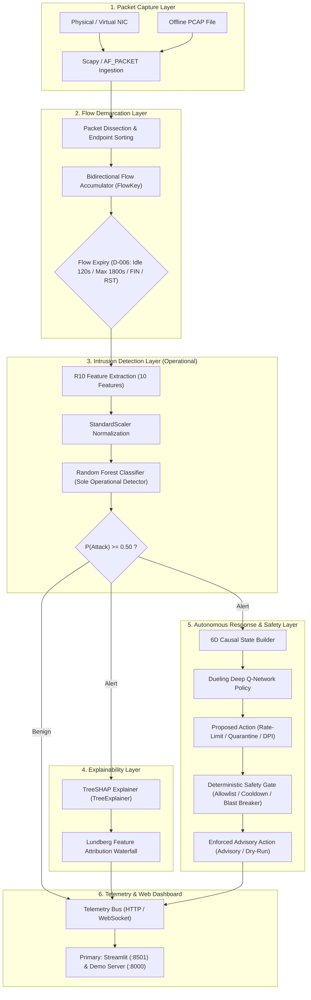

# XRL-IDARS

**Explainable Reinforcement Learning-Based Intrusion Detection and Autonomous Response System**

[](tests/)
[](https://www.python.org/)
[](LICENSE)
[](docs/architecture/SYSTEM_ARCHITECTURE.md)

---

## 1. Project Overview

**XRL-IDARS** is a comprehensive, reproducible, and explainable network security research platform designed for high-accuracy intrusion detection and safe autonomous response recommendation. 

The system ingests raw network packets via Scapy or Linux `AF_PACKET` sockets, reconstructs bidirectional transport-layer flows, extracts deterministic statistical flow features (the canonical **R10 Contract**), detects malicious traffic using a tabular **Random Forest** classifier ($< 1.0\,\text{ms}$ latency), explains threat scores via exact **TreeSHAP** game-theoretic feature attributions, recommends proactive mitigation policies via a **Dueling Deep Q-Network (DQN)**, and validates all actions against a **Deterministic Safety Gate** operating in advisory dry-run mode.

---

## 2. Problem Statement & Motivation

Traditional Network Intrusion Detection Systems (NIDS) suffer from three critical bottlenecks:
1. **Opaque "Black-Box" Decisions**: Deep neural network detectors provide high detection rates but fail to explain why a packet flow was flagged, forcing human analysts to sift through thousands of uncontextualized alerts.
2. **The Temporal Sequence Dilemma**: Many recent academic proposals apply complex recurrent neural networks (LSTMs, GRUs) to network intrusion detection. However, our empirical research reveals that maintaining stateful per-host sequence buffers introduces severe **cold-start blindness** (flows 1 to 4 remain undetected) and exposes the NIDS to **state-exhaustion denial of service**, with negligible accuracy gains over tabular tree ensembles ($+0.19\%$ F1).
3. **Risks of Autonomous Mitigation**: Unconstrained reinforcement learning agents can isolate critical network infrastructure (gateways, DNS) or induce mass network blackouts during spoofed flood attacks.

**XRL-IDARS resolves these bottlenecks** by employing Random Forest as an independent operational detector, providing real-time TreeSHAP local explanations, and restricting autonomous reinforcement learning recommendations to an advisory mode governed by deterministic safety shielding.

> [!IMPORTANT]
> **Preservation of Offline Research Benchmarks:**
> Preserve the existing pretrained LSTM model, RF–LSTM fusion implementation, checkpoints, experiment results and evaluation scripts. Use them exclusively for offline research benchmarking and comparison. The research dashboard may display RF, LSTM and fusion metrics, including latency comparisons. They must never be invoked by the operational live detection pipeline. Do not retrain or replace these models unless a specific reproducibility issue requires it and approval is obtained.
>
> **Explicit Operational vs. Research Mode Distinction:**
> Clearly distinguish LIVE, PCAP, SAMPLE and RESEARCH modes. Research benchmark results must never be presented as live detection results. Sample data must never be represented as actual network traffic.

---

## 3. Key Capabilities

- **Real-Time Packet Ingestion & Demuxing**: High-speed packet capture via Scapy or raw Linux sockets with non-blocking queue decoupling.
- **Canonical Bidirectional Flow Assembly**: Canonical endpoint sorting ($A < B$) ensuring symmetric bidirectional packet and byte tracking.
- **Sub-Millisecond Operational Detection**: 100-tree Random Forest classifier achieving **$F1 = 0.9512$** (CIC-IDS2017 full test, $N=355\text{k}$), **$F1 = 0.8861$** (CSE-CIC-IDS2018 multi-class, $N=1.66\text{M}$), and **$F1 = 0.9977$** on the targeted Tuesday flood window ($N=8,726$) at **$< 0.80\,\text{ms}$** algorithmic latency.
- **Exact Polynomial Explainability**: Real-time TreeSHAP attribution generating Lundberg waterfall charts showing the top positive and negative feature drivers.
- **Safe Autonomous Response Advisory**: Dueling Deep Q-Network evaluating 6D system state to recommend rate-limiting, IP quarantine, or deep inspection.
- **Deterministic Safety Shielding**: Hard constraints enforcing critical host allowlists, cooldown timers, and blast-radius circuit breakers.
- **Zero Host Mutation Guarantee**: Advisory dry-run execution by default—modifies zero `iptables` rules and drops zero network sockets.
- **Interactive Monitoring Dashboards**: Primary enterprise Streamlit operational command center across 8 dedicated modules (`dashboard/streamlit_app.py:8501`) and supplementary pure-Python web console (`dashboard/server.py:8000`).

---

## 4. High-Level System Architecture

The approved operational architecture is:

**Scapy → Canonical FlowEngine → R10 Feature Extraction → StandardScaler → Random Forest → Security Event → TreeSHAP Explanation → Dueling DQN → Deterministic Safety Gate → Advisory/Dry-run Response Actuator → Streamlit Dashboard.**

RF performs intrusion classification. DQN performs response recommendation. These are separate responsibilities. Do not combine their outputs into a new intrusion classifier.



---

## 5. Technology Stack

- **Core Runtime**: Python `3.14.4` (Compatible with Python `3.10`–`3.14`)
- **Machine Learning**: `scikit-learn>=1.6.0`, `torch>=2.6.0`, `shap>=0.46.0`
- **Networking & Dissection**: `scapy>=2.6.0`, Linux `AF_PACKET`
- **Data Engineering**: `pandas>=2.2.0`, `pyarrow>=18.0.0`, `joblib>=1.4.0`
- **Automated Testing**: `pytest>=9.0.0`, `pytest-cov`
- **Web Console**: Vanilla ES6 JavaScript (Zero Node.js dependency), pure-Python HTTP/WebSocket server (`dashboard/server.py`)

---

## 6. Repository Structure

```
fyp-xrlids/
├── configs/                     # System and feature configurations
├── dashboard/                   # Web console server and frontend assets
│   ├── index.html               # Main dashboard UI
│   ├── app.js                   # Telemetry, charts, and TreeSHAP waterfall renderer
│   └── server.py                # Pure-Python HTTP/WebSocket server
├── data/                        # Benchmark datasets and processed flow caches
│   ├── raw/                     # CIC-IDS2017, CSE-CIC-IDS2018, UNSW-NB15
│   └── processed/               # Parquet sequence caches and DQN policy caches
├── docs/                        # Complete technical and academic documentation
│   ├── academic/                # Viva preparation, report guide, demo script
│   ├── architecture/            # Architecture specifications and diagrams
│   ├── evaluation/              # Model evaluations, RF vs LSTM, latency benchmarks
│   ├── finalisation/            # Change control, baseline, and release checklists
│   ├── ml/                      # Machine learning models, features, preprocessing
│   ├── response/                # DQN agent, policy rules, and safety gate
│   ├── research/                # Scientific papers, methodology, reproducibility
│   └── testing/                 # Test strategy, results, and end-to-end evidence
├── models/                      # Verified model checkpoints and registries
│   ├── dqn/                     # Dueling DQN checkpoints (.pt)
│   ├── lstm/                    # Historical and experimental LSTM models (.pt)
│   └── rf/                      # Scikit-Learn Random Forest models (.joblib)
├── results/experiments/         # Verified experiment logs and metrics
│   └── EXP-P2-LSTM-VALID-001/   # Scientifically verified LSTM vs RF experiment
├── scripts/                     # Operational, demo, training, and benchmarking scripts
│   ├── benchmark_latency.py     # Microsecond latency benchmarks
│   └── demo/                    # Live dashboard, replay, and Scapy packet runners
├── src/xrlids/                  # Production Python source package
└── tests/                       # Pytest automated test suite (605 tests, 100% pass)
```

---

## 7. Installation & Quick Start

### 1. Clone & Set Up Environment
```bash
git clone https://github.com/rishikeshgowdakk/fyp-xrlids.git
cd fyp-xrlids

python3 -m venv .venv
source .venv/bin/activate
pip install --upgrade pip
pip install -r requirements.txt
pip install -e .
```

### 2. Run Automated Verification Tests
```bash
.venv/bin/pytest tests/
```
*Expected Result*: **605 passed in ~48s (100% pass rate)**.

### 3. Start the Interactive Operational Dashboards
```bash
# Primary Operational Command Center (Streamlit across 8 dedicated modules):
.venv/bin/streamlit run dashboard/streamlit_app.py --server.port 8501

# Supplementary Demo Server:
.venv/bin/python scripts/demo/run_dashboard.py 8000
```
Open your browser at: **`http://localhost:8501`** (Streamlit Primary) or **`http://localhost:8000`** (Demo)

### 4. Run Controlled Scapy Attack Demonstrations
In a second terminal window:
```bash
# Benign Traffic Demonstration:
.venv/bin/python scripts/demo/run_scapy_simulation.py --scenario scenario_a_benign --explain

# Volumetric TCP SYN Burst Attack Demonstration:
.venv/bin/python scripts/demo/run_scapy_simulation.py --scenario scenario_c_syn_burst --explain

# Anti-Mock Model Verification:
.venv/bin/python scripts/demo/explain_score.py --scenario slow_http_dos

# Complete Real End-to-End Operational Pipeline Demonstration:
.venv/bin/python scripts/demo/run_integrated_pipeline_demo.py
```

> [!IMPORTANT]
> **Real End-to-End Integration Requirement:**
> Run at least one complete integrated demonstration where captured or replayed traffic travels through the actual operational pipeline. Verify that the resulting RF prediction, TreeSHAP explanation, DQN recommendation, safety decision and response record are associated with the same security event and visible in Streamlit. Unit tests alone do not satisfy this criterion.

---

## 8. Verified Model Performance Summary

Every metric reported below is derived from direct test execution on held-out test sets:

| Model | Evaluation Dataset | Input Contract | Accuracy | Precision | Recall | F1-Score | PR-AUC | Algorithmic Latency |
| :--- | :--- | :--- | :---: | :---: | :---: | :---: | :---: | :---: |
| **Random Forest (Operational)** | CIC-IDS2017 Held-Out ($N=355,865$) | R10 (10 features) | $98.15\%$ | $91.51\%$ | $99.01\%$ | **$0.9512$** | $0.9824$ | **$< 0.80\,\text{ms}$** |
| **Random Forest (Operational)** | CSE-CIC-IDS2018 Multi-Class ($N=1,662,459$) | R10 (10 features) | $97.23\%$ | $82.42\%$ | $95.80\%$ | **$0.8861$** | $0.9676$ | **$< 0.80\,\text{ms}$** |
| **Random Forest (Operational)** | UNSW-NB15 Degraded ($N=24,504$) | R4 (4 features) | $85.88\%$ | $79.62\%$ | $92.23\%$ | **$0.8546$** | $0.9321$ | **$< 0.75\,\text{ms}$** |
| **Random Forest (Operational)** | Tuesday Flood Window ($N=8,726$) | R10 (10 features) | $99.78\%$ | $99.84\%$ | $99.72\%$ | **$0.9977$** | $0.9998$ | **$< 0.80\,\text{ms}$** |
| **PyTorch LSTM (Experimental)** | Tuesday Flood Window ($N=8,726$) | Sequence ($5 \times 11$) | $99.95\%$ | $100.0\%$ | $99.92\%$ | **$0.9996$** | $1.0000$ | $0.38\,\text{ms} + \text{Buffering}$ |

### Why Random Forest is the Sole Operational Detector:
- **Incremental LSTM Gain is Marginal**: The $+0.19\%$ F1 gain of the LSTM represents only **16 additional flows** correctly classified out of 8,726.
- **Cold-Start Blindness**: The LSTM is blind to initial probe and single-flow attacks ($K < 5$).
- **State-Exhaustion Protection**: Random Forest classifies statelessly, protecting the IDS from memory exhaustion during IP-spoofed flood attacks.
- **Cross-Benchmark Viability**: Random Forest supports all 17 attack families across all three datasets; sequence modeling is physically impossible on CIC-IDS2017 and UNSW-NB15 due to missing network identifiers.

---

## 9. Dashboard Visualizations & Screenshots

### Full Interactive Dashboard Live View


### Real-Time TreeSHAP Feature Attributions & Attack Evidence


### Multi-Model Score Provenance Modal


---

## 10. Research & Viva Documentation Hub

Comprehensive academic runbooks for final-year thesis evaluation and project defense:

- [🎓 **Viva Defense & Interview Preparation (15 Q&As)**](docs/academic/VIVA_PREPARATION.md)
- [📋 **Final-Year Project Report Guide**](docs/academic/PROJECT_REPORT_GUIDE.md)
- [⏱️ **5–10 Minute Live Demonstration Script**](docs/academic/DEMO_SCRIPT.md)
- [🏆 **Formal Project Contributions & Novelty**](docs/academic/PROJECT_CONTRIBUTIONS.md)
- [🔬 **Dataset Feasibility & Eligibility Audit**](docs/evaluation/DATASET_ELIGIBILITY.md)
- [⚖️ **Random Forest vs. LSTM Reconciliation**](docs/evaluation/RF_VS_LSTM.md)
- [⚡ **Empirical Latency Benchmark Report**](docs/evaluation/LATENCY_BENCHMARK.md)
- [🧪 **End-to-End System Validation Evidence**](docs/testing/END_TO_END_VALIDATION.md)

---

## 11. Security, Ethics & Limitations

- **Advisory by Default**: All automated mitigations operate in dry-run mode to ensure zero uncommanded host network disruption.
- **Throughput Boundary**: Scapy Python-space packet capture is bounded at $\approx 2,000 \to 5,000\,\text{pps}$ on commodity CPUs. It is an algorithmic research platform, not a 10 Gbps hardware ASIC appliance.
- **Payload Privacy**: The system inspects only packet headers and statistical flow intervals, preserving user data privacy without decrypting application payloads.

---

## 12. References

1. **Lundberg, S. M., & Lee, S.-I.** (2017). *A Unified Approach to Interpreting Model Predictions*. Advances in Neural Information Processing Systems (NeurIPS 2017).
2. **Grinsztajn, L., Oyallon, E., & Varoquaux, G.** (2022). *Why tree-based models still outperform deep learning on tabular data*. Advances in Neural Information Processing Systems (NeurIPS 2022).
3. **Alshiekh, M., et al.** (2018). *Safe Reinforcement Learning via Shielding*. AAAI Conference on Artificial Intelligence (AAAI 2018).
4. **Sharafaldin, I., Lashkari, A. H., & Ghorbani, A. A.** (2018). *Toward Generating a New Intrusion Detection Dataset and Intrusion Traffic Characterization*. ICISSP.
