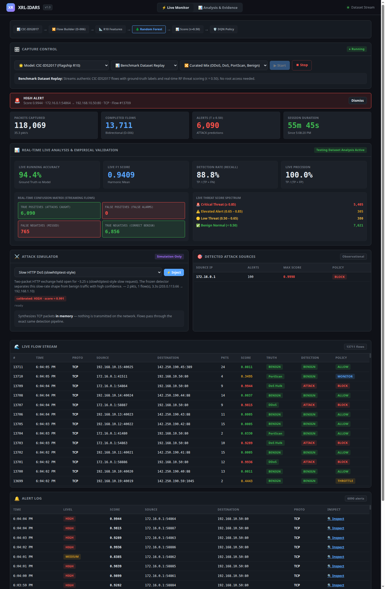
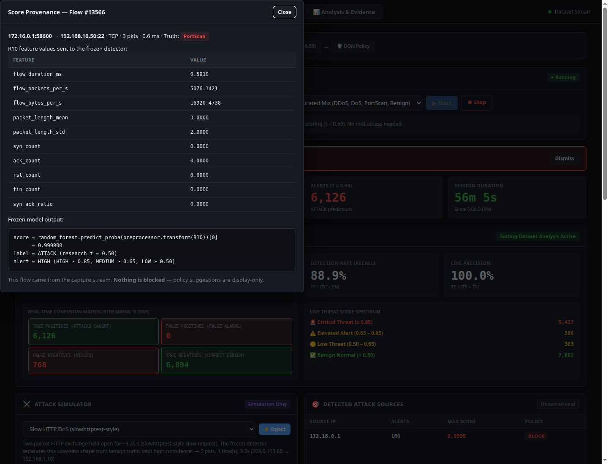
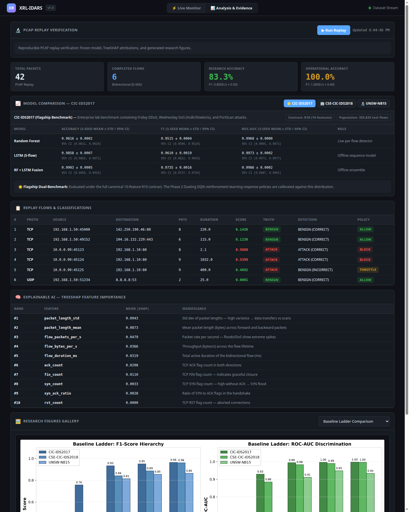
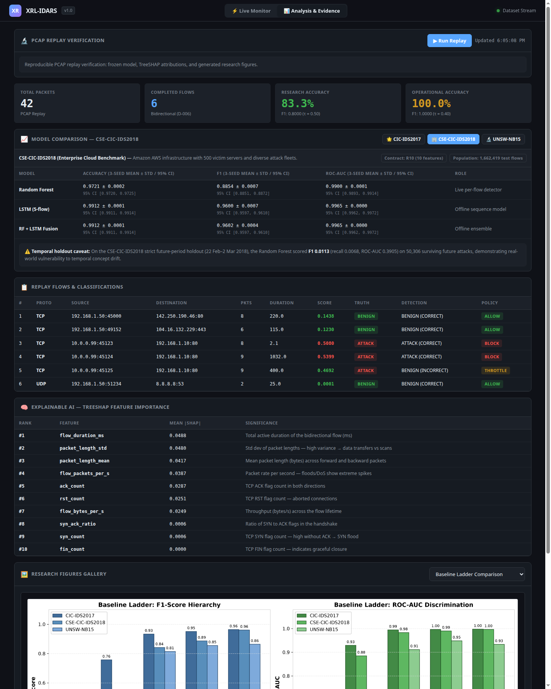

# XRL-IDARS

**Explainable Reinforcement Learning Based Intrusion Detection and Autonomous Response System**

XRL-IDARS is a research framework for network-flow intrusion detection and controlled autonomous response. It couples tabular and temporal machine learning detection (Random Forest + LSTM score fusion) with TreeSHAP feature attributions, context-aware reinforcement learning response policies (Dueling DQN), and deterministic safety constraints with atomic transaction rollback to prevent self-inflicted denial-of-service and unauthorized network mutations.

---

## 🎯 Viva & Presentation Hub (Quick Links)

Essential documentation, presentation scripts, and defense runbooks for final year project evaluations:

| Document | Purpose & Key Contents |
|----------|------------------------|
| [📖 **Frontend Presentation & Viva Script**](docs/FRONTEND_AND_DEMO_GUIDE.md) | **Word-for-word viva presentation script**, UI layout breakdown, step-by-step click guide, and defense answers |
| [🎓 **Final Viva Defense Guide**](docs/viva/FINAL_VIVA_GUIDE.md) | Comprehensive examiner Q&A, theoretical defense, metric rationale, and DQN safety principles |
| [🎬 **Demo Runbook & Video Guide**](docs/viva/DEMO_AND_VIDEO_SCRIPT.md) | Step-by-step practical demo walkthrough, pre-demo checks, and contingency plans |
| [⚙️ **System Architecture & Mechanics**](docs/HOW_IT_WORKS.md) | Full end-to-end explanation: D-006 flow policy, R10 feature contracts, and frozen model pipeline |
| [🔄 **Reproducibility Map**](docs/final/REPRODUCIBILITY_MAP.md) | Exact commands and scripts to reproduce all experiments, models, and metric artifacts from scratch |
| [📊 **Benchmark Datasets Guide**](docs/DATASETS.md) | Ingestion protocols, schema mapping, and preprocessing audits for CIC-IDS2017, CSE-CIC-IDS2018, UNSW-NB15 |
| [⚠️ **Temporal Generalization Report**](reports/generated/temporal_split_report.md) | Empirical analysis of concept drift across temporal vs. random splits on CSE-CIC-IDS2018 |

---

## Architecture

```text
Network / PCAP
      ↓
Packet Capture
      ↓
Flow Construction
      ↓
Feature Extraction
      ↓
   RF + LSTM
      ↓
    Fusion
      ↓
SHAP + Threat Score
      ↓
  DQN Response
      ↓
  Safety Gate
      ↓
Controlled Response / Rollback
```

---

## Key Components

| Component | Description |
|---|---|
| **Dataset & Preprocessing** | Leakage-safe split pipeline, chunked streaming audits, and canonical feature contracts (R10 / R4). |
| **Random Forest** | Low-latency tabular flow classifier for statistical traffic patterns. |
| **Supervised LSTM** | Sequence model ($T=5$) capturing multi-flow temporal dependencies. |
| **RF + LSTM Fusion** | Linear score blend balancing spatial and temporal signals (not probability calibration). |
| **SHAP Explainability** | TreeSHAP feature attributions explaining classification drivers. |
| **DQN Response Policy** | Context-aware Dueling DQN policy with Prioritized Experience Replay. |
| **Live Packet/Flow Processing** | Pure-Python PCAP replay and streaming bidirectional flow construction. |
| **Safety Gate** | Deterministic non-bypassable constraints (cooldowns, blast-radius limits, critical host exemptions). |
| **Transaction & Rollback** | Pre-action state snapshots, watchdog TTL monitoring, and automated compensation rollback. |
| **Isolated Laboratory Validation** | Controlled evaluation in virtualized Linux network namespaces (`10.200.1.0/24`) with zero host network mutations. |

---

## Research Results

### How to read these numbers

All figures below are **in-domain, random-split, seed-42** results on the frozen held-out
test populations. They are **upper bounds**, not future-day or production performance.
Read them as three separate per-dataset results, never as a pooled average: the datasets
use different feature contracts and have different attack prevalence.

| Dataset | Attack prevalence in test | Majority-class accuracy |
|---|---:|---:|
| CIC-IDS2017 | 18.2% (64,820 / 355,833) | 81.78% |
| CSE-CIC-IDS2018 | 11.3% (187,161 / 1,662,419) | 88.74% |
| UNSW-NB15 | 45.0% | 54.98% |

Accuracy is therefore dominated by the benign majority. **F1 and PR-AUC are the primary
metrics** here; PR-AUC is the honest summary under class imbalance.

### Primary benchmarks (10-feature R10 contract, seed 42, aligned test population)

| Dataset | Model | Accuracy | **F1** | **PR-AUC** | ROC-AUC | N |
|:---|:---|:---:|:---:|:---:|:---:|---:|
| CIC-IDS2017 | Random Forest | 0.9815 | 0.9512 | 0.9824 | 0.9968 | 355,833 |
| CIC-IDS2017 | Supervised LSTM | 0.9867 | 0.9633 | 0.9904 | 0.9974 | 355,833 |
| CIC-IDS2017 | **Fusion ($\alpha$=0.50)** | 0.9906 | **0.9745** | **0.9947** | 0.9989 | 355,833 |
| CSE-CIC-IDS2018 | Random Forest | 0.9723 | 0.8861 | 0.9676 | 0.9902 | 1,662,419 |
| CSE-CIC-IDS2018 | **LSTM (fusion $\alpha$=0.00)** | 0.9912 | **0.9603** | **0.9865** | 0.9966 | 1,662,419 |

> **On CSE-CIC-IDS2018 the validation-tuned fusion weight collapses to $\alpha = 0.00$.**
> The "fusion" is the LSTM alone and the RF contributes nothing, so this is reported as an
> **LSTM** result, not an RF+LSTM result. On the largest benchmark the two components are
> not complementary.

### Auxiliary benchmark (degraded 4-feature R4 contract)

| Dataset | Model | Accuracy | F1 | PR-AUC | ROC-AUC | N |
|:---|:---|:---:|:---:|:---:|:---:|---:|
| UNSW-NB15 | Random Forest | 0.8590 | 0.8548 | 0.9323 | 0.9487 | 24,496 |
| UNSW-NB15 | **Fusion ($\alpha$=0.60)** | 0.8996 | 0.8970 | 0.9538 | 0.9674 | 24,496 |

UNSW-NB15 cannot supply 6 of the 10 R10 features (no TCP flags and no packet-length std in
the Argus exporter) and shows ~19% false alarms on benign traffic. It is reported separately
and **never averaged** with the R10 benchmarks. Cross-dataset transfer collapses by 0.52–0.95
F1 in every direction.

### The result that matters most: future-day holdout

A strict temporal holdout on CSE-CIC-IDS2018 leaves the detector with **F1 0.0113** on
future traffic, versus 0.8861 on the random split. **Treat the random-split numbers as an
in-domain ceiling, not as deployment evidence.** Full detail in
[Temporal Holdout](#temporal-holdout-cse-cic-ids2018-gap-p06) below.

### Multi-Seed Robustness (Seeds 42 / 123 / 456)

Each benchmark was re-run end-to-end with three seeds (population std); seed 42 reproduces the frozen artifacts exactly. Fusion detector, mean ± std:

| Dataset | Accuracy | F1 | ROC-AUC |
|:---|:---:|:---:|:---:|
| CIC-IDS2017 | 0.9903 ± 0.0005 | 0.9735 ± 0.0016 | 0.9986 ± 0.0002 |
| CSE-CIC-IDS2018 | 0.9912 ± 0.0001 | 0.9602 ± 0.0004 | 0.9965 ± 0.0000 |
| UNSW-NB15 | 0.8988 ± 0.0008 | 0.8963 ± 0.0006 | 0.9674 ± 0.0004 |

Full RF / LSTM / Fusion table: [`reports/generated/multi_seed_report.md`](reports/generated/multi_seed_report.md). Per-seed records: `results/experiments/<EXP>/seed_<n>/`.

### Bootstrap Uncertainty (Seed 42)

Per-seed 95% bootstrap intervals from the frozen held-out predictions (B=1000; threshold metrics on the full test population, ROC-AUC on a fixed 100k stratified sample). These quantify **test-set sampling uncertainty**, not training-seed variance:

| Dataset | Model | F1 [95% CI] | ROC-AUC [95% CI] |
|:---|:---|:---:|:---:|
| CIC-IDS2017 | Random Forest | 0.9512 [0.9500, 0.9524] | 0.9968 [0.9965, 0.9971] |
| CIC-IDS2017 | Fusion ($\alpha=0.50$) | 0.9745 [0.9737, 0.9754] | 0.9989 [0.9987, 0.9991] |
| CSE-CIC-IDS2018 | Random Forest | 0.8861 [0.8851, 0.8872] | 0.9902 [0.9893, 0.9914] |
| CSE-CIC-IDS2018 | Fusion ($\alpha=0.00$) | 0.9603 [0.9597, 0.9610] | 0.9966 [0.9962, 0.9972] |
| UNSW-NB15 | Random Forest | 0.8548 [0.8502, 0.8599] | 0.9487 [0.9462, 0.9511] |
| UNSW-NB15 | Fusion ($\alpha=0.60$) | 0.8970 [0.8930, 0.9009] | 0.9674 [0.9654, 0.9693] |

Full table: [`reports/generated/bootstrap_ci_report.md`](reports/generated/bootstrap_ci_report.md).

### Temporal Holdout (CSE-CIC-IDS2018, GAP-P06)

`EXP-P1-CSE2018-TEMPORAL-R10-001` sorts the 8,312,295 modelling rows by the real CSE `Timestamp`, trains on 14–20 Feb 2018, validates on 20–22 Feb, and tests on 22 Feb–2 Mar. L-01/L-02/L-05 pass. The frozen RF result is a **negative generalization finding**:

| Metric | Random split | Temporal holdout |
|:---|:---:|:---:|
| Accuracy | 0.9723 | 0.9633 |
| Precision | 0.8242 | 0.0332 |
| Recall | 0.9580 | 0.0068 |
| F1 | 0.8861 | **0.0113** [0.0101, 0.0124] |
| ROC-AUC | 0.9902 | 0.3905 |

The future test contains 50,306 attacks (3.08%) after Policy A removed conflicting/duplicate rows; these are the surviving unique future flows. Bot recall falls from 99.17% to 0.09%, infiltration from 10.70% to 0.94%, and web/XSS/SQL to 0%. The random-split 99% numbers are in-domain upper bounds, not future-day readiness claims. Full comparison: [`reports/generated/temporal_split_report.md`](reports/generated/temporal_split_report.md).

---

## How to Run

### Prerequisites

- **OS:** Linux (tested on Ubuntu; any distro with Python 3.10+ should work)
- **Python:** 3.10 or later (developed and tested on 3.14.4)
- **Hardware:** CPU-only; no GPU required
- **Disk:** ~1 GB for the repository, models, and virtual environment
- **Root / sudo:** Only needed for live WiFi capture (`CAP_NET_RAW`); all other modes run as a normal user

### 1. Clone & Setup

```bash
git clone https://github.com/<your-username>/fyp-xrlids.git
cd fyp-xrlids

# Create and activate the virtual environment
python3 -m venv .venv
source .venv/bin/activate

# Install all dependencies
pip install -r requirements.txt
```

> **Artifacts and raw data are not committed.** `data/raw/**`, `*.joblib` and `*.pt` are
> gitignored (large files and licensed datasets). A fresh clone therefore contains **no
> trained detector**. The demo and dashboard now **refuse to score** in that state instead
> of substituting a heuristic, so check first:
>
> ```bash
> ls results/experiments/EXP-P1-CIC2017-R10-001/random_forest.joblib
> ls data/raw/cicids2017
> ```
>
> If either is missing, restore the frozen artifacts and datasets with
> [`docs/final/REPRODUCIBILITY_MAP.md`](docs/final/REPRODUCIBILITY_MAP.md), or retrain
> (step 5).

### 2. Verify Installation (Test Suite)

Run the full 409-test verification suite to confirm everything is working:

```bash
.venv/bin/pytest -q
```

All 417 tests should pass with 0 failures.

### 3. Quick Demo — PCAP Replay

The fastest way to see the system in action. Replays captured network packets through the full detection pipeline (packet → flows → RF/LSTM features → frozen model → predictions):

```bash
python scripts/demo/run_replay_demo.py
```

This runs entirely offline using the bundled sample PCAP and trained model — no network access or root needed.

### 4. Dashboard — Full Web Interface

> 📖 **Comprehensive Walkthrough & Viva Script:** See [`docs/FRONTEND_AND_DEMO_GUIDE.md`](docs/FRONTEND_AND_DEMO_GUIDE.md) for the complete presentation script (word-for-word guide for professors), component architecture, and FAQ defenses.

The dashboard is a zero-dependency web UI with two tabs:

| Tab | What it does |
|-----|--------------|
| **Live Monitor** | Real-time packet capture → flow construction → frozen detector scoring, with IP endpoints, attack source summary, threat scores, per-alert feature/score provenance, real-time confusion matrix, and an attack simulator |
| **Replay & Evidence** | Replay verification stats, offline RF/LSTM/fusion comparison, TreeSHAP attributions, research figures |

#### Visual Dashboard Tour & Live Console Gallery

##### 1. Live Monitor — Real-Time Detection & Empirical Validation
Streams authentic benchmark or live network flows with a real-time confusion matrix (True Positives, False Positives, False Negatives, True Negatives), threat score spectrum, in-memory attack simulator, detected attacker IP summary, and autonomous Dueling DQN mitigation policies (`BLOCK`, `THROTTLE`, `MONITOR`, `ALLOW`):



##### 2. Explainable AI — TreeSHAP Feature Provenance Modal
Clicking **`🔍 Inspect`** on any alert row displays the exact 10 R10 features sent to the frozen detector, the underlying prediction math, and TreeSHAP feature attributions:



##### 3. Analysis & Evidence — Multi-Benchmark Comparison & Research Figures
Static reproducible evidence view displaying 3-seed benchmark metrics across CIC-IDS2017, CSE-CIC-IDS2018, and UNSW-NB15 with 95% bootstrap confidence intervals, TreeSHAP feature importances, and publication-ready research figures:



##### 4. Cross-Benchmark & Temporal Concept Drift Analysis
Enterprise cloud benchmark evaluation on 1.66M flows with documented temporal concept drift caveat:



#### Option A: Benchmark Dataset Replay (CIC-IDS2017) (Recommended for Demos & Professors — No Root)

The best and most reliable way to demonstrate intrusion detection to professors and exhibition attendees without needing root permissions or live network attack risk:

```bash
python dashboard/server.py
# Or: .venv/bin/python dashboard/server.py
```

1. Open **http://localhost:8000** in your browser.
2. Under **Live Capture Control**, ensure **Benchmark Dataset Replay (CIC-IDS2017)** is selected.
3. Choose an evaluation category:
   - `Curated Benchmark Mix (DDoS, DoS Hulk, PortScan, Benign)` *(recommended for showing attacks vs. normal traffic)*
   - `Friday Afternoon — DDoS Attacks + Benign`
   - `Wednesday — DoS Hulk / Slowloris + Benign`
   - `Friday Afternoon — PortScan Recon + Benign`
   - `Monday — Normal Enterprise Benign Only`
4. Click **Start Capture**:
   - Streams authentic benchmark flows in real time with ground-truth labels displayed in the **Truth** column.
   - Attack bursts automatically trigger the red **ATTACK DETECTED** banner, populate the **Detected Attack Sources** table, and recommend Dueling DQN mitigation policies (e.g. `BLOCK`).
   - Click **features** on any alert to view the exact 10 R10 features and TreeSHAP explainability modal.

#### Option B: Sample PCAP Stream (no root needed)

```bash
python dashboard/server.py
```

Select **Sample PCAP stream (no root)** and click **Start Capture** — replays `data/demo/sample_traffic.pcap` at original pacing through the complete live packet pipeline.

#### Option C: Live WiFi Capture (requires sudo)

Captures real packets from your physical WiFi interface:

```bash
sudo .venv/bin/python dashboard/server.py 8000 --live --iface wlo1
```

Replace `wlo1` with your wireless interface name (find it with `ip link show`).

Open **http://localhost:8000** — the Live Monitor will show:
- Real flows and alerts from your network traffic
- The **Devices Observed on WiFi** panel listing devices seen via passive ARP/DHCP/mDNS/SSDP
- Network info (SSID, signal strength, gateway)

> **Note:** Live monitoring is **strictly observational** — zero firewall/routing mutations. It shows flows, alerts, and model scores only (no accuracy numbers, since live traffic has no ground truth). The device panel is passive: it shows devices this laptop has actually observed on the network, **not** the router's full client table. No probes or scans are sent.

#### Option D: Attack Simulator (in-memory, nothing transmitted)

Available in the Live Monitor tab during any capture mode. Injects synthetic attack-scenario packets **in memory** through the exact same pipeline — nothing is transmitted on the network.

- Scenario scores are pre-verified against the frozen detector by [`scripts/demo/verify_attack_scenarios.py`](scripts/demo/verify_attack_scenarios.py)
- [`scripts/demo/explain_score.py`](scripts/demo/explain_score.py) prints a scenario's exact R10 features and the frozen model's `predict_proba` output
- "Evasion demo" scenarios are documented non-detections, shown deliberately
- See [`dashboard/README.md`](dashboard/README.md#attack-simulator-simulation-only) for full details

### 5. Retraining (Optional — Large Data Required)

The demo and dashboard work out of the box **when the frozen artifacts are present** at `results/experiments/EXP-P1-CIC2017-R10-001/random_forest.joblib` (+ the matching `preprocessor.joblib`). They are gitignored, so a fresh clone must restore or regenerate them first; without them the demo exits non-zero and writes no artifacts.

To retrain on the full raw benchmark datasets (~8.7 GB across 20 CSV files):

1. Download raw data into `data/raw/` as detailed in [`docs/DATASETS.md`](docs/DATASETS.md)
2. Run the Phase 1 training scripts in `scripts/phase1/`
3. See [`docs/final/REPRODUCIBILITY_MAP.md`](docs/final/REPRODUCIBILITY_MAP.md) for exact reproduction commands

### Quick Reference — How to Run

| What you want to do | Command | Root needed? |
|---------------------|---------|:---:|
| Run full test suite (417 tests) | `.venv/bin/pytest` | No |
| **Launch Dashboard (Dataset & Sample Demo)** | `python dashboard/server.py` | **No** |
| Run quick offline PCAP replay demo | `python scripts/demo/run_replay_demo.py` | No |
| Dashboard with real live WiFi capture | `sudo .venv/bin/python dashboard/server.py 8000 --live --iface wlo1` | Yes |
| Verify all calibrated attack scenarios | `python scripts/demo/verify_attack_scenarios.py` | No |
| Explain a score with TreeSHAP features | `python scripts/demo/explain_score.py` | No |

---

## Project Status

| Component | Status |
|---|---|
| Detection pipeline | Complete |
| RF/LSTM/Fusion | Complete |
| SHAP | Complete |
| DQN response | Complete |
| Safety/Rollback | Complete |
| Live/lab pipeline | Complete within lab scope |
| Web dashboard | Complete (live monitor + replay evidence; zero-dependency) |
| Production deployment | Not validated |

---

## Documentation

- [`PROJECT_STATUS.md`](PROJECT_STATUS.md) — Comprehensive implementation and empirical status registry
- [`docs/final/FINAL_RESEARCH_REPORT.md`](docs/final/FINAL_RESEARCH_REPORT.md) — Comprehensive research report covering methodology, findings, and limitations
- [`docs/final/RELEASE_AUDIT.md`](docs/final/RELEASE_AUDIT.md) — Final release audit, governance verification, and checklist
- [`docs/final/REPRODUCIBILITY_MAP.md`](docs/final/REPRODUCIBILITY_MAP.md) — Detailed environment configuration and reproduction commands
- [`docs/viva/FINAL_VIVA_GUIDE.md`](docs/viva/FINAL_VIVA_GUIDE.md) — Technical defense questions, rationale, and empirical answers
- [`docs/viva/DEMO_AND_VIDEO_SCRIPT.md`](docs/viva/DEMO_AND_VIDEO_SCRIPT.md) — Demo runbook, viva script, video recording shot list, readiness verdict, and recovery playbook
- [`docs/HOW_IT_WORKS.md`](docs/HOW_IT_WORKS.md) — End-to-end system explanation (real vs. simulated traffic, pipeline, score calculation, thresholds, live capture, DL-model placement, anti-bluffing proof)

Detailed methodology, experiments, limitations, reproducibility information, and viva material are documented separately.

---

## Scope & Safety

Autonomous response enforcement is validated strictly within a controlled, isolated laboratory environment (Linux network namespaces on `10.200.1.0/24`) with verified zero mutations to the host networking stack. The project does not claim or support production deployment on uncontrolled operational networks such as campus or enterprise Wi-Fi.

---

## License

This project is licensed under the [MIT License](LICENSE). Raw benchmark datasets (CIC-IDS2017, CSE-CIC-IDS2018, UNSW-NB15) carry their own respective terms of use recorded in `data/manifests/dataset_registry.yaml`.
