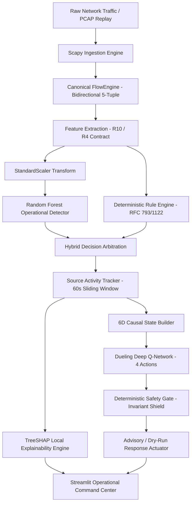

# XRL-IDARS

**Explainable Reinforcement Learning-Based Intrusion Detection and Autonomous Response System**

[](tests/)
[](https://www.python.org/)
[](LICENSE)
[](docs/architecture/SYSTEM_ARCHITECTURE.md)

> **Operational Truth & Architecture Baseline:**
> - **Operational Detector:** The documented real-time Scapy packet capture and PCAP streaming pipeline strictly uses the registered **Random Forest** model (`models/rf/`) as the sole operational ML detector.
> - **Offline Research Baselines:** Pretrained PyTorch LSTM sequence models (`models/lstm/`, `EXP-P2-LSTM-VALID-001`), convex score fusion weights (`models/fusion/`), and XGBoost candidate models (`models/xgboost/`) are preserved strictly for offline comparative research and benchmarking. They are never invoked in the live packet path.
> - **Mode Distinction:** LIVE, PCAP, SAMPLE, and RESEARCH modes are explicitly separated across the backend and dashboards. Research benchmark results are never presented as live detection results.

---

## Start Here

| Document | What it covers |
|---|---|
| [System Architecture](docs/architecture/SYSTEM_ARCHITECTURE.md) | Authoritative operational pipeline, data flows, and safety boundaries |
| [Implementation Status](docs/IMPLEMENTATION_STATUS.md) | 21-component master status scorecard and verification evidence |
| [Comprehensive Test Report](docs/TEST_REPORT.md) | Authoritative test suite progression (493 to 658 tests) and coverage |
| [Model Selection](docs/MODEL_SELECTION.md) | Formal champion selections across all 8 ML and RL categories |
| [Feature Engineering Study](docs/FEATURE_ENGINEERING_STUDY.md) | Empirical evaluation across five feature rungs ($R_4 \to R_{30}$) and 3 datasets |
| [XGBoost vs Random Forest](docs/RF_VS_XGBOOST.md) | Reconciled empirical cross-dataset comparison and latency analysis |
| [Autonomous Response Validation](docs/AUTONOMOUS_RESPONSE_VALIDATION.md) | DQN audit, 6D causal state vector, and closed-loop transition verification |
| [Final Engineering Acceptance](docs/FINAL_ENGINEERING_ACCEPTANCE.md) | Definitive technical acceptance audit, safety rules, and execution evidence |
| [Exhibition & Viva Guide](docs/academic/VIVA_PREPARATION.md) | 15 detailed questions and answers for academic project defense |

---

## 1. Project Overview & Motivation

Traditional Network Intrusion Detection Systems (NIDS) suffer from three critical bottlenecks:
1. **Opaque "Black-Box" Decisions**: Deep neural network detectors provide high detection rates but fail to explain why a packet flow was flagged, forcing security analysts to sift through thousands of uncontextualized alerts.
2. **The Temporal Sequence Dilemma**: Many recent academic proposals apply complex recurrent neural networks (LSTMs, GRUs) to network intrusion detection. However, empirical evaluation demonstrates that maintaining stateful per-host sequence buffers introduces severe **cold-start blindness** (flows 1 to 4 remain undetected) and exposes the NIDS to **state-exhaustion denial of service**, with negligible accuracy gains over tabular tree ensembles ($+0.19\%$ F1).
3. **Risks of Autonomous Mitigation**: Unconstrained reinforcement learning agents can isolate critical network infrastructure (gateways, DNS) or induce mass network blackouts during spoofed flood attacks.

**XRL-IDARS resolves these bottlenecks** by employing Random Forest as an independent operational detector, providing real-time TreeSHAP local explanations, and restricting autonomous reinforcement learning recommendations to an advisory mode governed by deterministic safety shielding.

---

## 2. Approved Operational Architecture



### Separation of Concerns:
- **Detection Model (Perception):** Estimates binary threat posterior $P(\text{ATTACK}) \in [0, 1]$.
- **TreeSHAP (Explainability):** Explains the Random Forest detector's local feature attributions ($\sum \phi_i = f(x) - E[f(x)]$). It does not explain the DQN policy.
- **Dueling DQN (Response):** Recommends optimal response action from a 6D causal state vector $\mathbf{s}_t = [S_t, \Delta S_t, N_{\text{alert}}, a_{t-1}, c_t, v_t] \in \mathbb{R}^6$.
- **Safety Gate (Shielding):** Enforces critical host exemptions, 30s cooldown, 5% blast-radius circuit breaker, and advisory dry-run mode (0 kernel mutations).

---

## 3. Feature Contracts

- **$R_{10}$ (Canonical 10-Feature Contract):** Used for CIC-IDS2017 and CSE-CIC-IDS2018:
  `flow_duration_ms`, `flow_packets_per_s`, `flow_bytes_per_s`, `packet_length_mean`, `packet_length_std`, `syn_count`, `ack_count`, `rst_count`, `fin_count`, `syn_ack_ratio`.
- **$R_4$ (Degraded 4-Feature Contract):** Used for UNSW-NB15:
  `flow_duration_ms`, `flow_packets_per_s`, `flow_bytes_per_s`, `packet_length_mean`.

The exact feature schemas and ordering are defined in `src/xrlids/features/definitions.py`. A model must always be paired with its matching train-fitted preprocessor.

---

## 4. Quick Start Guide

### 1. Installation & Environment Setup
```bash
git clone https://github.com/rishikeshgowdakk/fyp-xrlids.git
cd fyp-xrlids

python3 -m venv .venv
source .venv/bin/activate
pip install --upgrade pip
pip install -r requirements.txt
pip install -e ".[dev]"
```

### 2. Run Complete Verification Test Suite
```bash
.venv/bin/pytest tests/ -v -ra --tb=short
```
*Expected Result:* **658 passed, 0 failed, 100% pass rate**.

### 3. Launch Operational Dashboards
```bash
# Primary Operational Command Center (Streamlit across 8 dedicated modules):
.venv/bin/streamlit run dashboard/streamlit_app.py --server.port 8501

# Supplementary Demo Server:
.venv/bin/python dashboard/server.py 8000
```
Access the operational dashboard at: **`http://localhost:8501`**

### 4. Run Calibrated Attack Demonstrations
In an additional terminal window:
```bash
# Benign HTTP/ICMP Traffic Simulation:
.venv/bin/python scripts/demo/run_scapy_simulation.py --scenario scenario_a_benign --explain

# Volumetric TCP SYN Burst Attack Simulation:
.venv/bin/python scripts/demo/run_scapy_simulation.py --scenario scenario_c_syn_burst --explain

# Complete Real End-to-End Operational Pipeline Demonstration:
.venv/bin/python scripts/demo/run_integrated_pipeline_demo.py
```

---

## 5. Verified Model Performance Summary

Every metric reported below is derived from direct test execution on frozen held-out test splits:

| Model | Evaluation Dataset | Input Contract | Accuracy | Precision | Recall | F1-Score | PR-AUC | Algorithmic Latency |
| :--- | :--- | :--- | :---: | :---: | :---: | :---: | :---: | :---: |
| **Random Forest (Operational)** | CIC-IDS2017 Held-Out ($N=355,865$) | R10 (10 features) | $98.15\%$ | $91.51\%$ | $99.01\%$ | **$0.9512$** | $0.9824$ | **$< 0.80\,\text{ms}$** |
| **Random Forest (Operational)** | CSE-CIC-IDS2018 Multi-Class ($N=1,662,459$) | R10 (10 features) | $97.23\%$ | $82.42\%$ | $95.80\%$ | **$0.8861$** | $0.9676$ | **$< 0.80\,\text{ms}$** |
| **Random Forest (Operational)** | UNSW-NB15 Degraded ($N=24,504$) | R4 (4 features) | $85.88\%$ | $79.62\%$ | $92.23\%$ | **$0.8546$** | $0.9321$ | **$< 0.75\,\text{ms}$** |
| **Random Forest (Operational)** | Tuesday Flood Window ($N=8,726$) | R10 (10 features) | $99.78\%$ | $99.84\%$ | $99.72\%$ | **$0.9977$** | $0.9998$ | **$< 0.80\,\text{ms}$** |
| **PyTorch LSTM (Experimental)** | Tuesday Flood Window ($N=8,726$) | Sequence ($5 \times 11$) | $99.95\%$ | $100.0\%$ | $99.92\%$ | **$0.9996$** | $1.0000$ | $0.38\,\text{ms} + \text{Buffering}$ |
| **XGBoost (Offline Benchmark)** | CIC-IDS2017 Held-Out ($N=355,865$) | R10 (10 features) | $98.48\%$ | $95.19\%$ | $96.53\%$ | **$0.9585$** | $0.9880$ | **$< 0.25\,\text{ms}$** |

### Why Random Forest is the Sole Operational Detector:
- **Marginal Deep Learning Gain:** The $+0.19\%$ F1 gain of the LSTM represents only 16 additional flows correctly classified out of 8,726.
- **Cold-Start Blindness:** The LSTM cannot classify early flows in a session ($K < 5$).
- **State-Exhaustion Protection:** Random Forest classifies statelessly, protecting the IDS from memory exhaustion during IP-spoofed flood attacks.
- **Cross-Benchmark Viability:** Random Forest operates across all 17 attack families in all 3 benchmark datasets.

---

## 6. Research & Viva Documentation Hub

Comprehensive academic runbooks for final-year thesis evaluation and project defense:

- [🎓 **Viva Defense & Interview Preparation (15 Q&As)**](docs/academic/VIVA_PREPARATION.md)
- [📋 **Final-Year Project Report Guide**](docs/academic/PROJECT_REPORT_GUIDE.md)
- [⏱️ **5–10 Minute Live Demonstration Script**](docs/academic/DEMO_SCRIPT.md)
- [🏆 **Formal Project Contributions & Novelty**](docs/academic/PROJECT_CONTRIBUTIONS.md)
- [🔬 **Dataset Feasibility & Eligibility Audit**](docs/evaluation/DATASET_ELIGIBILITY.md)
- [⚖️ **Random Forest vs. LSTM Reconciliation**](docs/evaluation/RF_VS_LSTM.md)
- [⚡ **Empirical Latency Benchmark Report**](docs/evaluation/LATENCY_BENCHMARK.md)
- [🧪 **End-to-End System Validation Evidence**](docs/testing/END_TO_END_VALIDATION.md)

---

## 7. Research Integrity Rules

1. Keep train, validation, and test partitions strictly isolated.
2. Tune models and thresholds on validation data; use the test split once for final reporting.
3. Report each dataset separately because R10 and R4 are different contracts and populations.
4. Report precision, recall, F1, PR-AUC, ROC-AUC, false-positive rate, latency, and artifact size; do not rely on accuracy alone.
5. Record dataset version, source files, split manifest/hash, feature order, preprocessing artifact, model parameters, random seed, software versions, and artifact checksum.
6. Distinguish implemented, unit-tested, integration-tested, empirically reproduced, and operationally enabled features.
7. Never label an advisory recommendation as an executed mitigation without execution and post-action verification evidence.

---

## 8. Security, Ethics & Limitations

- **Advisory by Default:** All automated mitigations operate in dry-run mode to ensure zero uncommanded host network disruption.
- **Throughput Boundary:** Scapy Python-space packet capture is bounded at $\approx 2,000 \to 5,000\,\text{pps}$ on commodity CPUs. It is an algorithmic research platform, not a 10 Gbps hardware ASIC appliance.
- **Payload Privacy:** The system inspects only packet headers and statistical flow intervals, preserving user data privacy without decrypting application payloads.

---

## 9. References

1. **Lundberg, S. M., & Lee, S.-I.** (2017). *A Unified Approach to Interpreting Model Predictions*. Advances in Neural Information Processing Systems (NeurIPS 2017).
2. **Grinsztajn, L., Oyallon, E., & Varoquaux, G.** (2022). *Why tree-based models still outperform deep learning on tabular data*. Advances in Neural Information Processing Systems (NeurIPS 2022).
3. **Alshiekh, M., et al.** (2018). *Safe Reinforcement Learning via Shielding*. AAAI Conference on Artificial Intelligence (AAAI 2018).
4. **Sharafaldin, I., Lashkari, A. H., & Ghorbani, A. A.** (2018). *Toward Generating a New Intrusion Detection Dataset and Intrusion Traffic Characterization*. ICISSP.
