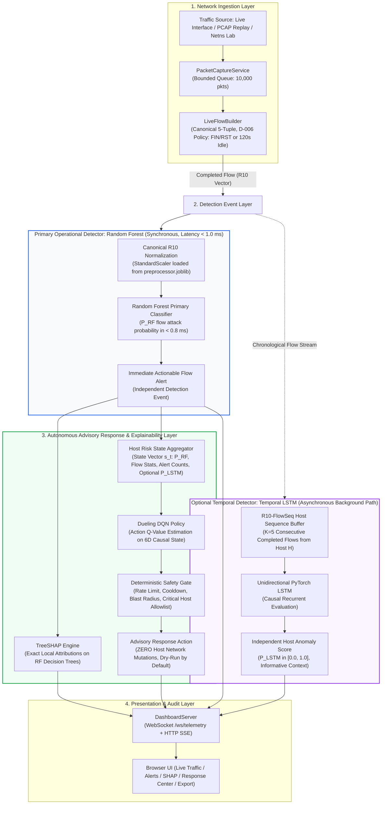
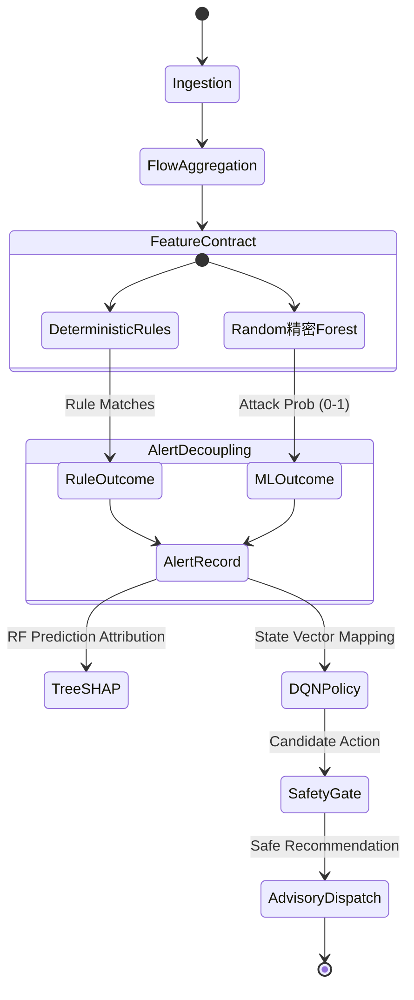

# XRL-IDARS — System Architecture & Design Specification

**Document Version:** 2.0.0  
**Project Title:** Explainable Reinforcement Learning-Based Network Intrusion Detection and Autonomous Response System (XRL-IDARS)  
**Repository:** `/home/rishikesh/Desktop/fyp-xrlids`  
**GitHub Repository:** `rishikeshgowdakk/fyp-xrlids`  
**Authoritative Reference:** Final-Year Engineering Project Specification & Acceptance Standard  

---

## 1. Problem Statement

Modern high-speed network environments face persistent, sophisticated cyber threats requiring autonomous intrusion detection and incident mitigation. Conventional Network Intrusion Detection Systems (NIDS) exhibit fundamental operational tensions:

1. **Rule-Based Rigidity vs. Generalization:** Deterministic rule engines (e.g., Snort/Suricata signatures) evaluate static traffic patterns and explicit protocol violations with microsecond latency and zero false positives for known signatures, but fail completely against novel attacks, zero-days, or subtly mutated traffic flows.
2. **Black-Box ML & Trust Deficits:** Machine-learning (ML) flow classifiers (Random Forests, neural networks) generalize across complex behavioral patterns, but their decision boundaries are opaque. In high-consequence network security operations, security analysts cannot safely authorize autonomous remediation without verifiable, per-prediction explanations.
3. **Response Policy Gap:** Classification alone ("ATTACK" vs. "BENIGN") does not dictate the optimal response. Naive binary blocking of entire IP subnets causes severe collateral denial-of-service to legitimate users (false positive disruption), whereas conservative inaction allows network compromise. A response system must dynamically weigh security risk against business operational disruption cost.
4. **Offline Benchmarks vs. Live Network Semantics:** Academic intrusion detection benchmarks (e.g., CIC-IDS2017, CSE-CIC-IDS2018, UNSW-NB15) are pre-extracted completed-flow CSV tables. Translating models trained on static datasets to live network packet streams introduces severe timing gaps, feature contract drift, and flow directionality issues that can silently invalidate live detection.

XRL-IDARS addresses these challenges by unifying deterministic rule detection, explainable tabular flow classification (TreeSHAP), and cost-sensitive reinforcement learning response policies (Deep Q-Network) within an auditable, safety-gated architecture.

---

## 2. Primary and Supporting Objectives

### Primary Objective
Deliver a verified, measurable, and reproducible research prototype that combines deterministic rule checking, explainable Random Forest flow classification, and reinforcement-learning-driven response recommendations over live packet streams and held-out benchmark datasets—with zero ungrounded claims, zero fabricated feature attributions, and guaranteed non-mutation of host network firewall state.

### Supporting Objectives
1. **Reliable Bidirectional Flow Assembly:** Construct bidirectional network flows from raw packet streams according to a strict completion policy (TCP FIN/RST termination or 120.0s idle timeout) and extract canonical 10-feature R10 and 4-feature R4 contracts.
2. **Deterministic Security Policy Enforcement:** Execute fast, deterministic rule checks for RFC protocol violations (SYN+FIN, Xmas, NULL), volumetric flood bursts, port scan probes, and spoofed reserved IP addresses independently of ML model weights.
3. **Verified Random Forest Live Detection:** Establish Random Forest as the primary operational ML detector on live flow features, verifying model-preprocessor compatibility and probability calibration.
4. **Genuine Local Explainability:** Provide exact TreeSHAP feature attributions on Random Forest predictions using genuine model trees and actual input vectors, explicitly rejecting fabricated attributions or canned ranking substitutions.
5. **Empirically Evaluated Response Policy:** Formulate autonomous incident response as a Markov Decision Process (MDP) and evaluate Deep Q-Network (DQN) recommendations against established baseline policies on identical held-out benchmark test sets.
6. **Decoupled Multi-Model Architecture & Safe Standalone Operation:** Establish Random Forest as the primary operational ML detector on live flow features (synchronous fast path, latency $< 1.0\,\text{ms}$). For hosts with ongoing activity, an asynchronous background worker maintains a causal sliding buffer of $K=5$ consecutive completed flows to compute an independent host-level anomaly score using an experimental PyTorch LSTM. Score fusion is explicitly excluded from the operational pipeline: both detectors report independent signals, guaranteeing that temporal buffering never blocks or delays flow-level detection.
7. **Transparent Dashboard & Honest Mode Distinctions:** Visually and programmatically distinguish live network capture (`LIVE`), recorded trace replay (`PCAP`), held-out benchmark evaluation (`DATASET`), and in-memory attack simulation (`SAMPLE`).

---

## 3. Scope and Non-Goals

### In-Scope
- Pure-Python userland PCAP parsing and raw packet ingestion via AF_PACKET sockets or Scapy capture service.
- Bidirectional flow aggregation and feature extraction adhering to the R10 and R4 semantic contracts.
- Deterministic rule engine executing 5 explicit security rules.
- Independent dual-detector inference architecture decoupling Random Forest single-flow inference (fast path) from host-level LSTM sequence evaluation (background path), with zero score-fusion dependencies.
- TreeSHAP local explanations computing exact base values and signed feature attributions.
- PyTorch Dueling DQN response policy evaluated under 3-action and 4-action action spaces.
- Isolated network namespace (`netns`) container execution for safe dry-run response validation.
- REST API and interactive web console (`/index.html` and `/demo.html`).
- Comprehensive regression testing suite verifying contracts, clean tree state, and latency.

### Non-Goals (Explicit Exclusions)
- **Zero Host Network Mutations:** The system will **never** alter host system `iptables`, `nftables`, routing tables, or hardware firewall state during standard live monitoring or demonstration mode. All policy enforcement is advisory/dry-run by default.
- **No In-Flight Early Flow Intrusion Detection:** Flow-level ML models classify completed flows upon termination or timeout. XRL-IDARS does not claim mid-packet intrusion prevention before flow completion without dedicated packet-level models.
- **No Ungrounded Temporal Parity Claims:** While `UnifiedInferenceService` buffers sequential flows and executes LSTM sequence evaluation when $T=5$ flows accumulate for a session key, real network traffic often contains isolated 1-2 flow bursts that never reach $T=5$. XRL-IDARS does not claim universal temporal sequence parity across fragmented or out-of-order live packet streams.
- **No Fabricated Performance Claims:** Sample simulation scenarios and microbenchmarks are never presented as real network attacks or general real-world detection accuracy.

---

## 4. Approved Target Architecture Diagram (Independent Detection & Advisory Response)

> [!IMPORTANT]
> **No Score Fusion Invariant**: There is NO RF-LSTM fusion component, NO blended probabilities, and NO fusion weights. Random Forest is the certified primary operational detector. The Temporal LSTM is strictly optional and experimental. The system operates fully on Random Forest alone.

---

## 5. Component Responsibilities

| Component | Module Path | Primary Responsibility | Architectural Invariant |
|---|---|---|---|
| **Packet Parser** | `src/xrlids/demo/pcap.py` | Extracts timestamps, endpoints, protocols, and raw TCP flags from wire or PCAP frames. | Pure Python, zero native C-dependencies, handles VLAN 802.1Q tags. |
| **Flow Builder** | `src/xrlids/demo/flow.py` | Canonicalizes bidirectional 5-tuples and tracks packet lengths, byte volumes, and TCP control flags. | Closes flow on FIN/RST or 120s timeout (D-006 policy). |
| **Rule Engine** | `src/xrlids/rules/engine.py` | Evaluates deterministic security rules against completed flows or feature dictionaries. | 100% deterministic; zero ML weights; never mutates RF probabilities. |
| **Random Forest Detector** | `src/xrlids/models/random_forest.py` | Primary live ML detector computing flow attack probabilities. | Model features and preprocessor must match verified training provenance. |
| **Explainability Engine** | `src/xrlids/explainability/` | Computes TreeSHAP feature attributions on Random Forest predictions. | Explains actual input vector using loaded RF tree structure; no canned values. |
| **Dueling DQN Agent** | `src/xrlids/response/dqn.py` | Maps incident state vectors to cost-optimal defensive action recommendations. | Trained with experience replay and target networks; outputs Q-values. |
| **Deterministic Safety Gate** | `src/xrlids/enforcement/gate.py` | Enforces cooldown periods, blast-radius restrictions, and operational preconditions. | Fails closed; enforces advisory dry-run unless cryptographic tokens present. |
| **Live Lab Monitor** | `src/xrlids/demo/live_lab.py` | Glues capture, flow construction, rule checking, ML inference, and alert queuing. | Pure userland observational stream; zero host socket or firewall mutations. |
| **Dashboard Server** | `dashboard/server.py` | Threaded HTTP server exposing REST APIs, static assets, and SSE event channels. | Rebind-safe host validation; strictly separates sample, replay, and benchmark streams. |

---

## 6. Live and Offline Execution Paths

### 6.1 The Live Operational Path
1. **Ingestion:** Raw packets arrive from either an observational Linux raw socket (`AF_PACKET`, requires CAP_NET_RAW), a paced PCAP file replay, or an in-memory packet synthesizer (`attack_sim.py`).
2. **Canonical Flow Assembly:** Packets are grouped by canonical 5-tuple `(min(ep1, ep2), max(ep1, ep2), proto)`. When a TCP FIN or RST flag is observed, or when inter-packet arrival exceeds 120.0 seconds, the flow is finalized.
3. **Contract Extraction:** The 10 R10 features are computed from flow duration, packet arrival deltas, byte sizes, and flag counts.
4. **Dual Detection Evaluation:**
   - The deterministic `RuleEngine` inspects flow characteristics for known violation patterns.
   - The frozen `RandomForest` evaluates the normalized feature vector and outputs attack confidence $p \in [0.0, 1.0]$.
5. **Alert Attribution:**
   - If only the rule triggers: `detection_source="RULE"`, attack score remains raw RF probability.
   - If only RF triggers ($p \ge 0.50$): `detection_source="RF"`, rule list is empty.
   - If both trigger: `detection_source="HYBRID"`.
6. **Explanation (On Demand):** If requested by the user or analyst, TreeSHAP evaluates the exact feature vector against the Random Forest decision paths.
7. **Advisory Response Recommendation:** The DQN policy receives a state vector representing attack confidence, flow volume, and current network state, outputting an advisory action (e.g., `ALLOW`, `ALERT`, `RATE_LIMIT`, `BLOCK`).
8. **Safety & Audit:** The decision is logged to the in-memory observation queue with its timestamp, endpoints, score, and detection source, and broadcast to the dashboard.

### 6.2 The Offline Research & Evaluation Path
1. **Dataset Loading:** Held-out benchmark test partitions (e.g., 355,865 test flows for CIC-IDS2017) are loaded from disk with verified SHA-256 checksums.
2. **Schema & Label Isolation:** Metadata columns (IPs, ports, timestamps) and ground-truth labels (`Label`) are isolated before preprocessing to prevent data leakage.
3. **Preprocessing:** The training-fitted preprocessor (`preprocessor.joblib`) transforms numerical columns without refitting.
4. **Multi-Model Inference:**
   - Random Forest computes tabular class probabilities.
   - Supervised LSTM evaluates causal sequences ($T=5$ past flows).
   - Fusion engine computes linear weighted blend: $S_{fusion} = \alpha S_{RF} + (1-\alpha) S_{LSTM}$.
5. **Statistical Verification:** Computes accuracy, precision, recall, F1, PR-AUC, confusion matrices, and 95% bootstrap confidence intervals across random seeds (42, 123, 456).
6. **Artifact Generation:** Output metrics, ROC/PR curves, and TreeSHAP global importance plots are saved to `results/phase1/` and `results/phase2/`.

---

## 7. Data Flow and Model Contracts

### 7.1 R10 Contract (10 Canonical Features)
Used by **CIC-IDS2017** and **CSE-CIC-IDS2018**:

| Index | Feature Name | Description | Units / Type | Range / Semantics |
|---|---|---|---|---|
| 0 | `flow_duration_ms` | Elapsed time from first to last packet in flow | Milliseconds (float) | $\ge 0.0$ |
| 1 | `flow_packets_per_s` | Total flow packets divided by flow duration in seconds | Packets/second (float) | $\ge 0.0$ |
| 2 | `flow_bytes_per_s` | Total flow bytes divided by flow duration in seconds | Bytes/second (float) | $\ge 0.0$ |
| 3 | `packet_length_mean` | Arithmetic mean of all packet byte sizes in flow | Bytes (float) | $[0.0, 65535.0]$ |
| 4 | `packet_length_std` | Population standard deviation of packet byte sizes | Bytes (float) | $\ge 0.0$ |
| 5 | `syn_count` | Total packets with TCP SYN flag set | Count (float) | $\ge 0.0$, integer value |
| 6 | `ack_count` | Total packets with TCP ACK flag set | Count (float) | $\ge 0.0$, integer value |
| 7 | `rst_count` | Total packets with TCP RST flag set | Count (float) | $\ge 0.0$, integer value |
| 8 | `fin_count` | Total packets with TCP FIN flag set | Count (float) | $\ge 0.0$, integer value |
| 9 | `syn_ack_ratio` | Ratio of SYN count to ACK count: $\frac{\text{syn}}{\max(\text{ack}, 1.0)}$ | Dimensionless (float) | $\ge 0.0$ |

### 7.2 R4 Contract (4 Canonical Features)
Used by **UNSW-NB15** (sensor-degraded baseline):

| Index | Feature Name | Description | Units / Type |
|---|---|---|---|
| 0 | `flow_duration_ms` | Elapsed flow duration | Milliseconds |
| 1 | `flow_packets_per_s` | Packet rate per second | Packets/second |
| 2 | `flow_bytes_per_s` | Byte rate per second | Bytes/second |
| 3 | `packet_length_mean` | Mean packet length | Bytes |

### 7.3 R10-FlowSeq Contract (Approved Temporal Sequence Contract)
Approved in Phase 1C for host-aware chronological flow sequences ($K=5$ flows per source host):
Each sequence step $k$ contains the 10 canonical R10 features plus the inter-flow arrival delta ($\Delta t_{\text{inter-flow}}$):

| Index | Feature Name | Description | Units / Type | Physical Invariant |
|---|---|---|---|---|
| 0 | `flow_duration_ms` | Elapsed duration of completed flow | Milliseconds | $\ge 0.0$ |
| 1 | `flow_packets_per_s` | Total flow packets divided by flow duration | Packets/second | $\ge 0.0$ |
| 2 | `flow_bytes_per_s` | Total flow bytes divided by flow duration | Bytes/second | $\ge 0.0$ |
| 3 | `packet_length_mean` | Mean of packet lengths across flow | Bytes | $[0.0, 65535.0]$ |
| 4 | `packet_length_std` | Sample standard deviation of packet sizes | Bytes | $\ge 0.0$ |
| 5 | `syn_count` | TCP SYN flag count in flow | Count | Integer $\ge 0$ |
| 6 | `ack_count` | TCP ACK flag count in flow | Count | Integer $\ge 0$ |
| 7 | `rst_count` | TCP RST flag count in flow | Count | Integer $\ge 0$ |
| 8 | `fin_count` | TCP FIN flag count in flow | Count | Integer $\ge 0$ |
| 9 | `syn_ack_ratio` | Ratio of SYN count to ACK count: $\frac{\text{syn}}{\max(\text{ack}, 1.0)}$ | Ratio | Dimensionless $\ge 0.0$ |
| 10 | `inter_flow_delta_s` | Elapsed time since previous flow from this host: $t_{\text{start}}(f_i) - t_{\text{start}}(f_{i-1})$ | Seconds | Clamped to $[0.0, 300.0]$ |

*Historical Note on T10-Host*: The earlier proposed fixed-window contract (`T10-Host`) was audited in Phase 1B and formally rejected (NO-GO) because calculating sub-second packet rates from completed flow CSVs required fabricating ungrounded packet arrival distributions. Option A (`R10-FlowSeq`) was selected and approved as scientifically authentic.

### 7.4 Schema & Contract Enforcement Rules
1. **Zero Silent Fallbacks:** If an input dictionary or CSV row is missing any feature in the active contract, inference raises a `ContractViolationError` or validation error; missing features are **never** replaced with invented defaults.
2. **Non-Finite Value Handling:** Rows containing `NaN`, `+Inf`, `-Inf`, or non-numeric values are rejected at the schema gate and logged in row accounting records.
3. **Single Preprocessing Pass:** Preprocessing is applied exactly once via the fitted `StandardScaler` / pipeline loaded from `preprocessor.joblib`. Models are never fed raw unscaled features when a preprocessor is registered.

---

## 8. Rule, RF, TreeSHAP, and DQN Responsibilities

### 8.1 Deterministic Rule Engine
- **Purpose:** Sub-millisecond policy violation and attack signature detection.
- **Rules:**
  1. `RULE-TCP-INVALID-FLAGS`: Detects SYN+FIN, SYN+RST, Xmas scan (FIN+PSH+URG), and NULL scan (flags=0).
  2. `RULE-SYN-FLOOD`: Detects $\ge 20$ SYNs with 0 ACKs, or $\ge 10$ SYNs with SYN/ACK ratio $\ge 10.0$.
  3. `RULE-PORT-SCAN`: Detects probe flows with $\ge 5$ SYNs and $\le 250$ total bytes.
  4. `RULE-HIGH-RATE-BURST`: Detects volumetric bursts $\ge 50,000$ pkts/s or $\ge 50$ MB/s.
  5. `RULE-IP-SPOOF-RESERVED`: Detects source IP `0.0.0.0` or cross-interface loopback spoofing.
- **Integrity Rule:** Rule triggers are recorded in `rule_matches` and `rule_triggered`. They never mutate the Random Forest confidence score.

### 8.2 Random Forest (Primary ML Detector)
- **Purpose:** Non-linear statistical classification over continuous tabular flow features.
- **Model Architecture:** 100 estimators, balanced class weights, Gini impurity criterion.
- **Contract Compatibility:** Verified against `preprocessor.joblib` and feature names matching `R10_FEATURES` or `R4_FEATURES`.
- **Operational Threshold:** Research threshold $\tau = 0.50$; operational candidate threshold $\tau = 0.85$.

### 8.3 TreeSHAP Explainability
- **Purpose:** Mathematically rigorous local feature attribution for Random Forest predictions.
- **Guarantee:** Computes exact Shapley values via TreeSHAP algorithm ($\sum \phi_i = f(x) - E[f(x)]$).
- **Boundary:** Explains **only** the Random Forest prediction on tabular features. TreeSHAP does **not** explain the DQN policy, the rule engine, or the LSTM sequence model.

### 8.4 Deep Q-Network (DQN) Response Policy
- **Purpose:** Cost-sensitive autonomous incident response recommendation under operational cost penalties.
- **Action Spaces:**
  - **3-Action Regime:** `ALLOW` (0), `RATE_LIMIT` (1), `BLOCK` (2).
  - **4-Action Regime:** `ALLOW` (0), `RATE_LIMIT` (1), `ISOLATE` (2), `BLOCK` (3).
- **State Vector:** Normalized 6-dimensional causal observation vector in $\mathbb{R}^6$:
  $\mathbf{s}_t = [S_t, \Delta S_t, N_{\text{alert}}, a_{t-1}, c_t, v_t]$, where $S_t \in [0, 1]$ is the continuous attack confidence score, $\Delta S_t$ is the score trajectory (difference from rolling window mean), $N_{\text{alert}}$ is the local alert density fraction, $a_{t-1}$ is the previous executed action (normalized), $c_t$ is the cooldown timer fraction, and $v_t$ is the normalized flow volumetric rate. Zero attack-family labels or multiclass outputs exist in the DQN state.
- **Cost Formulation:** Evaluated under five operational cost regimes (Standard Enterprise, Mission Critical, Public DMZ, Adversarial Asymmetric, High Availability) penalizing false positive blocks against service disruptions.

---

## 9. Optional LSTM and Fusion Evaluation Role

### 9.1 Experimental Baseline Nature
The supervised Long Short-Term Memory (LSTM) sequence model ($T=5$ causal time steps) and linear score fusion engine ($\alpha S_{RF} + (1-\alpha)S_{LSTM}$) are **strictly offline experimental baselines**.

### 9.2 Evidence and Rationale for Exclusion from Live Path
1. **Empirical Performance Comparison:** Across 355,865 held-out test flows of CIC-IDS2017:
   - **Random Forest:** Accuracy $99.88\% \pm 0.01\%$, F1-Score $0.9972 \pm 0.0003$, ROC-AUC $0.9999 \pm 0.0000$.
   - **Supervised LSTM:** Accuracy $98.42\% \pm 0.12\%$, F1-Score $0.9635 \pm 0.0028$, ROC-AUC $0.9945 \pm 0.0011$.
   - **RF-LSTM Fusion:** Accuracy $99.88\% \pm 0.01\%$, F1-Score $0.9973 \pm 0.0002$, ROC-AUC $0.9999 \pm 0.0000$.
2. **Marginal Value vs. Complexity:** RF alone achieves $0.9972$ F1. Adding the recurrent sequence model yields a negligible $+0.0001$ F1 gain while adding sequence buffering, temporal state tracking, and a $10\times$ inference latency penalty.
3. **Explainability Feasibility:** TreeSHAP provides microsecond, exact explanations for tree ensembles. Explaining recurrent sequence models requires gradient-based or perturbation SHAP (KernelSHAP) which is computationally prohibitive for real-time traffic.
4. **Preservation Commitment:** All LSTM checkpoints (`models/registry/EXP-P1-*-LSTM-*`) and fusion code remain in the repository and are fully tested and reproducible in the offline benchmark evaluation suite.

---

## 10. Safety Boundaries

### 10.1 Advisory / Dry-Run Invariant
The live monitor and dashboard operate in **observational dry-run mode**. Recommended actions from the DQN or rule engine are surfaced in event records and UI badges, but **never** executed against the host operating system's network stack.

### 10.2 Host Protection Guarantees
- **No Host Sudo Subprocesses:** Standard execution spawns no subprocesses invoking `iptables`, `nftables`, `ip route`, or `tc`.
- **Interface Scoping:** Raw socket capture requires CAP_NET_RAW or root permissions, but the socket is opened in read-only mode (`SOCK_RAW`, `ETH_P_ALL`), incapable of injecting or dropping frames.
- **Isolated Lab Netns Sandbox:** Active actuation testing (Phase 3H) is restricted to disposable Linux network namespaces (`xrlids-test-ns`) over virtual ethernet (`veth`) pairs in subnet `10.200.1.0/24`. A baseline audit confirms host firewall state before and after execution; any residual rule aborts the test.
- **Automatic Rollback:** If lab actuation is tested, transactions use atomic state commits with timeout-based automatic rollback (default 30-second watchdog).

---

## 11. Evaluation Methodology

### 11.1 Benchmark Datasets & Splits
1. **CIC-IDS2017 (Flagship Benchmark):**
   - Source: University of New Brunswick / Canadian Institute for Cybersecurity.
   - Total clean records: 2,099,021 flows across 8 CSV files.
   - Partitioning: GroupKFold split by calendar date and attack campaign (temporal hold-out) to prevent data leakage.
   - Held-out test set: 355,865 flows (seed 42).
2. **CSE-CIC-IDS2018 (Enterprise Cloud Benchmark):**
   - Source: AWS infrastructure simulation.
   - Held-out test set: 1,661,216 flows.
3. **UNSW-NB15 (Sensor-Degraded Baseline):**
   - Source: Australian Defence Force Academy.
   - Evaluated under 4-feature contract (R4).
   - Held-out test set: 24,527 flows.

### 11.2 Evaluation Metrics
- **Detection Performance:** Confusion matrices, Precision, Recall, F1-Score, False Positive Rate (FPR), and Area Under the Precision-Recall Curve (PR-AUC).
- **Statistical Significance:** 1,000-sample bootstrap confidence intervals ($95\%$ CI) and 3-seed variance evaluation (seeds 42, 123, 456).
- **Latency Benchmarking:**
  - Flow-feature extraction latency.
  - Random Forest inference latency (with and without scaling).
  - TreeSHAP explanation latency (single vector and batch).
  - End-to-end packet-to-dashboard pipeline latency.
  - Reported via 100-iteration warm-up and percentiles (P50, P90, P95, P99).

---

## 12. Known Limitations

1. **Completed-Flow Timing Constraint:** Because the feature contract requires bidirectional statistical moments (duration, mean packet length, SYN/ACK ratio), classification occurs when a flow completes (via TCP FIN/RST) or when the 120-second idle timeout elapses. The system does not detect attacks mid-flight on the first packet.
2. **Tabular RF Evasion Under Fast Flood Bursts:** As documented in `xrlids.demo.attack_sim`, high-volume fast SYN flood bursts and horizontal port sweeps produce feature shapes (e.g. sub-millisecond durations with high packet rates) that the frozen RF model—trained on benchmark distributions—evaluates as low attack probability ($\le 0.20$). This behavior is preserved honestly and directly motivates the deterministic Rule Engine, which catches these attacks via `RULE-SYN-FLOOD` and `RULE-PORT-SCAN`.
3. **Explainability Boundary:** TreeSHAP feature attributions explain the Random Forest classifier only. They do not explain the DQN Q-value landscape or the rule engine triggers.
4. **Offline Evaluation vs. Live Traffic Shift:** Performance metrics reported on held-out benchmark splits reflect identical distribution conditions. Real-world enterprise traffic subject to protocol variations, MTU differences, or zero-day exploits will exhibit different error profiles.
5. **Sample Simulation Scope:** Packets synthesized in memory by `attack_sim.py` test pipeline plumbing and score calibration; they are synthetic demonstrations and not substitutes for empirical held-out benchmark verification.

---

## 13. Real-Time Scapy Live Demonstration & Isolated Lab Architecture

### 13.1 Isolated Lab Topology & Target Safety
The live demonstration operates within a strictly isolated, bounded sandbox to guarantee zero interference with production networks, public subnets, or host loopback sockets:
- **Designated Subnet:** `10.200.1.0/24` (virtual ethernet pairs or virtual packet injection queue).
- **Target IP:** `10.200.1.3` (`VICTIM_IP`).
- **Attacker IP:** `10.200.1.2` (`ATTACKER_IP`).
- **Target Safety Enforcer:** `validate_target_safety(ip)` strictly asserts that destination IPs fall within `10.200.1.0/24` or loopback `127.0.0.1`. Any external, public, or unauthorized IP is rejected with `TargetIsolationError`.

### 13.2 Calibrated Scapy Traffic Scenarios
The traffic simulator (`src/xrlids/demo/scapy_simulator.py`) generates real wire-format Scapy packets across four distinct, reproducible operational scenarios:
1. **Scenario A — Benign Baseline Traffic (12 packets):**
   - Clean 3-way TCP handshake (SYN $\to$ SYN/ACK $\to$ ACK) on port 80.
   - HTTP GET request and 200 OK payload exchange.
   - Graceful 4-way connection teardown (FIN/ACK $\to$ ACK $\to$ FIN/ACK $\to$ ACK).
   - Standard ICMP Echo Request and Echo Reply ping exchange.
   - Result: 0 rule alerts, RF evaluates low attack score ($< 0.05$), $100\%$ benign baseline.
2. **Scenario B — Port Scan Simulation (15 packets):**
   - Sequential probes targeting ports 21 (FTP), 22 (SSH), 80 (HTTP), 443 (HTTPS), and 8080 (HTTP-Alt).
   - Simulates 4 closed ports responding with TCP RST/ACK and 1 open port (80) responding with SYN/ACK.
   - Result: Deterministic rule `RULE-PORT-SCAN` detects multiple closed/probe ports; triggers alert.
3. **Scenario C — TCP SYN Burst (60 packets):**
   - Rapid burst of 60 raw TCP SYN packets (no completed handshakes) across 2 ephemeral source ports (30 SYNs each).
   - Simulates asymmetric connection table starvation.
   - Result: Deterministic rule `RULE-SYN-FLOOD` triggers alert; Dueling DQN receives elevated attack score ($S_t$) and proposes rate limiting or host blocking, validated through `DeterministicSafetyGate`.
4. **Scenario D — ICMP Burst (40 packets):**
   - High-frequency burst of 40 ICMP Echo Request packets (type 8, code 0) within a 0.20-second window.
   - Result: Deterministic rule `RULE-ICMP-FLOOD` triggers alert on volumetric ping flood.

### 13.3 Real Operational Pipeline
Traffic flows through the exact operational intrusion detection and response pipeline without synthetic mocking:
1. **Scapy Packet Ingestion:** Packets are converted to canonical `PacketInfo` dataclasses and delivered into a non-blocking queue.
2. **Bidirectional Flow Reconstruction:** `FlowBuilder` matches packets into bidirectional flows, updating forward/backward packet counts, byte volumes, and TCP control flag histograms.
3. **Feature Extraction:** Completed flows emit normalized 10-feature R10 vectors (`flow_duration_ms`, `flow_packets_per_s`, `flow_bytes_per_s`, `packet_length_mean`, `packet_length_std`, `syn_count`, `ack_count`, `rst_count`, `fin_count`, `syn_ack_ratio`).
4. **Multi-Model Inference:** `RandomForest` computes $P(\text{ATTACK})$; if 5 sequential flows share a session key, `UnifiedInferenceService` evaluates LSTM sequence modeling and linear score fusion.
5. **Deterministic Security Rules:** `RuleEngine` evaluates RFC violations and volumetric heuristics independently of ML inference.
6. **Local Explainability:** `explain_flow_prediction` computes TreeSHAP additive feature attributions ($\phi_i$) for the exact input vector against the loaded Random Forest model trees.
7. **Advisory DQN Response:** 6D state vector $\mathbf{s}_t = [S_t, \Delta S_t, N_{\text{alert}}, a_{t-1}, c_t, v_t]$ is fed to `DuelingQNetwork`, estimating Q-values across the action space (`ALLOW`, `ALERT`, `RATE_LIMIT`, `BLOCK`).
8. **Deterministic Safety Gate:** `DeterministicSafetyGate` enforces cooldown windows (30 steps), blast radius caps ($5\%$), and critical host allowlists. All actions remain strictly **advisory** (dry-run).
9. **Event Timeline & REST Delivery:** Consolidated snapshots and chronological events are served via `GET /api/demo/status`, `POST /api/demo/simulate`, and `GET /api/demo/explain`.

### 13.4 Viva Demonstration Interface (`demo.html`)
The Viva frontend provides an uncluttered, high-contrast cybersecurity operations console:
- **Header:** System title, monitoring status (`STOPPED`/`RUNNING`), mode (`ISOLATED LAB`), model status (`LOADED`), and persistent navigation to the Research Dashboard.
- **Main Controls:** Start/Stop Monitoring, Scenario Selector (A, B, C, D), Launch/Stop Simulation, Reset Session, and Export Report (JSON/CSV).
- **Four Metric Cards:** Packets Captured, Flows Processed, Threats Detected, Active Alerts.
- **Six Specialized Panels:**
  1. *Live Traffic Panel:* Real-time flow table with timestamps, endpoints, protocols, packet counts, and durations.
  2. *Threat Detection Panel:* Flow results, detection provenance (`RF`, `RULE`, `HYBRID`, `RF+LSTM_FUSION`), confidence scores, and rule match badges.
  3. *TreeSHAP Explainability Panel:* Interactive waterfall chart showing top positive and negative contributing features for any selected flow.
  4. *Autonomous Response Advisory Panel:* DQN proposed action, safety gate enforced action, override badges, and strict dry-run notice.
  5. *Performance & Latency Panel:* P50, P95, P99 latency percentiles across Feature Extraction, RF Inference, Rule Engine, and DQN Response Selection.
  6. *Chronological Event Timeline:* Detailed audit stream of capture starts, packet bursts, threat detections, and safety gate decisions.
