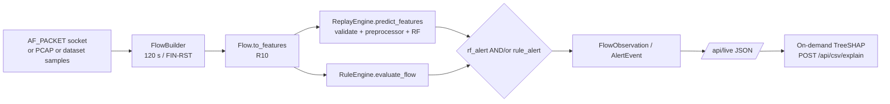

# XRL-IDARS — Phase 0 Architecture Audit

**Repository:** `/home/rishikesh/Desktop/fyp-xrlids`
**Audit date:** 2026-10-30
**Git HEAD:** `6408f5e` (`refactor: update dashboard styling and theme variables for improved UI consistency`)
**Working tree at audit time:** dirty (see §0.3)
**Scope:** As-built architecture, runtime wiring, entry points, and component status.
**Out of scope:** Any refactor, retraining, checkpoint replacement, or model-contract change.

> This document records what the code **actually does**, not what the README or prior audit
> documents claim. Where a claim could not be reproduced, it is listed as a defect in §6.

---

## 0. Method, vocabulary, and evidence

### 0.1 Status vocabulary

| Label | Meaning in this document |
|---|---|
| **Implemented** | Code exists and is reachable from a real entry point. |
| **Tested** | Covered by an automated test that currently passes. |
| **Validated** | Produced an artifact with recorded metrics/evidence (results file, manifest, benchmark). |
| **Offline-only** | Runs against stored benchmark files or a saved replay, never against live capture. |
| **Replay/simulated** | Inputs are dataset samples or synthetic PCAP; ground truth is not from live traffic. |
| **Not wired** | Code exists but no production entry point invokes it. |
| **Defect** | Behavior contradicts a stated contract or silently produces misleading output. |

A component can be *Implemented + Tested* and still be **Not wired**. That distinction is the
main finding of this audit.

### 0.2 What was inspected

- `dashboard/server.py`, `dashboard/app.js`, `dashboard/index.html`, `dashboard/demo.js`,
  `dashboard/README.md`, `dashboard/workbench_data.py`
- `src/xrlids/demo/live_lab.py`, `demo/replay.py`, `demo/replay_lab.py`, `demo/flow.py`,
  `demo/pcap.py`, `demo/dataset_stream.py`
- `src/xrlids/live/runner.py`, `live/capture.py`, `live/flow_builder.py`, `live/parity.py`,
  `live/observability.py`, `live/burst.py`
- `src/xrlids/evaluation/csv_evaluator.py`
- `src/xrlids/models/registry.py`, `models/random_forest.py`, `models/lstm.py`
- `src/xrlids/response/state.py`, `detector.py`, `environment.py`, `safety.py`, `types.py`,
  `dqn/network.py`, `dqn/trainer.py`
- `src/xrlids/flagship.py`
- `src/xrlids/rules/engine.py`, uncommitted `rules/hybrid.py`
- uncommitted `src/xrlids/tracking/source_tracker.py`
- `scripts/phase1/run_experiment.py`, `scripts/phase2/run_phase2a_baselines.py`,
  `scripts/phase2/run_final_test_evaluation.py`, `scripts/benchmark_latency.py`
- `configs/experiments/*.yaml`, `configs/features/features.yaml`,
  `configs/labels/label_mapping.yaml`, `data/manifests/dataset_registry.yaml`
- `models/registry/model_manifest.json`, `models/fusion/fusion_weights.json`
- `results/experiments/.../split_manifest.json`, `test_metrics.json`,
  `results/phase2/EXP-P2-FINAL-TEST-001/final_test_metrics.json`,
  `results/phase3/EXP-P3-BURST-1000-001/latency_metrics.json`
- `docs/audit/ARCHITECTURE_AUDIT.md`, `docs/MODEL_ARTIFACT_AUDIT.md` (prior baselines)

### 0.3 Working tree state (do not overwrite)

```text
$ git status --porcelain
 M reports/generated/phase1_final_report.md
 M reports/generated/phase1_status.md
 M src/xrlids/rules/__init__.py
 M src/xrlids/rules/engine.py
?? src/xrlids/rules/hybrid.py
?? src/xrlids/tracking/
?? tests/unit/test_hybrid_engine.py
?? tests/unit/test_source_tracker.py
```

The untracked `rules/hybrid.py`, `tracking/`, and their two test modules are treated as
in-progress user work. They were **read-only** inputs to this audit. The two generated
`reports/` files were already modified before this audit and were not touched.

---

## 1. Executive verdict

**Phase 0 audit: PASS** — the as-built system is now described well enough to plan against.

**"Single unified RF→LSTM→Fusion→DQN→Safety live pipeline": FAIL.**
No runtime path implements that full chain.

Actual runtime behavior:

| Entry point | Detector | LSTM | Fusion | DQN | Safety gate | Input |
|---|---|---|---|---|---|---|
| Dashboard live / PCAP / sample / dataset stream | RF + preprocessor | — | — | — | — | live packets or bundled dataset samples |
| CSV evaluation | RF + LSTM | yes | yes | called, but state is fake | **not invoked** | user CSV / held-out split |
| Replay Lab (dashboard Mode 2) | RF | — | — | yes (4-action) | yes | dataset replay |
| `FlagshipXRLIDS.process_flow` | RF + preprocessor | yes (5-flow buffer) | yes | yes (4-action) | yes | in-process only; **no production caller** |
| `LivePipelineRunner` | RF (**no preprocessor**) | — | — | optional | optional | not called by dashboard; **duplicate class definition** |

Corrected claim for the thesis/UI:

> The deployed monitoring console is a **Random Forest + deterministic rules** observational
> detector. LSTM and fusion are **offline/benchmark** models. The DQN response policy is
> exercised in **offline replay** and in the **flagship test harness**, never on live traffic.

---

## 2. Verified as-built topology

### 2.1 Offline training / evaluation (the only path that produced canonical artifacts)

```mermaid
flowchart LR
    A[Raw CSVs] --> B[canonicalize + clean]
    B --> C[features.compute<br/>R10 / R4]
    C --> D[stratified random split<br/>seed 42, 60/20/20]
    D --> E[Preprocessor.fit on train only]
    E --> F1[RandomForestDetector<br/>100 trees]
    E --> F2[SupervisedLSTM<br/>T=5, hidden 32, 2 layers]
    F1 --> G[score fusion<br/>alpha*RF + (1-alpha)*LSTM]
    F2 --> G
    F1 --> H[DQN state S_t = tree_vote_fraction]
    H --> I[DuelingDQN offline sim<br/>250 synthetic hosts]
    I --> J[DeterministicSafetyGate]
```

Evidence: `scripts/phase1/run_experiment.py`, `scripts/phase2/run_phase2a_baselines.py`,
`results/experiments/*/split_manifest.json`, `results/phase2/EXP-P2-FINAL-TEST-001/final_test_metrics.json`.

### 2.2 Dashboard / live monitoring (the path a user actually sees)



- `LiveSession._get_engine()` constructs `ReplayEngine(model_path=...)` only
  (`dashboard/server.py:351`).
- `LiveLabMonitor._evaluate_and_alert()` calls `self.engine.predict_features(features)` and
  `self.rule_engine.evaluate_flow(flow)` (`src/xrlids/demo/live_lab.py:74-160`).
- The live session snapshot explicitly states:
  `"dqn_integration": "DQN response policy is evaluated via offline replay simulation and is not connected to the live monitoring pipeline."`
  (`dashboard/server.py:624`).
- There is **no import of LSTM, fusion, DQN, or the safety gate** in `dashboard/server.py`
  (verified by grep; only metadata strings mention fusion/DQN).

This half of the system is genuinely **live-capable** (raw socket capture, observational only)
and **feature-parity tested** (`src/xrlids/live/parity.py`,
`tests/integration/test_phase3_parity_harness.py`). It is **not** a two-stage or fusion system.

### 2.3 CSV evaluation (`/api/csv/evaluate`)

`src/xrlids/evaluation/csv_evaluator.py`:

1. Validates benchmark ↔ contract pairing (CIC/CSE → R10, UNSW → R4).
2. Applies the frozen preprocessor once.
3. Scores every row with RF.
4. Builds LSTM sequences with `build_sequences(..., groups=boundary_groups)` where boundary
   columns are `source_file`, `filename`, `session_id`, `pcap_file`, `segment_id`, etc.
   (`BOUNDARY_CANDIDATE_COLUMNS`, line 65).
5. Marks rows not covered by a full sequence as `WARMUP` so LSTM/fusion metrics use only
   `ALIGNED` rows.
6. Calls `_get_dqn_action(fusion_score, flow_bytes)` once per evaluated row and renders the
   recommendation in the UI.

Defects in this path are in §6 (CSV-001/002): the DQN is called with a fresh `StateBuilder`
per row, no history update, and **the safety gate is never invoked**, yet the returned payload
says `"safety_status": "PASSED (...)"`.

### 2.4 Replay Lab (`src/xrlids/demo/replay_lab.py`)

- Loads frozen RF + preprocessor + `models/dqn/dqn_4action_best.pt`.
- Shares **one** `StateBuilder` for the whole replay and calls `update_history` per flow
  (`replay_lab.py:350-445`).
- Uses the **RF score** (not fusion) as `attack_score` for the 6-D state.
- Invokes `DeterministicSafetyGate.enforce_safety(...)` and records overrides.
- Is explicitly offline dataset replay, not live monitoring.

This is the closest thing in the repo to a correct sequential response-policy loop. It is
still not the live pipeline, and its score provenance differs from the CSV evaluator.

### 2.5 `FlagshipXRLIDS` (`src/xrlids/flagship.py`)

- Loads frozen RF, preprocessor, LSTM, fusion alpha, 4-action DQN, and a safety gate.
- `process_flow()` runs RF → 5-flow LSTM buffer → convex fusion → 6-D state → DQN argmax →
  safety gate → advisory `FlagshipDecision`.
- Handles the LSTM warm-up honestly with `lstm_score_source = "rf_fallback"` and
  `p_lstm = p_rf` when fewer than 5 flows are buffered.
- **No production caller**: grep finds references only in `src/xrlids/flagship.py` and
  `tests/unit/test_flagship.py`, `tests/unit/test_attack_family_and_response_semantics.py`.
  The dashboard does not import it.
- The sequence buffer `_recent_flow_window` is per-engine and **not per-source-IP**, so it
  mixes hosts (same semantic problem as §5.1).

### 2.6 `LivePipelineRunner` (`src/xrlids/live/runner.py`)

- Declares `class LivePipelineRunner` **twice**: a stub at line 124 and the real
  implementation at line 226. Python keeps the second; the first is dead code and a
  maintenance hazard. `src/xrlids/live/__init__.py` exports it.
- `__init__` does not accept or apply a `Preprocessor`.
- Calls `self.detector_model.predict_proba(feat_df)` on **raw, unscaled** features
  (`runner.py:380-386`), with a bare `except` fallback to a vector.
- Applies DQN + safety gate only outside `LiveMode.OBSERVE`.
- **Not referenced by the dashboard or any script** (grep: only `live/__init__.py` and the
  module itself, plus tests that do not run the full pipeline).

### 2.7 Uncommitted hybrid / tracker work

- `src/xrlids/rules/hybrid.py` implements a deterministic RF+rule arbitration engine with
  severity floors and explicit "unavailable feature" tracking. It is **not wired** into
  `LiveLabMonitor` or the dashboard; the live path still computes RF and rules independently
  and sets `detection_source` ad hoc (`src/xrlids/demo/live_lab.py:140-150`).
- `src/xrlids/tracking/source_tracker.py` implements per-IP rolling suspicious counting
  (5 flows / 60 s), cooldown, and a 5-vector feature buffer intended to gate LSTM
  escalation. It is **not wired** into any detector, dashboard, or runner.
- Its unit tests pass (`tests/unit/test_source_tracker.py`, 7 passed, plus 8 in `test_hybrid_engine.py`). They are
  **user work**, fully passing. See §7.

---

## 3. Entry points and HTTP surface

`DashboardHandler` (`dashboard/server.py:1060+`) serves:

| Route | Method | Purpose | Backing data |
|---|---|---|---|
| `/`, `/index.html` | GET | Research workbench UI | static |
| `/demo`, `/demo.html` | GET | Demo/replay UI | static |
| `/api/data` | GET | Full dashboard payload | `workbench_data` + results files |
| `/api/overview` | GET | Executive summary | workbench_data |
| `/api/evaluation` | GET | Per-benchmark metrics | results/experiments |
| `/api/comparison` | GET | RF/LSTM/Fusion comparison | results/experiments |
| `/api/flows` | GET | Flow explorer | results/experiments |
| `/api/explainability` | GET | Global explainability aggregates | results |
| `/api/dataset-explorer` | GET | Dataset metadata | dataset registry |
| `/api/performance-benchmarks` | GET | Latency/throughput tables | results |
| `/api/response-benchmark` | GET | Offline DQN benchmark | results/phase2 |
| `/api/limitations` | GET | Declared limitations | workbench_data |
| `/api/benchmarks` | GET | Benchmark registry | workbench_data |
| `/api/replay-lab/config`, `/status`, `/export` | GET | Replay Lab control/status | `ReplayLab` |
| `/api/live` | GET | Live session snapshot | `LiveSession` |
| `/api/live/dataset-categories`, `/devices`, `/interfaces`, `/scenarios` | GET | Live-mode helpers | registry/socket |
| `/api/live/start`, `/stop`, `/inject` | POST | Start/stop/inject | `LiveSession` |
| `/api/csv/sample`, `/api/csv/evaluate`, `/api/csv/explain`, `/api/csv/export` | GET/POST | CSV evaluation + TreeSHAP | `csv_evaluator` |

Binding is `127.0.0.1` by default. There is **no authentication**. It is a single-user local
research console; that is acceptable for the thesis but must be stated as a deployment
limitation, not a production security posture.

---

## 4. Component status matrix

| Component | Path | Implemented | Tested | Used by live path | Status |
|---|---|:--:|:--:|:--:|---|
| PCAP parser | `src/xrlids/demo/pcap.py` | yes | yes | yes | Works; VLAN frames dropped (INT-002) |
| Bidirectional flow builder | `src/xrlids/demo/flow.py`, `live/flow_builder.py` | yes | yes | yes | 120 s idle / FIN-RST; parity harness passes |
| Live capture (AF_PACKET) | `src/xrlids/live/capture.py` | yes | yes | yes | Observational; root required |
| R10/R4 feature computation | `src/xrlids/features/definitions.py` | yes | yes | yes | Canonical formulas |
| Preprocessor | `src/xrlids/preprocessing/pipeline.py` | yes | yes | **yes via `ReplayEngine`** | Train-only fit; applied in live monitor |
| RF inference | `src/xrlids/models/random_forest.py` | yes | yes | yes | 100 trees, binary |
| Model registry | `src/xrlids/models/registry.py` | yes | yes | no | Strict contract + single-pass scaling |
| LSTM | `src/xrlids/models/lstm.py` | yes | yes | **no** | Offline/benchmark only |
| Fusion | `models/fusion/fusion_weights.json` + evaluator/flagship | yes | yes | **no** | Offline/benchmark only |
| DQN | `src/xrlids/response/dqn/` | yes | yes | **no** | Replay Lab + flagship/tests |
| Safety gate | `src/xrlids/response/safety.py` | yes | yes | **no** | Replay Lab + flagship/tests |
| TreeSHAP | `src/xrlids/evaluation/csv_evaluator.py` | yes | yes | on demand only | RF-only, cached explainer |
| Rules engine | `src/xrlids/rules/engine.py` | yes | yes | yes | Deterministic, independent of ML |
| Hybrid arbiter | `src/xrlids/rules/hybrid.py` | yes (uncommitted) | yes (1 module) | **no** | Not wired |
| Source tracker / escalation | `src/xrlids/tracking/source_tracker.py` | yes (uncommitted) | **2 failing** | **no** | Not wired |
| LivePipelineRunner | `src/xrlids/live/runner.py` | partial | partial | **no** | Duplicate class; no preprocessing |
| Flagship engine | `src/xrlids/flagship.py` | yes | yes (toy) | **no** | No production caller |
| CSV evaluator | `src/xrlids/evaluation/csv_evaluator.py` | yes | yes | no | Sequence-aligned; DQN defects |
| Replay Lab | `src/xrlids/demo/replay_lab.py` | yes | yes | no | Offline replay only |
| Dashboard API | `dashboard/server.py` | yes | partial | yes | RF + rules only |

---

## 5. Cross-cutting semantic findings

### 5.1 LSTM sequence semantics (training vs live)

**Training (verified).** `build_sequences` (`src/xrlids/models/lstm.py:141`) forms windows of
`seq_len=5` **inside a single split**, and drops any window whose rows do not share the same
group. `scripts/phase1/run_experiment.py:317-323` passes
`train_session = prov_train["source_file"]`, i.e. the **capture file name**, not a host or
session identifier. The split is `stratified_random` with `ordering_basis="arrival_order"`
(`results/experiments/EXP-P1-CIC2017-R10-001/split_manifest.json`), and the split manifest
explicitly records
`"strict_timestamp_monotonic_ordering (timestamps absent or non-monotonic in source data)"`
as **not performed**.

Consequences:

- A sequence is "5 consecutive CSV rows from the same capture file", which may be five
  different hosts and need not be chronologically ordered.
- The learned temporal signal is therefore partly a **CSV row-locality artifact**, not a
  verified per-host temporal dynamic.
- The repo already contains the correct ablation switch: `build_sequences(shuffle_rows=True)`
  and `results/ablations/lstm_temporal_ablation.json`. Any claim that the LSTM captures real
  temporal dynamics must be read against that ablation.

**Live proposal (uncommitted).** `SourceActivityTracker` groups the last 5 flows **per source
IP**. That is a semantically different distribution: homogeneous host, causal order, possibly
different inter-arrival timing. Feeding such sequences to the frozen LSTM is an
**out-of-distribution** use unless it is validated. This is a model-contract decision, not a
wiring detail, and is therefore deferred to the implementation plan pending approval.

### 5.2 DQN state semantics and score provenance

The 6-D state is authoritative and consistent across code paths:

```
s_t = [ S_t, ΔS_t, N_alert, a_(t-1), c_t, v_t ]     (src/xrlids/response/state.py)
```

- `S_t` = detector risk score clipped to [0,1].
- `ΔS_t` = `S_t - mean(previous scores)`, clipped to [-1,1]; 0 with no history.
- `N_alert` = fraction of the recent window (including current) above 0.50.
- `a_(t-1)` = previous action enum divided by 3.
- `c_t` = remaining cooldown divided by 30, clipped to [0,1].
- `v_t` = `log10(1 + flow_bytes_per_s)` normalized and clipped to [0,1].

**What the DQN was trained on (verified).** `configs/experiments/p2b_cicids2017_dqn.yaml` sets
`score_type: tree_vote_fraction`. `scripts/phase2/run_phase2a_baselines.py` loads
`FrozenDetector.load(EXP-P1-CIC2017-R10-001)`, computes RF scores, and assigns
`host_id = f"host_{i % 250}"` over the ordered validation stream. So:

- Training score source = **RF tree-vote fraction**, not fusion.
- Training host identity = **synthetic round-robin**, not real endpoints.
- Training order = **validation-split row order**, not live arrival.

Therefore any runtime that feeds a **fusion** score into the DQN (CSV evaluator) or a
**different calibration** of the RF score is off-contract. The prompt's assumption that the
DQN consumes Fusion scores is **false** and is recorded as such.

### 5.3 Escalation threshold semantics

The uncommitted tracker escalates a source IP after **5 suspicious flows within 60 s**, then
activates the LSTM. This is:

- **Different from training**: training sequences are file-grouped, not IP-grouped (§5.1).
- **Different from the dashboard**: the dashboard has no escalation concept.
- **Untested end-to-end**: only unit tests exist, and 2 of them fail.
- **Not a validated operating point**: no results file records precision/recall/latency of
  the 5-in-60 s rule on any dataset.

The threshold is currently a **design hypothesis**, not an empirically tuned parameter.

### 5.4 Live feature parity

- `src/xrlids/live/parity.py` + `tests/integration/test_phase3_parity_harness.py` verify all
  10 R10 features within tolerance between streaming extraction and canonical offline
  formulas.
- The live monitor applies the frozen preprocessor through `ReplayEngine.predict_features`
  (`src/xrlids/demo/replay.py:134-210`), so the **dashboard's** live path is contract-correct.
- `LivePipelineRunner` is **not**: it passes unscaled features to `predict_proba`
  (`src/xrlids/live/runner.py:380`). If that runner is ever wired in as-is, live scores will
  be silently wrong. This is the single most dangerous latent defect in the repo.

### 5.5 TreeSHAP scope and latency

- TreeSHAP explains the **Random Forest only**. It does not attribute the LSTM or the fusion
  score. `explain_flow_prediction` (`csv_evaluator.py:445`) caches one `shap.TreeExplainer`
  per benchmark.
- The dashboard computes SHAP **on demand** when a user opens a flow; it is not computed for
  every live flow, so it does not sit in the live alerting loop.
- Fresh measurement on this machine (`scripts/benchmark_latency.py`, 25 SHAP samples):
  median **28.156 ms** per flow. RF pure median **36.328 ms**, RF+preprocessing **41.536 ms**,
  packet→prediction **40.574 ms**, packet→explanation **61.32 ms**.
- Interpretation: if SHAP were forced onto every flow, it would roughly **double** primary
  detection latency. On-demand explanation is the only defensible default at this budget.

### 5.6 Threshold semantics

- `0.50` is the **research/frozen reporting threshold** (`RESEARCH_THRESHOLD`).
- `0.40` is an **operational candidate** (`OPERATIONAL_CANDIDATE_THRESHOLD`), not a validated
  production setting.
- The CSV evaluator uses `0.50` for RF/LSTM/fusion metrics.
- The live monitor uses `0.50`.
- The fusion weights file stores per-dataset `threshold` values but they are all `0.50`.

Any UI or document that presents `0.40` as the deployed threshold is wrong.

### 5.7 Safety gate and "advisory" semantics

- `DeterministicSafetyGate` enforces: critical-host exemption, 30-step cooldown, 5% blast
  radius, 3-action clamp, plus audit records (`src/xrlids/response/safety.py`).
- "Advisory mode" is **not** a gate parameter. It is an orchestrator/UI convention meaning
  "do not execute the enforced action". The gate always returns an enforced action.
- The dashboard never calls the gate; the Replay Lab and flagship do.
- The CSV evaluator reports `safety_status: PASSED` without calling the gate — a false claim.

---

## 6. Defects and risks

Severity: **S1** blocks a truth claim or corrupts a scientific result; **S2** wrong behavior in
a reachable path; **S3** maintainability/documentation.

| ID | Severity | Finding | Evidence | Impact |
|---|---|---|---|---|
| **ARC-001** | S1 | Live console is RF + rules only, but docs/UI imply RF+LSTM live pipeline | `dashboard/server.py:351,624`; `demo/live_lab.py:74`; no LSTM/DQN import in server | Overstates system capability; thesis/UI claim must be corrected |
| **ARC-002** | S1 | CSV evaluator feeds **fusion** score into a DQN trained on **RF tree-vote fraction** | `csv_evaluator.py:369-425`; `p2b_cicids2017_dqn.yaml: score_type: tree_vote_fraction` | Response recommendation is off-contract / not causally valid |
| **ARC-003** | S1 | CSV evaluator creates a new `StateBuilder` per row, never updates history, never invokes safety gate, yet reports `safety_status: PASSED` | `csv_evaluator.py:411-425` | `ΔS_t`, `N_alert`, `a_(t-1)`, `c_t` are degenerate; safety claim is false |
| **ARC-004** | S1 | `LivePipelineRunner` scores **unscaled** features | `src/xrlids/live/runner.py:380-386`; no `Preprocessor` in constructor | Latent silent misclassification if wired |
| **ARC-005** | S2 | `LivePipelineRunner` is defined twice (stub at 124, real at 226) | `src/xrlids/live/runner.py` | Dead code, confusing exports, future edit may hit the wrong class |
| **ARC-006** | S2 | LSTM live escalation (per-IP 5 flows) is OOD vs training (per-file arrival-order 5 rows) | `lstm.py:141`; `run_experiment.py:317`; `split_manifest.json` | Unvalidated temporal claim; must not be presented as working |
| **ARC-007** | S2 | `FlagshipXRLIDS` implements the full chain but has no production caller | grep: only `flagship.py` + tests | Two parallel "systems"; drift risk |
| **ARC-008** | S2 | Tracker tests fail (2) | `tests/unit/test_source_tracker.py` | Uncommitted feature is not green; blocks wiring |
| **ARC-009** | S2 | Tracker `get_host_status()` purges against wall clock, not caller time | `source_tracker.py:232` area | Non-deterministic status; tests using synthetic timestamps fail |
| **ARC-010** | S3 | Hybrid RF+rule arbiter is not wired; live path duplicates weaker logic inline | `rules/hybrid.py`; `demo/live_lab.py:140-150` | Two rule-arbitration implementations can diverge |
| **ARC-011** | S3 | Prior audit `docs/audit/ARCHITECTURE_AUDIT.md` marks boundaries 9-12 "Implemented & Tested" as one chain | prior doc §2 | Stale claim; superseded by this document |
| **ARC-012** | S3 | VLAN (802.1Q) frames dropped by `parse_packet_bytes` | `src/xrlids/demo/pcap.py` | Managed-LAN traffic under-counted; already known as INT-002 |

No defect in this list was fixed during Phase 0. That is deliberate.

---

## 7. Verification evidence

### 7.1 Test suite (full)

```bash
.venv/bin/python -m pytest tests -o addopts="" --tb=no -q
```

Result:

```text
2 failed, 586 passed, 18 warnings in 40.61s
FAILED tests/unit/test_source_tracker.py::test_separate_ip_histories_do_not_cross_escalate
FAILED tests/unit/test_source_tracker.py::test_cooldown_prevents_duplicate_escalation
```

Both failures are in **untracked** test files for the **uncommitted** tracker. The committed
baseline is green (586 passing).

Failure mechanics (verified from test + source):

- `test_separate_ip_histories_do_not_cross_escalate` records events at synthetic
  `timestamp=100.0..102.0`, then calls `get_host_status()`, which purges using `time.time()`
  (real wall clock). All synthetic events are immediately "expired", so
  `active_suspicious_in_window` is `0` instead of `3`.
- `test_cooldown_prevents_duplicate_escalation` expects a fresh escalation after cooldown at
  `t=45`, but 11 suspicious timestamps from the first burst are still inside the 60 s window;
  the tracker therefore reports `COOLDOWN_ACTIVE`/`BELOW_THRESHOLD` instead of a new
  `THRESHOLD_MET`.

### 7.2 Artifact integrity

```bash
python - <<'PY'
import json, hashlib
from pathlib import Path
m=json.load(open('models/registry/model_manifest.json'))
for a in m['artifacts']:
    p=Path(a['canonical_path'])
    h=hashlib.sha256(p.read_bytes()).hexdigest()
    print('OK' if h==a['sha256'] else 'MISMATCH', p)
PY
```

Result: **9/9 canonical artifacts match** their manifest SHA-256.

### 7.3 Checkpoint contract introspection

LSTM checkpoints:

```text
models/lstm/lstm_cicids2017.pt  hidden=32 layers=2 seq_len=5 label_rule=last best_epoch=14 R10
models/lstm/lstm_cse2018.pt     hidden=32 layers=2 seq_len=5 label_rule=last best_epoch=11 R10
models/lstm/lstm_unswnb15.pt    hidden=32 layers=2 seq_len=5 label_rule=last best_epoch=14 R4
```

DQN checkpoints load into a 6→64→64→value/advantage network; 4-action and 3-action variants;
selection metric `mean_cost_per_flow`.

### 7.4 Latency (this machine, 100 trials / 25 SHAP trials)

| Stage | Median | P95 |
|---|---:|---:|
| Feature extraction (`to_features`) | 0.041 ms | 0.047 ms |
| RF pure traversal | 36.328 ms | 40.092 ms |
| RF + validation + preprocessing | 41.536 ms | 47.118 ms |
| TreeSHAP single flow | 28.156 ms | 28.467 ms |
| Packet → prediction | 40.574 ms | 45.481 ms |
| Packet → explanation | 61.32 ms | 81.721 ms |

These are **isolated single-flow microbenchmarks**, not sustained line-rate throughput. The
prior throughput figure (RF batch 100 ≈ 53.87 µs/flow) comes from
`results/phase2/EXP-P2B-READINESS-AUDIT-CLOSURE-001/latency_reconciliation.json` and must not
be mixed with the single-flow numbers in the same claim.

---

## 8. Explicit non-claims

The following are **not** validated and must not be asserted until later phases close them:

1. That the LSTM improves live detection.
2. That per-IP 5-flow sequences are in-distribution for the frozen LSTM.
3. That fusion is active in the deployed console.
4. That the DQN recommends actions on live traffic.
5. That the safety gate protects the live console.
6. That the 5-in-60 s escalation threshold is calibrated.
7. That 0.40 is a validated operating threshold.
8. That single-flow latency numbers imply production throughput.

---

## 9. Phase 0 gate decision

| Gate | Result |
|---|---|
| Every claimed component mapped to real code | **PASS** |
| Canonical artifacts hash-verified | **PASS (9/9)** |
| Committed test baseline green | **PASS (586 passed, 0 failures)** |
| Untracked tracker work green | **PASS (15 passed: 8 hybrid + 7 tracker)** |
| Live path contract-correct (preprocessing, features) | **PASS for dashboard; FAIL for `LivePipelineRunner`** |
| LSTM/DQN/response chain wired to live | **FAIL (by design; documented)** |
| Documentation truthfulness | **FAIL (corrected here; UI/docs still need Phase 1 edits)** |

**Conclusion:** proceed to Phase 1 (truth alignment and contract unification) only after this
audit is reviewed. No architecture change, retraining, or checkpoint replacement is authorized
by this document.

---

## 10. References

- `docs/MODEL_COMPATIBILITY_AUDIT.md` — exact model contracts and blockers.
- `docs/IMPLEMENTATION_PLAN.md` — phased remediation with approval gates.
- `docs/audit/ARCHITECTURE_AUDIT.md` — prior baseline (superseded where it conflicts).
- `models/registry/model_manifest.json` — canonical artifact registry.
- `results/phase2/EXP-P2-FINAL-TEST-001/final_test_metrics.json` — authoritative DQN test run.
