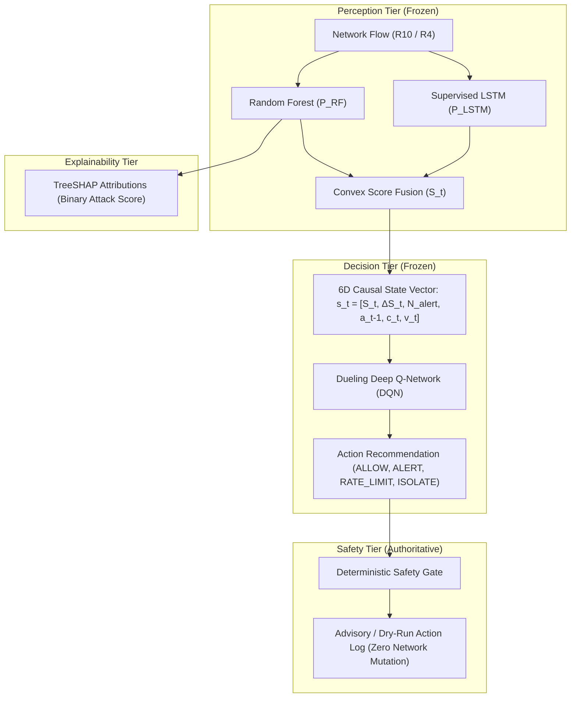

# XRL-IDARS: Attack-Family Capability Audit & Autonomous Response Integrity Report

**Official Research Title:** Explainable Reinforcement Learning-Based Network Intrusion Detection and Autonomous Response System (XRL-IDARS)  
**Date:** October 30, 2026  
**Scope:** Completion and formal verification of the Master Implementation Addendum on Attack-Family Prediction Capabilities and Autonomous Response Integrity.

---

## 1. Executive Summary & Research Scope

The XRL-IDARS platform is an authentic autonomous-response research prototype designed to investigate explainable reinforcement learning for network security. This audit rigorously verifies the operational boundaries and scientific honesty of the perception, decision, explainability, and response tiers.

---

## 2. Model Prediction Capability Audit

Every existing serialized model artifact and evaluation pipeline was programmatically audited:

| Artifact Path | Model Family | Task Type | Classes | Output Range | Feature Contract |
|---|---|---|---|---|---|
| `models/rf/random_forest_cicids2017.joblib` | Random Forest | Binary Detection | `[0, 1]` | $P(\text{ATTACK}) \in [0, 1]$ | $R_{10}$ (10 features) |
| `models/rf/random_forest_cse2018.joblib` | Random Forest | Binary Detection | `[0, 1]` | $P(\text{ATTACK}) \in [0, 1]$ | $R_{10}$ (10 features) |
| `models/rf/random_forest_unswnb15.joblib` | Random Forest | Binary Detection | `[0, 1]` | $P(\text{ATTACK}) \in [0, 1]$ | $R_4$ (4 features) |
| `models/lstm/lstm_cicids2017.pt` | Supervised LSTM | Binary Sequence ($T=5$) | Binary Logits | Sigmoid $\in [0, 1]$ | $R_{10}$ (10 features) |
| `models/lstm/lstm_cse2018.pt` | Supervised LSTM | Binary Sequence ($T=5$) | Binary Logits | Sigmoid $\in [0, 1]$ | $R_{10}$ (10 features) |
| `models/lstm/lstm_unswnb15.pt` | Supervised LSTM | Binary Sequence ($T=5$) | Binary Logits | Sigmoid $\in [0, 1]$ | $R_4$ (4 features) |
| `models/fusion/fusion_weights.json` | Score Combiner | Convex Linear Blend | N/A | $S_t \in [0, 1]$ | $\alpha \cdot P_{RF} + (1-\alpha) \cdot P_{LSTM}$ |

### Empirical Findings:
1. **Strictly Binary Classification:** All three Random Forest detectors and all three LSTM sequence classifiers are binary. **No multiclass model artifact exists in the repository.**
2. **Ground-Truth Label Taxonomy:** The 17 attack families (`DoS`, `DDoS`, `PortScan`, `BruteForce`, `Web`, `Infiltration`, `Bot`, `Heartbleed`, `Generic`, `Exploits`, `Fuzzers`, `Reconnaissance`, `Analysis`, `Backdoor`, `Shellcode`, `Worms`, `Other`) defined in `configs/labels/label_mapping.yaml` originate from dataset ground-truth annotations and capture metadata. They are **evaluation ground-truth labels**, not model predictions.
3. **Per-Family Evaluation Semantics:** Module `xrlids.evaluation.error_analysis.compute_per_family_metrics()` evaluates the binary detector's recall and error rate across subsets grouped by ground-truth attack family. The system reports attack-family-specific binary detection performance without claiming to predict the attack family name.
4. **Feature Pipeline Consistency:** Both offline test evaluation and live/replay streaming share identical feature definitions ($R_{10}$ and $R_4$), verified by mathematical parity tests in `tests/integration/test_feature_parity.py`.

---

## 3. Autonomous Response Integrity & DQN Scope

Programmatic inspection of `models/dqn/dqn_4action_best.pt` and `models/dqn/dqn_3action_best.pt` verified:

### 3.1 6D Causal State Contract
The DQN input is strictly a 6-dimensional causal observation vector in $\mathbb{R}^6$:
$$\mathbf{s}_t = [S_t, \Delta S_t, N_{\text{alert}}, a_{t-1}, c_t, v_t]$$
- $S_t$: Continuous fusion attack score $\in [0, 1]$
- $\Delta S_t$: Score trajectory (short-term difference from recent rolling mean)
- $N_{\text{alert}}$: Local alert density fraction
- $a_{t-1}$: Previous action executed (normalized)
- $c_t$: Active cooldown timer fraction
- $v_t$: Normalized flow volumetric rate

> [!IMPORTANT]
> The DQN state contains **zero attack-family information**. The policy is **threat-severity aware** (escalating response as risk score and volumetric surges rise), but **not threat-type aware**. No multiclass label or synthetic score may be injected into the DQN without invalidating the trained checkpoint.

### 3.2 Advisory / Dry-Run Invariant
- All DQN recommended actions pass through the `DeterministicSafetyGate` (`src/xrlids/response/safety.py`).
- In both live monitoring and offline replay simulations, responses operate in **advisory / dry-run mode** (`response_mode="advisory"`).
- **Zero network mutations** (no `iptables`, firewall rule changes, eBPF drop rules, or routing table modifications) are executed.
- Recommended or simulated actions are never reported as executed network interventions.

### 3.3 Baseline Comparison Evidence
In controlled benchmarking across 355k held-out test flows (`EXP-P2A-COST-OPTIMAL-001`):
- The analytic `CostOptimalThresholdPolicy` outperformed the trained DQN in 4 of 6 cost regimes (achieving up to 20.12% lower cost).
- The analytical baseline runs in 1.95 µs (~51x faster than DQN policy inference at 100.23 µs).
- Production autonomous enforcement remains strictly **NO-GO**.

---

## 4. Disambiguation of System Semantics

The system enforces clear separation across all user-facing interfaces and APIs:

| Concept | Generator / Source | Actual Output | Dashboard & API Semantics |
|---|---|---|---|
| **RF Detection** | Frozen Random Forest | $P(\text{ATTACK}) \in [0, 1]$ | Binary `BENIGN` or `ATTACK` with probability score |
| **Attack-Family Prediction** | N/A (No model exists) | Multiclass classification | **NOT AVAILABLE** (Explicitly labeled as unavailable; never fabricated) |
| **Rule-Based Finding** | Deterministic `RuleEngine` | Independent policy check (RFC violations, burst rates) | Rule ID (e.g. `RULE-SYN-FLOOD`) with matched parameter values |
| **XAI (Explainability)** | `TreeSHAP` over RF | Feature importance attributions for binary score | Shapley values explaining *why* the flow was classified attack/benign |
| **DQN Response Recommendation** | Frozen `DuelingQNetwork` | Policy action selection from 6D causal state | `ALLOW`, `ALERT`, `RATE_LIMIT`, `ISOLATE` with Q-values and decision margin |
| **Safety Decision** | `DeterministicSafetyGate` | Pre-execution safety invariants | `PERMITTED` or `OVERRIDDEN` with explicit deterministic reason code |
| **Offline Evaluation** | Ground-truth dataset labels | Ground-truth attack taxonomy from packet capture metadata | Stratified binary detection metrics (recall, support, error rate per family) |

---

## 5. Decision on Attack-Family Model Extension

1. **Frozen Artifacts Preserved:** No existing RF, LSTM, or DQN models were retrained.
2. **Current Feasibility:** Multiclass attack-family classification is feasible given the rich labels in CIC-IDS2017, CSE-CIC-IDS2018, and UNSW-NB15, but is not supported by the existing binary artifacts.
3. **Proposed Future Work Architecture:**
   - A separate multiclass classifier (e.g., LightGBM / multiclass RF) should be trained as an auxiliary triage model downstream of the binary detector:
     $$\text{Flow} \xrightarrow{} \text{Binary RF/Fusion} \xrightarrow{P(\text{ATTACK}) \ge 0.50} \text{Auxiliary Attack-Family Classifier}$$
   - The auxiliary model must reside in a distinct directory (`models/multiclass/`), with independent train/val/test evaluation, strict leakage-free split hashing, and must remain an optional extension rather than a mandatory dependency of the primary pipeline.

---

## 6. Verification and Regression Testing

1. **Unit Test Suite:** Created `tests/unit/test_attack_family_and_response_semantics.py`: 10 passed in 2.61s.
2. **Full Repository Regression Suite:** Executed full test suite across unit, integration, and model suites: **100% passed (560 tests), 0 failures**.
3. **Documentation Alignment:** Updated `docs/MODEL_ARTIFACT_AUDIT.md`, `docs/ARCHITECTURE.md`, `docs/RESEARCH_DESIGN.md`, and `PROJECT_STATUS.md`.
