# XRL-IDARS — Start Here: Exhibition & Viva Presentation Guide

> **Start Here — Exhibition & Viva Guide**  
> *Target System: XRL-IDARS (Explainable Reinforcement Learning Intrusion Detection & Autonomous Response System)*  
> *Audience: Academic Examiners, Evaluators, Project Demonstrators, and Exhibition Attendees*  
> *Repository: `rishikeshgowdakk/fyp-xrlids`*  
> *Core Invariant: Zero Production Network Mutation & Strict Separation Between Closed Benchmarks and Live Traffic*

---

## 1. Prerequisites & Environment Setup

XRL-IDARS is engineered with a **zero-dependency, zero-build frontend** that runs entirely using Python's standard library `ThreadingHTTPServer` (`dashboard/server.py`). There is **no Node.js, npm, or webpack build pipeline**.

### System Requirements
| Component | Minimum Specification | Recommended / Tested |
|:---|:---|:---|
| **Operating System** | Linux (Ubuntu 20.04+, Debian 11+), macOS (12+), or WSL2 on Windows | Ubuntu Linux (kernel 6.x / 7.x, x86_64) |
| **Python Version** | Python 3.10 to 3.14 | Python 3.14 (CPython) |
| **Hardware** | 2 CPU Cores, 4 GB RAM (CPU inference only; no GPU required) | 4+ CPU Cores, 8 GB RAM |
| **Network Privileges** | **Standard user account (non-root)** for all presentation modes | Non-root (root / `CAP_NET_RAW` is only needed if sniffing a physical Wi-Fi NIC) |
| **Web Browser** | Any modern web browser | Chrome, Chromium, Firefox, or Safari |

### Quick Setup (from a Fresh Clone)
```bash
# 1. Clone repository (or navigate to cloned workspace)
cd fyp-xrlids

# 2. Activate existing virtual environment (or create one)
source .venv/bin/activate
# If initializing fresh: python3 -m venv .venv && source .venv/bin/activate && pip install -r requirements.txt

# 3. Verify test suite and exhibition package
python scripts/verify_fresh_clone_exhibition.py
```

---

## 2. Launch Commands & Dashboard Access

Launch the interactive dashboards with standard Python commands:

```bash
# 1. Primary Operational Command Center (Streamlit on port 8501 across 8 modules)
streamlit run dashboard/streamlit_app.py --server.port 8501

# 2. Supplementary Research Workbench & Demo Server (port 8000)
python scripts/demo/run_dashboard.py
```
*(Alternative direct launch for demo server: `python dashboard/server.py --port 8000`)*

### Access URLs
Open your web browser and navigate to:
- **🛡️ Primary Operational Command Center (Streamlit, 8 Modules)**:
  ```
  http://localhost:8501
  ```
- **⚡ 3-Minute Viva Demonstration (Supplementary Demo Screen)**:
  ```
  http://localhost:8000/demo.html
  ```
- **🔬 Full Research Evaluation Workbench (Supplementary In-Depth Backup)**:
  ```
  http://localhost:8000/index.html
  ```

> [!NOTE]
> The server binds strictly to `127.0.0.1` (loopback). It does not open external public ports or broadcast across local networks.

---

## 3. Recommended 3-Minute Viva Defense Strategy (`/demo.html`)

For an academic viva defense, thesis evaluation, or quick demonstration, **do not attempt to navigate all 8 detailed research tabs in real time**. Use the focused 4-zone presentation page:

> [!TIP]
> **The 30-Second Examiner Elevator Pitch**:  
> *"XRL-IDARS watches network flows and executes a 4-tier pipeline: it detects intrusions with a certified tabular Random Forest (< 0.8 ms), explains each decision using exact TreeSHAP game-theoretic Shapley values, and an autonomous reinforcement-learning agent recommends mitigation under a deterministic safety gate. Replay and live Scapy sniffing run through the exact operational pipeline. Offline LSTM and fusion models serve as comparative research benchmarks, where we show sequence modeling provides only marginal gain (+0.19% F1) at the cost of cold-start blindness."*

### 3-Minute Viva Demo Walkthrough:
1. **Open `http://localhost:8000/demo.html`** and deliver the 30-second elevator pitch above.
2. **Click `▶ Run 2-Min Scenario`**:
   - Point out **Zone 1 (Pipeline Strip)**: Real-time visual flow from packet capture $\to$ flow assembly $\to$ detector $\to$ TreeSHAP $\to$ action gate.
   - Point out **Zone 2 (The 4 Numbers Only)**: Replay sample metrics for `Flows Analysed`, `Attacks Caught`, `Attacks Missed`, and `False Alarms`.
   - In **Zone 3 (Timeline & "Why?" Card)**: Click an attack flow to show its confidence score, policy action (`ALLOW`, `ALERT`, `BLOCK`), and **top 3 plain-English TreeSHAP reasons** (e.g., "Very high packet rate", "Irregular packet length variance", "Abnormal TCP flags").
   - In **Zone 4 (Held-Out Benchmark Strip)**: Point out that official test set metrics (355k flows) achieve **0.9745 F1** (99.06% accuracy) with **~51.4x faster** Cost-Optimal policy execution (1.95 µs vs 100.23 µs DQN).
3. **Closing Scorecard**:
   - The scenario finishes with a scorecard modal ("Replayed N flows, caught X of Y attacks with 0 false alarms").
4. **Transition to Research Tabs Only If Asked**:
   - If the examiners probe deeper on model calibration, the $\alpha=0.00$ degenerate fusion weight, sequence ablations ($\Delta\text{F1} = -0.0038$), or DQN policy latency, click **`🔬 Open Full Research Workbench →`** to show the full 5 research sections in `/index.html`.

---

## 4. Comprehensive 5-to-7-Minute Research Deep-Dive Sequence (Full Workbench)

When examiners request a detailed technical walkthrough of the research findings, use this sequence on **`http://localhost:8000/index.html`**:

```mermaid
flowchart LR
    M1["1. Overview\n(0:00 - 0:45)\nSystem Integrity & Matrix"] --> M2["2. Dataset Explorer\n(0:45 - 2:00)\n3 Benchmarks, CSV & Mode B"]
    M2 --> M3["3. Model Comparison\n(2:00 - 3:00)\nDegenerate Fusion & Ablation"]
    M3 --> M4["4. Benchmarks & Scopes\n(3:00 - 4:00)\nScope Reconciliation & Speedup"]
    M4 --> M5["5. Explainability & Attacks\n(4:00 - 4:50)\nTreeSHAP & Critical Blind Spots"]
    M5 --> M6["6. Autonomous Response\n(4:50 - 5:40)\nCost-Optimal vs DQN & Gate"]
    M6 --> M7["7. Live Exhibition Demo\n(5:40 - 6:30)\nPCAP Replay & Attack Simulation"]
    M7 --> M8["8. Limitations & Wrap-Up\n(6:30 - 7:00)\nTemporal Drift & NO-GO Policy"]
```



---

### Step 1: System Overview & Component Integrity (Minute 0:00 – 0:45)
- **UI Location**: Mode: **`🔬 Research & Model Validation`** → Click **`📋 Overview`** tab.
- **Examiner Talking Points**:
  - *"Examiners, XRL-IDARS addresses two core questions in intrusion detection: first, whether deep sequence models and multi-model fusion actually provide measurable value over tuned decision-tree ensembles under real capture constraints; second, whether reinforcement learning provides an operational advantage over cost-sensitive decision rules for autonomous response."*
  - *"We do not assume models are perfect or that high benchmark metrics equate to production readiness. We audit every claim against held-out ground truth."*
- **What to Point Out on Screen**:
  - Point to the **Git Commit Hash** and environment fingerprint (Python 3.14, PyTorch 2.14, Scikit-Learn 1.9.1, SHAP 0.52).
  - Highlight the **Verified Test Suite**: `605 passed, 0 failed (100% pass rate)`.
  - Point to the **Component Verification Matrix**: all 20 benchmark CSVs verified, Policy A feature deduplication enforced (0 cross-split duplicates).

---

### Step 2: Dataset Explorer, Benchmark Evaluation & Mode B Demo (Minute 0:45 – 2:00)
- **UI Location**: Click **`📊 1. Dataset Explorer`** (Default Active View).
- **Examiner Talking Points**:
  - *"Here we explore three major datasets (19.3M raw rows): CIC-IDS2017, CSE-CIC-IDS2018, and UNSW-NB15 under strict feature contracts (R10 and R4)."*
  - *"On our flagship benchmark, CIC-IDS2017 (355,833 aligned test flows), Random Forest achieves F1 = 0.9512 with 98.15% accuracy. Supervised LSTM with length-5 causal sequences achieves F1 = 0.9633. Blending both via score fusion reaches F1 = 0.9745."*
  - *"Notice the population derivation note: the 32-flow difference between tabular (355,865) and sequence (355,833) is mathematically proven by file-boundary isolation: for sequence length $T=5$, the first 4 context flows across each of the 8 capture files cannot form a sequence without crossing disjoint capture boundaries ($8 \times 4 = 32$ dropped benign flows)."*
- **Action**:
  - Switch between the **CIC-IDS2017**, **CSE-CIC-IDS2018**, and **UNSW-NB15** cards to show consistent dataset schemas and class breakdowns.
  - Scroll down to the **Multi-Model Inference Engine** card and click **`Run Mode B (200 Exhibition Demo)`**.
- **What to Point Out on Screen**:
  - Watch the live execution of 200 real network flows (166 benign, 34 attacks) across Random Forest, Supervised LSTM, and Score Fusion.
  - Point to the side-by-side metric cards and 3 confusion matrices.
  - Click **`🔍 Inspect`** on any flagged attack flow to view its feature values and threat score.
  - Highlight the **Custom CSV Upload & Evaluation** panel: examiners can upload or paste external network flow records to evaluate them against frozen model artifacts without target data leakage.

---

### Step 3: Head-to-Head Comparison & Negative Results Disclosure (Minute 2:00 – 3:00)
- **UI Location**: Click **`⚖️ 2. Model Comparison`** tab.
- **Examiner Talking Points**:
  - *"Good science requires disclosing where models fail. On CIC-IDS2017, validation grid search gave fusion weight $\alpha = 0.50$. But now look at CSE-CIC-IDS2018:"*
  - Switch benchmark dropdown to **CSE-CIC-IDS2018**.
  - *"Validation grid search yielded $\alpha = 0.00$. The interface flags this with an amber warning: $\alpha = 0.00$ makes the fusion model mathematically identical to the standalone LSTM. We do not claim an ensemble improvement where none exists."*
  - *"Next, look at our Shuffled-Window Ablation box: when we randomly permute flow arrival order within each length-5 sequence, the order gain is $\Delta \text{F1} = -0.0038$. This proves empirically that the LSTM acts as a spatial burst-smoothing filter rather than learning temporal sequence causality."*
- **What to Point Out on Screen**:
  - The amber **Degenerate Fusion Warning ($\alpha = 0.00$)**.
  - The **Shuffled-Window Ablation Box** showing $\Delta \text{F1} = -0.0038$.
  - The paired bootstrap confidence intervals (B=1000) across all 6 models.

---

### Step 4: Performance Benchmarks & Measurement Scope Reconciliation (Minute 3:00 – 4:00)
- **UI Location**: Click **`⏱️ 3. Performance Benchmarks`** tab.
- **Examiner Talking Points**:
  - *"A critical issue in published IDS benchmarks is conflating different measurement scopes. In this section, every figure is dynamically loaded from 10 canonical result artifacts on disk."*
  - *"Notice our Empirical Measurement Scope Reconciliation banner:"*
    - *"Latency Scope 1 (Microbenchmark)*: Pure 100-tree RF traversal on an isolated pre-extracted feature vector is **~3.53 ms** on CPU (53.87 µs/flow in vectorized batches of 100). The analytic Cost-Optimal policy evaluates in **1.95 µs**, which is **~51.4x faster** than neural DQN forward passes (100.23 µs).*
    - *"Latency Scope 2 (Streaming Burst Pipeline Queue)*: Under a 1,000-packet line-rate burst (`EXP-P3-BURST-1000-001`), end-to-end packet capture (0.50 µs), flow assembly (12.89 µs), feature extraction (763.72 µs), dual-model sequence queuing with thread contention (**~35.42 ms P50**), and safety verification result in a median end-to-end flow completion latency of **37.51 ms P50**.*
    - *"Memory Scopes*: Quiescent model weight RAM is **123.2 MB** (RF 117.4M, LSTM 1.2M, DQN 0.4M, hash table 4.2M). Under intense socket stress (`EXP-P3K-STRESS-SECURITY-001`), transient flood buffers cause peak RSS to reach **1,049.45 MiB (~1.05 GiB)**, safely dropping back to **175.74 MiB** post-soak with only **12.05 MiB (7.36%)** net permanent growth over 10,000 soak flows.*
- **What to Point Out on Screen**:
  - The **Scope Reconciliation Cards** (Microbenchmark vs Burst Stream Queue; Quiescent RAM vs Peak Flood Stress RSS).
  - The **Canonical Experiment Artifacts Registry Table** showing all 10 verified JSON files dynamically loaded from disk.

---

### Step 5: Explainable AI & Critical Attack Blind Spots (Minute 4:00 – 4:50)
- **UI Location**: Click **`💡 4. Explainability & Attacks`** tab.
- **Examiner Talking Points**:
  - *"For explainability, we compute TreeSHAP feature attributions on our Random Forest detector."*
  - *"Features like `packet_length_std`, `packet_length_mean`, and `flow_packets_per_s` dominate the decision attributions across volumetric attacks."*
  - *"However, look at our Critical Attack Blind Spots panel: low-footprint application attacks suffer catastrophic detection failure (Infiltration recall 0.00%, SQL Injection recall 0.00%, XSS recall 2.78%). Attack payloads reside inside HTTP URIs or single packets, leaving statistical flow features completely indistinguishable from normal web surfing."*
  - *"Notice our scientific notice: TreeSHAP explains tree decisions for Random Forest ONLY; it does not explain the LSTM, the Fusion model, or the DQN."*
- **What to Point Out on Screen**:
  - The horizontal bar chart of mean absolute SHAP values.
  - The **Critical Blind Spots Cards** detailing zero-day and application-layer detection gaps.

---

### Step 6: Autonomous Response — DQN vs Analytic Cost-Optimal Baseline (Minute 4:50 – 5:40)
- **UI Location**: Click **`🛡️ 5. Autonomous Response`** tab.
- **Examiner Talking Points**:
  - *"In Phase 2, we investigated whether Deep Q-Networks justify their complexity for autonomous response. We benchmarked our trained Dueling DQN against a zero-parameter `CostOptimalThresholdPolicy` across six operational cost regimes on held-out 355k test flows."*
  - Select **High Availability (4-Action)** from the regime dropdown.
  - *"Look at the result: in High Availability 4-action, the analytic baseline achieves a **20.12% lower cost than the trained DQN** ($1,547,511$ vs $1,937,476$) while executing in **1.95 µs**—a **~51x latency advantage** over neural inference (1.95 µs vs 100.23 µs)."*
  - *"Furthermore, analyzing the environment proves traffic arrivals are purely exogenous replay. Response actions do not alter future packet arrivals. Therefore, non-zero discount factors ($\gamma = 0.95$) lack physical justification."*
  - *"Our Deterministic Safety Gate remains 100% authoritative over all actions, and autonomous production enforcement is strictly **NO-GO**."*
- **What to Point Out on Screen**:
  - The cost comparison table showing Cost-Optimal winning by 20.12%.
  - The latency comparison badge: 1.95 µs vs 100.23 µs.
  - The Safety Gate status: deterministic cooldowns, blast radius caps, atomic rollbacks (`EXP-P3G-ROLLBACK-001`), and production NO-GO policy.

---

### Step 7: Live Observational Traffic Replay & Attack Simulation (Minute 5:40 – 6:30)
- **UI Location**: Switch top-level mode button to **`⚡ Live Exhibition Demo`**.
- **Examiner Talking Points**:
  - *"To demonstrate real-time packet processing without endangering networks, we provide pure-Python streaming replay and in-memory attack simulation."*
  - Point to the **⚠️ Scientific Disclaimer & Strict Operational Mode Separation** banner:
    > *"Live operational network traffic lacks ground-truth labels. Benchmark accuracy on closed datasets does NOT prove or guarantee detection accuracy on live operational traffic."*
  - *"Our live pipeline is strictly observational: no packets are dropped, no iptables rules are injected, and no host routes are modified."*
- **Action**:
  - Under **Mode 1 (Synthetic PCAP Replay)**: click **`Play Demo Stream`** (`data/demo/sample_traffic.pcap`, 42 packets).
  - OR under **Mode 2 (Attack Simulation)**: click **`Inject Syn Flood Attack`**.
- **What to Point Out on Screen**:
  - Watch the real-time threat gauge swing from green (0.02) to red (0.95+).
  - See the flow table populate with extracted R10 features.
  - Point out the **Detected Attack Sources** aggregation table and **WiFi Devices** passive discovery panel.
  - Observe the **Policy Suggestion** (`MONITOR`, `THROTTLE`, `BLOCK`) derived from fixed score thresholds, demonstrating advisory decision support.

---

### Step 8: Audited Research Limitations & Viva Wrap-Up (Minute 6:30 – 7:00)
- **UI Location**: Switch back to **`🔬 Research & Model Validation`** → Click **`⚠️ Research Limitations`** tab.
- **Examiner Talking Points**:
  - *"Finally, our Limitations tab documents all nine audited research limitations in plain language."*
  - *"For example, on CSE-CIC-IDS2018, when tested on genuine chronological future days, Random Forest F1 collapses from **0.8861 down to 0.0113** because attack patterns change."*
  - *"Similarly, transferring between CIC and CSE causes a 52% to 95% F1 collapse due to covariate shift."*
  - *"We conclude that transparent disclosure of failure modes, rigorous negative findings, and deterministic safety bounds are essential to transforming IDS from academic benchmark exercises into credible computer science research."*

---

## 4. Expected Outputs Reference Card

Use this quick-reference table to confirm that the dashboard is displaying the exact audited values during your presentation:

| Screen / Section | Metric / Element | Expected Audited Value | Note |
|:---|:---|:---|:---|
| **📋 Overview** | Test Suite Pass Rate | `493 passed, 0 failed (100%)` | Authoritative pytest suite |
| **📊 1. Dataset Explorer** | CIC-IDS2017 RF F1 | `0.9512` (98.15% accuracy) | Tabular test split (355,865 flows) |
| **📊 1. Dataset Explorer** | CIC-IDS2017 LSTM F1 | `0.9633` (98.67% accuracy) | Sequence test split (355,833 flows) |
| **📊 1. Dataset Explorer** | CIC-IDS2017 Fusion F1 | `0.9745` (99.06% accuracy) | Convex blend $\alpha = 0.50$ |
| **📊 1. Dataset Explorer** | Mode B 200 Exhibition Sample | 166 Benign, 34 Attack flows | Real held-out flows, RFC 5737 IPs |
| **⚖️ 2. Model Comparison** | CSE-2018 Fusion Weight | `α = 0.00` (Amber Alert) | Degenerate fusion; identical to LSTM |
| **⚖️ 2. Model Comparison** | Shuffled-Window Ablation | $\Delta \text{F1} = -0.0038$ | Proves spatial burst smoothing |
| **⏱️ 3. Performance Benchmarks** | Policy Latency Advantage | **~51.4x faster** (1.95 µs vs 100.23 µs) | Cost-Optimal vs Dueling DQN |
| **⏱️ 3. Performance Benchmarks** | Latency Reconciliation | Micro: ~3.53 ms / Burst: ~35.42 ms P50 | Isolated tree traversal vs burst queue |
| **⏱️ 3. Performance Benchmarks** | Memory Reconciliation | Quiescent: 123.2 MB / Peak Stress: 1,049 MiB | Cold weights vs flood stress peak RSS |
| **⏱️ 3. Performance Benchmarks** | Canonical Artifacts Loaded | `10 / 10 Canonical Artifacts` | Dynamically verified from disk |
| **💡 4. Explainability & Attacks** | Top Feature Drivers | `packet_length_std`, `flow_packets_per_s` | TreeSHAP on Random Forest only |
| **💡 4. Explainability & Attacks** | Critical Blind Spots | Infiltration (0%), SQLi (0%), XSS (2.78%) | Statistical flow invariance failure |
| **🛡️ 5. Autonomous Response** | High Availability Cost | Cost-Optimal beats DQN by **20.12%** | $1,547,511.0$ vs $1,937,476.5$ |
| **⚡ Live Exhibition Demo** | Network Enforcement | `DISABLED (Observational Only)` | Strictly read-only; zero iptables mutations |
| **⚠️ Research Limitations** | Future-Day Holdout F1 | Collapses from `0.8861` to `0.0113` | Chronological concept drift |


---

## 5. Troubleshooting & Contingency Runbook

| Problem | Root Cause | Immediate Fix |
|:---|:---|:---|
| **Port 8000 already in use** (`OSError: [Errno 98] Address already in use`) | Another server instance or background task is running on port 8000 | Kill existing process or specify an alternate port:<br>`fuser -k 8000/tcp`<br>Or run: `python scripts/demo/run_dashboard.py 8080` (open `http://localhost:8080`) |
| **Browser displays stale styling or cached JavaScript** | Web browser cached previous version of `app.js` or `index.html` | Perform a hard reload in your browser:<br>**Linux/Windows**: `Ctrl + Shift + R`<br>**macOS**: `Cmd + Shift + R` |
| **Live sniffing option disabled in UI** | Standard user accounts cannot open raw sockets (`AF_PACKET`) without root privileges | **Expected behavior for exhibition**: Use **Mode 1 (PCAP Replay)** or **Mode 2 (Attack Simulation)**. If live Wi-Fi sniffing is explicitly required: `sudo .venv/bin/python dashboard/server.py --port 8000` |
| **Missing sample PCAP file error** | Git clone excluded `.pcap` files via stale `.gitignore` | `data/demo/sample_traffic.pcap` is tracked in git. Verify with `ls -lh data/demo/sample_traffic.pcap` (should be 63,924 bytes, 42 packets). |
| **ModuleNotFoundError on imports** | Shell is executing standard system Python instead of repository `.venv` | Ensure virtual environment is active:<br>`source .venv/bin/activate`<br>Or invoke directly: `.venv/bin/python scripts/demo/run_dashboard.py` |
| **Need to quickly prove model hashes match registry** | Examiner asks for cryptographic proof of checkpoint authenticity | Run: `.venv/bin/python scripts/verify_fresh_clone_exhibition.py` (checks all 9 canonical SHA-256 hashes in ~3 seconds) |
