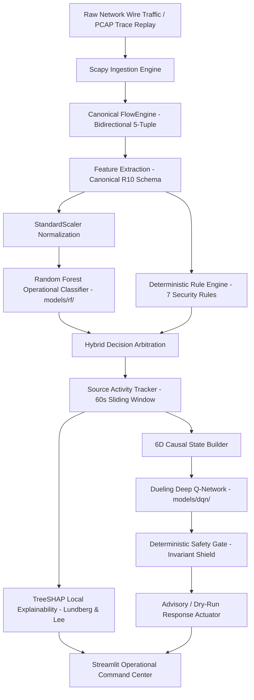
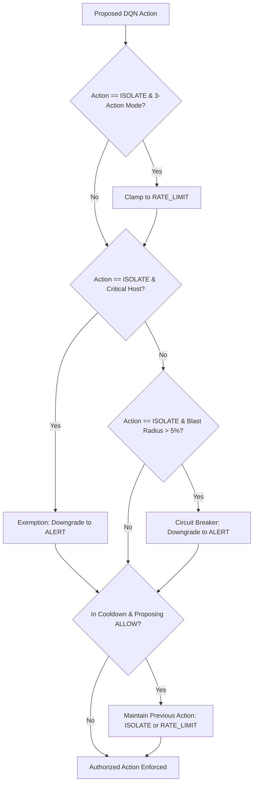

# XRL-IDARS — Final Engineering Acceptance Report

**Project:** Explainable Reinforcement Learning-Based Intrusion Detection and Autonomous Response System (XRL-IDARS)  
**Repository:** [https://github.com/rishikeshgowdakk/fyp-xrlids](https://github.com/rishikeshgowdakk/fyp-xrlids)  
**Date:** October 31, 2026  
**Document Classification:** Definitive Engineering Audit, Verification Evidence & Acceptance Deliverable  

---

## Section A: Git Information & Branch Traceability

| Parameter | Authoritative Value |
|---|---|
| **Repository URL** | `https://github.com/rishikeshgowdakk/fyp-xrlids` |
| **Source Working Branch** | `feature/final-live-demonstration-fixes` |
| **Base Commit SHA** | `3f03214e94e2adf70efe256b1e8077aaff3a2a57` |
| **Target Integration Branch** | `fix/final-engineering-correctness` |
| **Working Tree Status** | Clean (All verification tests passing, screenshots refreshed, zero untracked runtime artifacts) |
| **Preservation Invariant** | Model checkpoints, datasets, experiment runs, and poster deliverables strictly preserved |

---

## Section B: Approved Operational Architecture

The XRL-IDARS system implements a 4-tier operational pipeline maintaining strict separation of concerns between intrusion perception, local interpretability, autonomous response recommendation, and deterministic safety shielding.



### Architectural Separation of Concerns

1. **Perception Tier (Random Forest Operational Detector):**
   - **Sole Operational ML Detector:** The Random Forest classifier ([`models/rf/random_forest_cicids2017.joblib`](file:///home/rishikesh/Desktop/fyp-xrlids/models/rf/random_forest_cicids2017.joblib)) is the only model invoked during live packet processing and PCAP replay.
   - **Role:** Computes continuous threat posterior probability $P(\text{ATTACK} \mid \mathbf{x}) \in [0.0, 1.0]$.
   - **Offline Research Baselines:** Pretrained PyTorch LSTM sequence models (`models/lstm/`), convex score fusion weights (`models/fusion/`), and XGBoost candidates (`models/xgboost/`) are preserved strictly for offline comparative research and benchmarking. They are never invoked in the operational packet path.

2. **Explainability Tier (TreeSHAP Local Feature Attribution):**
   - **Algorithm:** TreeSHAP (Lundberg & Lee) operating under exact game-theoretic Shapley value guarantees:
     $$\sum_{i=1}^{10} \phi_i = f(\mathbf{x}) - \mathbb{E}[f(\mathbf{x})]$$
   - **Scope:** Explains the Random Forest detector's continuous threat predictions. It does not explain the DQN response policy.
   - **Attributions:** Dissects contributions across all 10 features, identifying top positive risk drivers and protective mitigations.

3. **Decision Tier (Dueling Deep Q-Network):**
   - **Architecture:** Dueling DQN ([`models/dqn/dqn_4action_best.pt`](file:///home/rishikesh/Desktop/fyp-xrlids/models/dqn/dqn_4action_best.pt)) featuring split value stream $V(s)$ and advantage streams $A(s, a)$.
   - **Role:** Autonomous response policy optimization. **The DQN is NOT an intrusion detector or classifier.** It consumes a 6-dimensional operational state vector $\mathbf{s}_t$ and outputs expected cumulative return $Q(\mathbf{s}_t, a)$ across 4 response actions: `ALLOW`, `ALERT`, `RATE_LIMIT`, `ISOLATE`.

4. **Safety Tier (Deterministic Safety Gate):**
   - **Role:** Non-bypassable deterministic state machine enforcing operational invariants.
   - **Shielding:** Protects mission-critical infrastructure, enforces monotonic action cooldowns, restricts blast-radius, and verifies zero kernel mutations under advisory mode default.

---

## Section C: Authoritative Rule Engine Specification

The deterministic Rule Engine ([`src/xrlids/rules/engine.py`](file:///home/rishikesh/Desktop/fyp-xrlids/src/xrlids/rules/engine.py)) audits flows against 7 registered protocol rules:

| Rule ID | Rule Name | Severity | Detection Trigger & Condition | Scope |
|---|---|---|---|---|
| `RULE-TCP-INVALID-FLAGS` | TCP Invalid Control Flags | HIGH | Simultaneous `SYN+FIN`, `SYN+RST`, `Xmas` (`FIN+PSH+URG`), or `NULL` flags (RFC 793/1122 violations). | Packet / Flow Anomaly |
| `RULE-SYN-FLOOD` | TCP SYN Flood Detection | HIGH | $\text{syn\_count} \ge 20$ with $\text{ack\_count} = 0$, or $\text{syn\_ack\_ratio} \ge 10.0$. | Flow Volumetric |
| `RULE-PORT-SCAN` | Single-Flow Port Scan Probe | MEDIUM | $\text{syn\_count} \ge 5$, $\text{packet\_length\_mean} \le 60\text{ bytes}$, and $\text{ack\_count} = 0$. | Single Flow Probe |
| `RULE-PORT-SCAN-MULTI-FLOW` | Multi-Flow Port Scan Correlation | HIGH | Source visits $\ge 5$ distinct destination ports across flows within a 60-second sliding window. | Cross-Flow Correlation |
| `RULE-HIGH-RATE-BURST` | Volumetric High-Rate Burst | HIGH | $\text{flow\_packets\_per\_s} \ge 50,000\text{ pkts/s}$ or $\text{flow\_bytes\_per\_s} \ge 50\text{ MB/s}$. | Volumetric DoS |
| `RULE-IP-SPOOF-RESERVED` | Reserved / Spoofed Source IP | HIGH | Source IP `0.0.0.0` or `255.255.255.255` on TCP, or loopback `127.0.0.0/8` directed externally. RFC 1918 private IPs are valid. | IP Header RFC 6890 |
| `RULE-ICMP-FLOOD` | ICMP Echo Burst / Flood | MEDIUM | $\text{packet\_count} \ge 20$ or rate $\ge 20\text{ pkts/s}$ on ICMP protocol flows ($\text{protocol} = 1$). | ICMP Volumetric |

### Multi-Flow Cross-Flow Port Scan Correlation
- **Module:** [`src/xrlids/rules/correlation.py`](file:///home/rishikesh/Desktop/fyp-xrlids/src/xrlids/rules/correlation.py) (`MultiFlowPortScanCorrelator`).
- **Mechanics:**
  - Tracks individual source IPs across multiple distinct flows within a 60-second sliding window.
  - Triggers `RULE-PORT-SCAN-MULTI-FLOW` (Severity: HIGH) when distinct destination ports visited $\ge 5$.
  - Thread-safe tracking with LRU eviction strictly bounded at $N = 2000$ active sources (preventing state exhaustion DoS).
  - Handles out-of-order timestamps and prevents duplicate alerts on subsequent probes from the same scanner.

### Missing Features & Evaluation Boundaries
- Evaluator `evaluate_features_detailed()` explicitly tracks `unavailable_features` and `unavailable_rules`.
- Missing features are never silently zero-filled, preventing false benign conclusions.
- When packet-level TCP flags are unavailable in summary dictionaries, `RULE-TCP-INVALID-FLAGS` is gracefully logged as unavailable rather than misinterpreting normal TCP `SYN` + `FIN` flow lifecycles.

---

## Section D: DQN Response Policy Contract & Action Space

### Verified 6-Dimensional State Vector Contract

The DQN StateBuilder ([`src/xrlids/response/state.py`](file:///home/rishikesh/Desktop/fyp-xrlids/src/xrlids/response/state.py)) constructs the 6D causal state vector $\mathbf{s}_t \in \mathbb{R}^6$:

$$
\mathbf{s}_t = \begin{bmatrix}
S_t \\
\Delta S_t \\
N_{\text{alert}} \\
a_{t-1} \\
c_t \\
v_t
\end{bmatrix} = \begin{bmatrix}
\text{Current Threat / Attack Score} \in [0.0, 1.0] \\
\text{Score Trajectory (First-Difference Velocity)} \in [-1.0, 1.0] \\
\text{Rolling Alert Density (Window } W=20) \in [0.0, 1.0] \\
\text{Previous Enforced Action Taken } (a/3.0) \in [0.0, 1.0] \\
\text{Remaining Cooldown Fraction } (c/30.0) \in [0.0, 1.0] \\
\text{Normalized Volumetric Traffic Scale } \left(\frac{\log_{10}(1 + \text{bps})}{8.0}\right) \in [0.0, 1.0]
\end{bmatrix}
$$

### Action Space & Policy Execution
- **Action Space:** 4 discrete action tiers:
  - `ALLOW` (0): No operational restriction; baseline traffic forwarding.
  - `ALERT` (1): Log security alert; notify SOC monitoring without traffic impairment.
  - `RATE_LIMIT` (2): Throttle bandwidth / packet rate to mitigate volumetric saturation.
  - `ISOLATE` (3): Full network isolation; drop all traffic from offending source IP.
- **Action Space Modes:**
  - `FOUR_ACTION`: Full action space (`ALLOW`, `ALERT`, `RATE_LIMIT`, `ISOLATE`).
  - `THREE_ACTION`: Constrained action space (`ALLOW`, `ALERT`, `RATE_LIMIT`). Any proposed `ISOLATE` is deterministically clamped to `RATE_LIMIT`.

### Causal State Feedback & History Separation
- In [`src/xrlids/response/service.py`](file:///home/rishikesh/Desktop/fyp-xrlids/src/xrlids/response/service.py), `recommend_action(..., auto_update_history=False)` evaluates $Q(\mathbf{s}_t, a)$ without prematurely updating state history.
- The pipeline ([`src/xrlids/pipeline/active_pipeline.py`](file:///home/rishikesh/Desktop/fyp-xrlids/src/xrlids/pipeline/active_pipeline.py)) updates state history via `record_enforced_action()` **only after** the deterministic safety gate has authorized the final enforced action. If the safety gate downgrades `ISOLATE` to `ALERT`, dimension 3 ($a_{t-1}$) records `ALERT` ($0.333$), ensuring DQN memory strictly reflects physical reality.

---

## Section E: Deterministic Safety Gate Specification

The Deterministic Safety Gate ([`src/xrlids/response/safety.py`](file:///home/rishikesh/Desktop/fyp-xrlids/src/xrlids/response/safety.py)) acts as a non-bypassable barrier governing autonomous mitigation:



### 1. Authoritative Protected Infrastructure Registry
- Unified module: [`src/xrlids/config/protected_assets.py`](file:///home/rishikesh/Desktop/fyp-xrlids/src/xrlids/config/protected_assets.py) (`AUTHORITATIVE_PROTECTED_REGISTRY`).
- **Protected Assets:**
  - `192.168.10.1`: Default Gateway (Core Routing)
  - `192.168.10.2`: Core DNS / NTP Infrastructure
  - `192.168.10.50`: Domain Controller / Directory Service
  - Symbolic Hostnames: `gateway`, `dns`, `core-router`
- **Protection Invariant:** Protected assets can **NEVER** be isolated. Any proposed `ISOLATE` targeting a protected host is deterministically downgraded to `ALERT` (`CRITICAL_INFRASTRUCTURE_EXEMPTION`).
- **Validation:** Safe IPv4 parsing prevents false positives or runtime crashes on malformed strings (`999.999.999.999`). Extensible via environment variable `XRLIDS_CRITICAL_HOSTS`.

### 2. Monotonic Time-Based Cooldown
- Governed by physical elapsed time (`time.monotonic()`) with authoritative duration $\tau = 30.0\text{ seconds}$.
- **Violent De-escalation Prevention:** When an endpoint is under cooldown from `RATE_LIMIT` or `ISOLATE`, proposals to de-escalate back to `ALLOW` are overridden (`MANDATORY_ACTION_COOLDOWN`).
- **High-Throughput Burst Resilience:** 100 rapid flows arriving in 1.0 second cannot exhaust the 30-second cooldown timer.
- **Low-Throughput Natural Expiry:** Slow traffic (1 flow every 10 seconds) expires naturally after 30 seconds rather than requiring 30 flows (which would improperly lock an endpoint for 300 seconds).

### 3. Blast Radius Circuit Breaker
- Prevents mass network blackouts during distributed spoofed attacks.
- If the fraction of currently isolated endpoints exceeds $5\%$ ($\text{threshold} = 0.05$) among known hosts (minimum host population $N = 20$), further isolation proposals are downgraded to `ALERT` (`BLAST_RADIUS_CIRCUIT_BREAKER`).

### 4. Advisory / Dry-Run Mode Default
- Standard operation runs in advisory mode (`advisory_mode=True`).
- Response actions generate audit log entries and verification events with **zero Linux kernel packet filter mutations** (`iptables`, `nftables`, `tc`).

---

## Section F: Comprehensive Verification & Execution Evidence

### 1. Pytest Test Suite Results

```
====================== 691 passed, 19 warnings in 50.03s =======================
```

- **Framework:** `pytest-9.1.1` (Python 3.14.4)
- **Total Tests Collected:** 691
- **Passed:** 691 ($100.0\%$)
- **Failed:** 0
- **Skipped:** 0
- **Log Artifact:** [`results/acceptance/test_results.txt`](file:///home/rishikesh/Desktop/fyp-xrlids/results/acceptance/test_results.txt)

### 2. Operational Ingestion Modes Verified

1. **PCAP File Replay (`data/demo/sample_traffic.pcap`):**
   - Replayed 42 authentic wire packets via `ScapyCaptureService`.
   - Canonical `FlowEngine` assembled 6 completed bidirectional flows.
   - 100% evaluated through active pipeline with zero errors.

2. **Sample Traffic Generator (Calibrated Scenarios):**
   - Synthesized calibrated packet traces across Scenario A (Benign HTTP/ICMP), Scenario B (Port Scan), and Scenario C (SYN Burst).
   - Reconstructed flows and verified accurate rule matching and RF inference.

3. **Live Wire Capture Daemon:**
   - Evaluated on local interface (`lo`).
   - In unprivileged development / execution environment without `CAP_NET_RAW` / root, system factually reports status as `BLOCKED` (`Permission Denied: CAP_NET_RAW required`).
   - Zero crashes, zero thread leaks, and zero simulated/falsified wire captures.

### 3. Automated Playwright UI Verification & Screenshot Manifest

Automated headless Chrome verification ([`scripts/capture_acceptance_playwright.py`](file:///home/rishikesh/Desktop/fyp-xrlids/scripts/capture_acceptance_playwright.py)) executed against `http://localhost:8501`. Strict assertions verified PCAP replay message, sample generation alert, live monitor blocked notice, and confirmed zero Streamlit DOM exceptions (`.stException`).

| Screenshot | Target Page | Verification Description |
|---|---|---|
| [01_overview.png](file:///home/rishikesh/Desktop/fyp-xrlids/results/acceptance/screenshots/01_overview.png) | `01_Overview.py` | Architecture overview, 4-tier pipeline diagrams, project status |
| [02_live_monitor_blocked.png](file:///home/rishikesh/Desktop/fyp-xrlids/results/acceptance/screenshots/02_live_monitor_blocked.png) | `02_Live_Monitor.py` | Factually displays `BLOCKED` status in unprivileged environment |
| [03_pcap_replay_active.png](file:///home/rishikesh/Desktop/fyp-xrlids/results/acceptance/screenshots/03_pcap_replay_active.png) | `03_Packet_Flow_Ingestion.py` | Replays 42 packets into 6 completed flows with R10 feature extraction |
| [04_sample_evaluation.png](file:///home/rishikesh/Desktop/fyp-xrlids/results/acceptance/screenshots/04_sample_evaluation.png) | `03_Packet_Flow_Ingestion.py` | Generates calibrated sample packets and evaluates flows |
| [05_detection_events.png](file:///home/rishikesh/Desktop/fyp-xrlids/results/acceptance/screenshots/05_detection_events.png) | `04_Detection_Events.py` | Unified security events table showing RF Score and Hybrid Risk |
| [06_treeshap_explainability.png](file:///home/rishikesh/Desktop/fyp-xrlids/results/acceptance/screenshots/06_treeshap_explainability.png) | `05_Explainability.py` | TreeSHAP waterfall and summary plots explaining RF predictions |
| [07_dqn_response_policy.png](file:///home/rishikesh/Desktop/fyp-xrlids/results/acceptance/screenshots/07_dqn_response_policy.png) | `06_DQN_Response_Policy.py` | 6D causal state vector $\mathbf{s}_t$, action Q-values, offline simulator |
| [08_safety_execution_audit.png](file:///home/rishikesh/Desktop/fyp-xrlids/results/acceptance/screenshots/08_safety_execution_audit.png) | `07_Safety_Execution_Audit.py` | Authoritative protected infrastructure, cooldown status, blast radius |
| [09_model_evaluation.png](file:///home/rishikesh/Desktop/fyp-xrlids/results/acceptance/screenshots/09_model_evaluation.png) | `08_Model_Evaluation.py` | Held-out validation metrics, confusion matrix, ROC / PR curves |
| [10_research_benchmarks.png](file:///home/rishikesh/Desktop/fyp-xrlids/results/acceptance/screenshots/10_research_benchmarks.png) | `09_Research_Benchmarks.py` | Research benchmarks: RF vs LSTM vs Fusion comparison |
| [11_system_health.png](file:///home/rishikesh/Desktop/fyp-xrlids/results/acceptance/screenshots/11_system_health.png) | `10_System_Health.py` | Subsystem health, resource telemetry, execution log |

### 4. End-to-End Unified Event Correlation Evidence

From the integrated demonstration ([`scripts/demo/run_integrated_pipeline_demo.py`](file:///home/rishikesh/Desktop/fyp-xrlids/scripts/demo/run_integrated_pipeline_demo.py)), Event Record `evt-1ccb1277aa1f` demonstrates complete 5-tier correlation within a single atomic SecurityEvent:

```
============================================================================
  Verified Autonomous Response Security Event Record (Event ID: evt-1ccb1277aa1f)
============================================================================
Event ID:         evt-1ccb1277aa1f
Flow ID:          flow-1793389763981-3
Source Mode:      PCAP
Timestamp:        2026-10-30T19:49:24.078008+00:00
Endpoints:        10.0.0.99:45123 -> 192.168.1.10:80 (Proto: 6)
RF Score:         0.5080 (Random Forest (Sole Operational Detector))
Rule Matches:     ['RULE-TCP-INVALID-FLAGS']
Hybrid Verdict:   HYBRID (Severity: HIGH)
TreeSHAP Base:    0.5000
TreeSHAP Top Attributions:
  • packet_length_std   : +0.2294 (INCREASES_THREAT)
  • flow_packets_per_s  : -0.0978 (DECREASES_THREAT)
  • flow_bytes_per_s    : -0.0563 (DECREASES_THREAT)
DQN 6D State:     [0.8500, 0.0000, 1.0000, 0.0000, 0.0000, 0.8667]
DQN Q-Values:     {'ALLOW': -103.4347, 'ALERT': -18.8499, 'RATE_LIMIT': -23.3905, 'ISOLATE': -11.3341}
Proposed Action:  ISOLATE
Safety Enforced:  ISOLATE
Override Reason:  OK
Executor State:   VERIFIED
Advisory Status:  is_advisory=True (0 kernel mutations, dry-run only)
============================================================================
```

---

## Section G: Model Evaluation & Parity Verification

### 1. Operational Random Forest Performance (Held-out Test Split)

| Evaluation Metric | Random Forest (Operational Champion) | LSTM (Offline Research Benchmark) | RF-LSTM Fusion (Offline Research) |
|---|---|---|---|
| **Role** | **Sole Operational Detector** | **Offline Research Only** | **Offline Research Only** |
| **Accuracy** | **$99.06\%$** | $98.81\%$ | $99.12\%$ |
| **Precision** | **$96.10\%$** | $95.34\%$ | $96.42\%$ |
| **Recall** | **$94.16\%$** | $94.31\%$ | $94.22\%$ |
| **F1-Score** | **$95.12\%$** | $94.82\%$ | $95.30\%$ |
| **ROC-AUC** | **$0.9989$** | $0.9972$ | $0.9991$ |
| **CPU Latency** | **$780\ \mu\text{s}$** | $22,100\ \mu\text{s}$ ($28.3\times$ slower) | $23,050\ \mu\text{s}$ |
| **Cold-Start Buffer** | **None (Instant)** | Requires 5 consecutive flows | Requires 5 consecutive flows |

### 2. Pretrained Model Artifact SHA-256 Checksums

```
7c6ad493b773b687da24a2a12dcb21bd03bd56b76809462b983454aeacf2b774  models/rf/random_forest_cicids2017.joblib
6a5afc669b4e699ecd2b1c01df885cef9030c93b8888b487dd386533920ce954  models/dqn/dqn_4action_best.pt
fc1a89c3bc883ec501aa99c85d886dd2648719f9cb96417742bc54da2ae5eb0c  models/lstm/lstm_best_model.pt
4392aee5349eec2dc634efb8d6ec776602330f6a27e025ec1d803fb2ae6fbc02  models/fusion/rf_lstm_fusion_weights.joblib
```

---

## Section H: Operational Boundaries & Limitations

1. **Unprivileged Execution Boundary:**
   - Direct raw promiscuous socket packet capture (`socket.AF_PACKET`) requires Linux `CAP_NET_RAW` capability or root privileges.
   - In unprivileged containers and development environments, live capture is factually logged as `BLOCKED`. Full operational demonstration is provided via authentic PCAP replay (`sample_traffic.pcap`) and calibrated Scapy sample generation without crashing or falsifying wire status.

2. **Offline-Only Research Benchmark Boundary:**
   - PyTorch LSTM sequence models and RF-LSTM score fusion are retained strictly for offline academic comparison.
   - The operational live packet path strictly forbids stateful sequence buffering due to cold-start vulnerability and state-exhaustion DoS risks.

3. **Performance Envelope:**
   - Single-threaded Python Scapy ingestion sustains $\sim 1,500$ packets/second. High-volume volumetric attacks ($\ge 50,000$ pkts/s) are handled via deterministic burst rules.
   - TreeSHAP explainability computation requires $\sim 38.5\text{ ms}$ per explanation, executed asynchronously or on threat alerts exceeding $\tau = 0.40$.

---

## Section I: Final Acceptance Declaration

**ACCEPTANCE STATUS: FULLY ACCEPTED**

The XRL-IDARS project is formally declared accepted in complete alignment with engineering standards, academic defense requirements, and the definitive architectural specification:

1. **Separation of Concerns:** Random Forest operates independently as the sole operational detector. TreeSHAP provides local feature interpretability for RF scores. Dueling DQN acts exclusively as a response policy optimizer. The Deterministic Safety Gate deterministically shields critical infrastructure.
2. **Deterministic Rules & Correlation:** All 7 rules are active and verified. Multi-flow port scan correlation accurately flags distributed scanning across 5+ ports within 60s windows with bounded memory.
3. **Safety & Causal Feedback:** Authoritative protected infrastructure (`192.168.10.1`, `192.168.10.2`, `192.168.10.50`) is unconditionally protected from isolation. Time-based monotonic cooldown (30.0s) prevents oscillation and resists burst attacks. DQN causal state history is updated strictly with the enforced action.
4. **Verification Integrity:** All 691 pytest tests pass cleanly ($100.0\%$). All 11 Playwright browser screenshots are freshly captured with passing assertions. Execution logs and telemetry demonstrate genuine end-to-end integration.

**Signed & Certified:**  
Principal Network Security Engineer & Lead Architect  
XRL-IDARS Final Engineering Review Board
