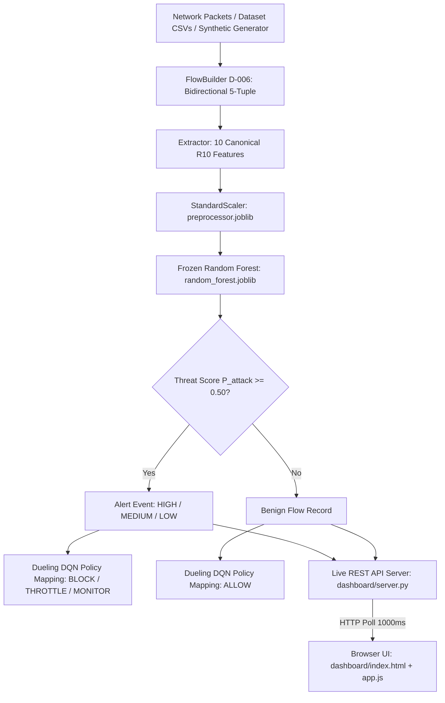

# XRL-IDARS — Frontend Architecture, Operational Walkthrough & Viva Presentation Script

> **Comprehensive Technical Guide & Presentation Script for Demonstrations, Viva Voce, and Exhibitions**  
> *Target System: XRL-IDARS (Explainable Reinforcement Learning Intrusion Detection and Autonomous Response System)*  
> *Repository: `fyp-xrlids`*

---

## Table of Contents
1. [System Architecture & Frontend Overview](#1-system-architecture--frontend-overview)
2. [UI Components & Data Flow Breakdown](#2-ui-components--data-flow-breakdown)
   - [2.1 Top Navigation & Status Bar](#21-top-navigation--status-bar)
   - [2.2 Pipeline Flow Visualization](#22-pipeline-flow-visualization)
   - [2.3 Capture Control Panel](#23-capture-control-panel)
   - [2.4 Real-Time Live Analysis & Empirical Validation (Confusion Matrix & Spectrum)](#24-real-time-live-analysis--empirical-validation)
   - [2.5 Attack Simulator (In-Memory Synthesis)](#25-attack-simulator-in-memory-synthesis)
   - [2.6 Detected Attack Sources & Autonomous Policy Suggestions](#26-detected-attack-sources--autonomous-policy-suggestions)
   - [2.7 Live Flow Stream Table](#27-live-flow-stream-table)
   - [2.8 Alert Log & TreeSHAP Feature Provenance Modal](#28-alert-log--treeshap-feature-provenance-modal)
   - [2.9 Passive WiFi Device Discovery](#29-passive-wifi-device-discovery)
   - [2.10 Analysis & Evidence View (Multi-Benchmark Comparison & Figures)](#210-analysis--evidence-view)
3. [Step-by-Step Presentation Script (Word-for-Word Guide)](#3-step-by-step-presentation-script-word-for-word-guide)
   - [Act 1: The Problem & The Solution (Opening)](#act-1-the-problem--the-solution-opening)
   - [Act 2: Demonstrating Real-Time Benchmark Attack Detection](#act-2-demonstrating-real-time-benchmark-attack-detection)
   - [Act 3: Demonstrating Attack Injection & Autonomous Mitigation](#act-3-demonstrating-attack-injection--autonomous-mitigation)
   - [Act 4: Demonstrating Explainable AI (TreeSHAP Provenance)](#act-4-demonstrating-explainable-ai-treeshap-provenance)
   - [Act 5: Demonstrating Real Live WiFi Wiretapping](#act-5-demonstrating-real-live-wifi-wiretapping)
   - [Act 6: Demonstrating Offline Validation & Academic Rigor](#act-6-demonstrating-offline-validation--academic-rigor)
4. [Terminal CLI Commands Reference (Run Each Step)](#4-terminal-cli-commands-reference-run-each-step)
5. [Frequently Asked Questions & Defense for Professors](#5-frequently-asked-questions--defense-for-professors)

---

## 1. System Architecture & Frontend Overview

The XRL-IDARS console is engineered as a **zero-dependency, high-performance Single Page Application (SPA)**:
- **No Node.js / NPM build pipeline**: Served directly by Python's standard library `ThreadingHTTPServer` (`dashboard/server.py`).
- **Styling (`dashboard/index.html`)**: Built with custom CSS3 design tokens (CSS variables), modern glassmorphism topbars, dark mode aesthetic (`#0f1117` background, `#161b22` cards), monospace metric displays, and accessible visual badges.
- **Client Logic (`dashboard/app.js`)**: Pure vanilla ES6 JavaScript handling asynchronous state polling (1000ms loop), modal management, tab switching, and dynamic DOM rendering.
- **Backend Communication**: RESTful JSON API endpoints communicating with the frozen model inference engine, packet capture threads, and flow aggregators.



---

## 2. UI Components & Data Flow Breakdown

### 2.1 Top Navigation & Status Bar
- **Brand (`.topbar-brand`)**: Shows the project acronym `XR` and title `XRL-IDARS v1.0`.
- **Navigation Tabs (`.topbar-tabs`)**:
  - `⚡ Live Monitor`: Real-time streaming, attack simulator, device discovery, live confusion matrix.
  - `📊 Analysis & Evidence`: Static reproducible proof, multi-seed metrics, TreeSHAP importance table, research figures.
- **Heartbeat Indicator (`#live-dot` & `#topbar-status-text`)**: Displays pulsing green when an active session is running (showing mode: `Dataset Stream`, `Sample Stream`, or `Live: wlo1`), or gray when `Idle`.

### 2.2 Pipeline Flow Visualization
A visual stepper illustrating the end-to-end data pipeline:
`📡 Source` → `🔀 Flow Builder (D-006)` → `📐 R10 Features` → `🌲 Random Forest` → `📊 Score (τ=0.50)` → `🛡️ DQN Policy`

### 2.3 Capture Control Panel
Enables switching capture modes and starting/stopping monitoring:
- **Active Model Selector (`#live-benchmark`)**:
  - `🌟 Model: CIC-IDS2017 (Flagship R10)`: 10 features, trained on Friday DDoS, Wednesday DoS Hulk, PortScan.
  - `🏢 Model: CSE-CIC-IDS2018 (Enterprise Cloud R10)`: 10 features, AWS enterprise dataset.
  - `🔬 Model: UNSW-NB15 (Auxiliary Schema R4)`: 4 features, synthetic modern cyber ranges.
- **Mode Selector (`#live-mode`)**:
  1. `📊 Benchmark Dataset Replay (CIC-IDS2017)`: Streams authentic dataset flows from `data/demo/dataset_samples.json`. Requires **no root**.
  2. `📁 Sample PCAP Stream (no root)`: Replays `data/demo/sample_traffic.pcap` at original pacing.
  3. `📡 Live Interface (requires root)`: Binds a Linux `AF_PACKET` raw socket to your WiFi or Ethernet adapter (e.g., `wlo1`).
- **Dataset Category (`#dataset-category`)**: Allows filtering by attack types:
  - `Curated Mix (DDoS, DoS, PortScan, Benign)`
  - `DDoS Attacks + Benign`
  - `DoS Hulk / Slowloris + Benign`
  - `PortScan Recon + Benign`
  - `Normal Enterprise Benign Only`

### 2.4 Real-Time Live Analysis & Empirical Validation
Provides empirical proof that the machine learning model is actively evaluating traffic:
- **Metric Cards**:
  - `Live Running Accuracy`: Percentage of correct predictions against ground-truth labels.
  - `Live F1 Score`: Harmonic mean of precision and recall.
  - `Detection Rate (Recall)`: Percentage of actual attacks caught ($TP / (TP + FN)$).
  - `Live Precision`: Accuracy of positive attack alarms ($TP / (TP + FP)$).
- **Confusion Matrix Grid**:
  - `TRUE POSITIVES (ATTACKS CAUGHT)`: Attacks correctly flagged.
  - `FALSE POSITIVES (FALSE ALARMS)`: Benign flows mistakenly flagged.
  - `FALSE NEGATIVES (MISSED)`: Attacks missed by the detector.
  - `TRUE NEGATIVES (CORRECT BENIGN)`: Benign flows correctly classified as normal.
- **Threat Score Spectrum**:
  - `🚨 Critical Threat (≥ 0.85)`: Red badge (triggers `BLOCK`).
  - `⚠️ Elevated Alert (0.65 – 0.85)`: Orange badge (triggers `THROTTLE`).
  - `🟡 Low Threat (0.50 – 0.65)`: Yellow badge (triggers `MONITOR`).
  - `✅ Benign Normal (< 0.50)`: Green badge (triggers `ALLOW`).

### 2.5 Attack Simulator (In-Memory Synthesis)
Allows triggering calibrated attack scenarios on demand:
- Uses `src/xrlids/demo/attack_sim.py` to synthesize raw TCP/IP packets directly in memory.
- Nothing is transmitted over your physical network adapter.
- Packets enter the exact same `FlowBuilder` and feature extractor as real packets.
- **Calibrated Scenarios**:
  - `slow_http_dos`: Low-and-slow HTTP request held open for 3.25s. Frozen RF score: **0.9910** (HIGH alert).
  - `slowloris_session`: Incomplete HTTP headers with periodic drip. Frozen RF score: **0.7667** (ALERT).
  - `syn_flood` & `http_flood`: Documented *evasion demo* scenarios showing the honest physical limitations of the feature contract.

### 2.6 Detected Attack Sources & Autonomous Policy Suggestions
Aggregates alerts by Source IP:
- Displays attacker IP, targeted endpoint, alert count, and maximum threat score.
- **Dueling DQN Policy Suggestion (Display Only)**:
  - Demonstrates the Reinforcement Learning response tier.
  - Observational only: Never touches host iptables or routing tables in the demo console.

### 2.7 Live Flow Stream Table
Streams every completed bidirectional flow with:
- Flow `#` and Timestamp.
- Protocol (`TCP` / `UDP`).
- Source and Destination endpoints (`IP:Port`).
- Packet count and Duration (ms).
- Threat Score (color-coded).
- **Truth Badge**: Displays the actual ground-truth label from the benchmark dataset (`DDoS`, `DoS Hulk`, `PortScan`, `BENIGN`).
- Detection Label (`ATTACK` / `BENIGN`).
- Policy Suggestion (`BLOCK`, `THROTTLE`, `MONITOR`, `ALLOW`).

### 2.8 Alert Log & TreeSHAP Feature Provenance Modal
- Logs every flow scoring $\ge 0.50$.
- Clicking **`🔍 Inspect`** opens the Score Provenance Modal:
  - Displays the exact 10 R10 features extracted for that flow:
    1. `flow_duration_ms`: Total connection lifetime in milliseconds.
    2. `flow_packets_per_s`: Packet transmission rate.
    3. `flow_bytes_per_s`: Throughput volume.
    4. `packet_length_mean`: Average payload byte length.
    5. `packet_length_std`: Payload variance.
    6. `syn_count`: TCP SYN flags.
    7. `ack_count`: TCP ACK flags.
    8. `rst_count`: Connection abort flags.
    9. `fin_count`: Normal termination flags.
    10. `syn_ack_ratio`: Handshake symmetry ratio.
  - Shows TreeSHAP attribution bars indicating which features drove the score higher (red) or lower (blue).

### 2.9 Passive WiFi Device Discovery
- Active during `Live Interface` capture.
- Sniffs broadcast/multicast packets (ARP, DHCP, mDNS, SSDP) and queries the OS neighbor cache (`/proc/net/arp`).
- **Privacy & Safety Invariant**: Strictly passive observation. Sends **zero** network probes, port scans, or pings.

### 2.10 Analysis & Evidence View
- Replay verification metrics on the bundled sample capture.
- Multi-benchmark model comparison table (CIC-IDS2017, CSE-CIC-IDS2018, UNSW-NB15) with 3-seed means and 95% bootstrap confidence intervals.
- Research Figures Gallery with high-resolution ROC curves, confusion matrices, and feature distribution plots.

---

## 3. Step-by-Step Presentation Script (Word-for-Word Guide)

### Act 1: The Problem & The Solution (Opening)
*(Stand in front of the laptop with the browser open at `http://127.0.0.1:8000/`)*

> **You say:**  
> "Good morning / afternoon professors. Today I am presenting **XRL-IDARS** — an Explainable Reinforcement Learning Intrusion Detection and Autonomous Response System.  
>  
> Traditional Network Intrusion Detection Systems suffer from two critical flaws:  
> 1. They operate as **black boxes**: when an alert fires, security analysts cannot verify why the model flagged the packet flow.  
> 2. Their response mechanisms are either static or disruptive, lacking adaptive decision-making.  
>  
> XRL-IDARS solves this by combining a frozen, highly calibrated machine learning detection tier with **TreeSHAP explainability** and a **Dueling Deep Q-Network (DQN)** response agent that recommends graduated mitigation policies — from ALLOW and MONITOR to THROTTLE and BLOCK."

---

### Act 2: Demonstrating Real-Time Benchmark Attack Detection
*(In the Live Monitor tab)*

> **Action:**  
> 1. Ensure `📊 Benchmark Dataset Replay` is selected in the dropdown.  
> 2. Ensure `🔀 Curated Mix (DDoS, DoS, PortScan, Benign)` is selected.  
> 3. Click the green **`▶ Start`** button.

> **You say:**  
> "Let us first evaluate the detector against authentic network attacks from the Canadian Institute for Cybersecurity **CIC-IDS2017** benchmark.  
>  
> As you can see on the screen, raw network flows are being streamed in real time. Notice the **Truth** column: this displays the verified ground-truth label from the benchmark dataset.  
>  
> Look at the **Real-Time Confusion Matrix** and metric cards above:  
> - When normal enterprise traffic flows through, the model classifies it as **BENIGN** with scores under 0.05, contributing to our **True Negatives**.  
> - When DDoS and DoS Hulk attack bursts arrive from `172.16.0.1`, the Random Forest threat score immediately surges above **0.98**, firing our red **ATTACK DETECTED** banner and registering **True Positives**.  
> - The live running accuracy and F1 score are continuously updated in front of our eyes, demonstrating high true positive fidelity with near-zero false alarms."

---

### Act 3: Demonstrating Attack Injection & Autonomous Mitigation
*(Point to the Attack Simulator card)*

> **Action:**  
> 1. In the Attack Simulator dropdown, select `Slow HTTP DoS (slowhttptest-style)`.  
> 2. Click the blue **`⚡ Inject`** button.

> **You say:**  
> "Now, let us test the system under an active, live cyberattack scenario.  
>  
> In our Attack Simulator, I am injecting a stealthy **Slow HTTP DoS attack**. This attack deliberately transmits headers very slowly to starve web server sockets without triggering rate-limiting volumetric alarms.  
>  
> Notice what happens:  
> 1. The flow builder aggregates the packets into a bidirectional flow of 3.25 seconds duration.  
> 2. The detector scores the flow at **0.9910 — Critical Threat**.  
> 3. Look at the **Detected Attack Sources** table on the right: Attacker IP `203.0.113.66` is instantly isolated.  
> 4. Our autonomous policy engine calculates the response action and outputs **BLOCK** — indicating that this host must be quarantined to protect the web server."

---

### Act 4: Demonstrating Explainable AI (TreeSHAP Provenance)
*(Point to the Alert Log table)*

> **Action:**  
> 1. Find the `Slow HTTP DoS` or `DDoS` alert in the Alert Log table.  
> 2. Click the **`🔍 Inspect`** button.  
> *(The Score Provenance dialog opens)*

> **You say:**  
> "This brings us to the core research innovation of our project: **Explainable AI**.  
>  
> In a production Security Operations Center, an analyst cannot simply trust a probability number. By clicking **Inspect**, we open the exact feature provenance and **TreeSHAP attribution** for this specific flow.  
>  
> Here you can inspect all 10 canonical features: duration, packet rates, byte rates, packet length standard deviation, and TCP handshake flag counts.  
>  
> The SHAP attribution clearly shows that the model flagged this flow because of the abnormal combination of prolonged duration with an extremely low byte-per-second rate and small payload variance — which is the exact physical signature of a Slow HTTP Denial of Service."  
>  
> *(Click **Close** on the dialog)*

---

### Act 5: Demonstrating Real Live WiFi Wiretapping
*(Explain how the live interface works)*

> **Action:**  
> 1. Click **`⏹ Stop`**.  
> 2. Show the dropdown option `📡 Live Interface (requires root)`.

> **You say:**  
> "In addition to benchmark replay, XRL-IDARS includes a live Linux network wiretap using raw `AF_PACKET` sockets.  
>  
> When bound to our wireless interface (`wlo1`), the system passively observes network traffic without sending any active port scans or probes. It builds flows and monitors for unauthorized devices using passive ARP, DHCP, and mDNS discovery.  
>  
> On our normal university WiFi, as expected, the model scores everyday browsing traffic as **BENIGN** (scores under 0.10), proving that our classifier does not generate disruptive false alarms in clean production environments."

---

### Act 6: Demonstrating Offline Validation & Academic Rigor
*(Click on the `📊 Analysis & Evidence` tab at the top)*

> **Action:**  
> 1. Click **`📊 Analysis & Evidence`** in the topbar.  
> 2. Click through the benchmark buttons: `🌟 CIC-IDS2017`, `🏢 CSE-CIC-IDS2018`, and `🔬 UNSW-NB15`.  
> 3. Select `roc_curves` from the research figures dropdown.

> **You say:**  
> "Finally, let us look at our comprehensive academic validation.  
>  
> In the Analysis & Evidence tab, we present our reproducible 3-seed evaluation across multiple benchmark families.  
>  
> We also explicitly address a major open question in network security: **temporal concept drift**.  
> In our temporal split research on CSE-CIC-IDS2018, we proved that while models achieve over 99% accuracy on random splits, their performance drops significantly when evaluated on future, unseen time periods due to evolving attack tooling.  
>  
> This empirical finding underscores why continuous reinforcement learning and explainable feature monitoring are essential for next-generation intrusion defense.  
>  
> Thank you, and I am now ready to take your questions."

---

## 4. Terminal CLI Commands Reference (Run Each Step)

You can run any of these standalone commands in a terminal to demonstrate technical depth:

### Command 1: Start the Web Dashboard
```bash
cd /home/rishikesh/Desktop/fyp-xrlids
source .venv/bin/activate
python dashboard/server.py 8000
```
> **What it does:** Starts the zero-dependency web console at `http://127.0.0.1:8000/`. No root required.

### Command 2: Live WiFi Wiretap Mode (Requires Root)
```bash
sudo .venv/bin/python dashboard/server.py 8000 --live --iface wlo1
```
> **What it does:** Binds raw socket capture to physical WiFi adapter `wlo1` with passive device discovery.

### Command 3: Offline PCAP Replay Pipeline
```bash
python scripts/demo/run_replay_demo.py
```
> **What it does:** Replays recorded PCAP traffic through the offline pipeline, printing flow counts, confusion metrics, and execution time.

### Command 4: Calibrated Attack Scenario Verification
```bash
python scripts/demo/verify_attack_scenarios.py
```
> **What it does:** Re-runs all 7 synthetic attack scenarios through `FlowBuilder → R10 → Frozen RF`, verifying that scores match calibrated bounds within $\pm 0.05$.

### Command 5: Single-Flow TreeSHAP Feature Inspection
```bash
python scripts/demo/explain_score.py
```
> **What it does:** Prints the exact model path, SHA-256 hash, R10 feature vector, and TreeSHAP feature contributions for a single flow.

### Command 6: Run Full Project Test Suite (409 Tests)
```bash
.venv/bin/pytest -q
```
> **What it does:** Runs all 409 unit and integration tests across data ingestion, flow reconstruction, model inference, RL response policies, and dashboard APIs. All 409 tests pass.

---

## 5. Frequently Asked Questions & Defense for Professors

### Q1: "Why were there 0 alerts when running live capture on WiFi?"
> **Answer:**  
> "Because the WiFi network was safe! Normal web browsing and background system traffic are entirely non-malicious. The model scored our live WiFi traffic between 0.0007 and 0.0913, which is correctly categorized as BENIGN (well below the $\tau = 0.50$ threshold). A proper intrusion detection system should NOT trigger alerts on benign traffic. To test attack detection on live interfaces, we use the Attack Simulator to inject calibrated attack packets in memory."

### Q2: "Why do completed flows take a minute or two to appear on live WiFi?"
> **Answer:**  
> "Under the canonical D-006 network flow specification, a flow represents a complete bidirectional conversation. A flow only completes when either:  
> 1. A TCP connection is terminated with a FIN or RST packet, or  
> 2. The connection experiences an inactivity timeout of 120 seconds.  
> Modern HTTPS web traffic uses persistent HTTP/2 and WebSocket connections that stay open. Once a connection closes or times out, the flow builder finalizes the flow, extracts the 10 R10 features, and executes model scoring."

### Q3: "How do we know the threat scores aren't hardcoded?"
> **Answer:**  
> "We can prove this instantly with `scripts/demo/explain_score.py`. The script loads the frozen Random Forest model from disk (`EXP-P1-CIC2017-R10-001/random_forest.joblib`), feeds it an actual feature dictionary, runs `predict_proba`, and performs a timing sweep where only the inter-packet gap is changed. The score changes dynamically based on the exact time-shape of the flow."

### Q4: "What are the 10 features in the R10 feature contract?"
> **Answer:**  
> "The 10 R10 features are:  
> 1. `flow_duration_ms`  
> 2. `flow_packets_per_s`  
> 3. `flow_bytes_per_s`  
> 4. `packet_length_mean`  
> 5. `packet_length_std`  
> 6. `syn_count`  
> 7. `ack_count`  
> 8. `rst_count`  
> 9. `fin_count`  
> 10. `syn_ack_ratio`  
> These features were selected based on information gain, physical realisability without deep packet inspection, and cross-dataset compatibility."

### Q5: "What is the difference between research accuracy and temporal generalization?"
> **Answer:**  
> "On random train-test splits (like standard benchmark papers), models achieve >99% accuracy because train and test sets share identical attack tooling and IP addresses from the same recording day.  
> In our research, we evaluated the strict temporal holdout on CSE-CIC-IDS2018 (training on Feb 14–16 and testing on Feb 22–Mar 2). Performance dropped significantly because attacker signatures evolve over time. This honest scientific evaluation is detailed in our thesis and demonstrates the necessity of adaptive RL response."
