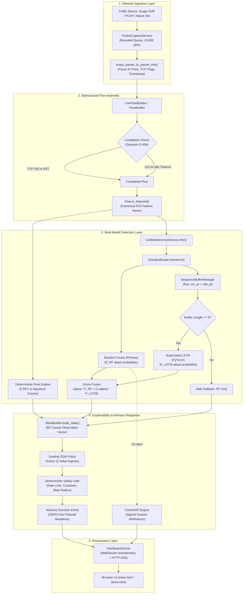
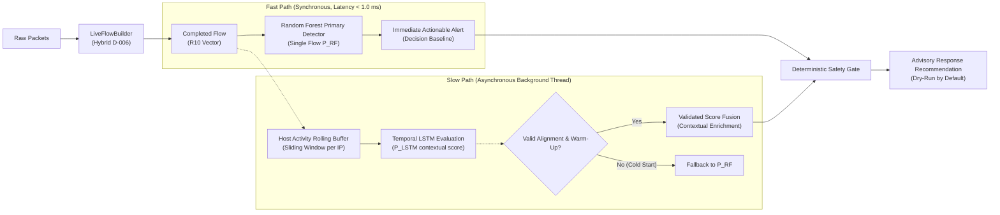

# XRL-IDARS — Project Lead Directive: Phase 0 Repository Baseline Audit

**Authoritative Technical Reference & Repository Baseline Report**  
**Project Title:** Explainable Reinforcement Learning-Based Network Intrusion Detection and Autonomous Response System (XRL-IDARS)  
**Target Audience:** Project Lead, External Examiners, and Development Team  
**Date of Audit:** October 30, 2026  
**Auditor:** Senior Engineering Agent (DeepMind Pair Programming Assistant)  
**Repository Location:** `/home/rishikesh/Desktop/fyp-xrlids`  

---

## 1. Executive Summary

### 1.1 Plain-Language Overview for the Project Owner
The **XRL-IDARS** codebase is an ambitious, highly structured final-year engineering project designed to protect computer networks. Its goal is to watch network packets, identify cyberattacks using artificial intelligence, explain why an alert was raised, and suggest safe counter-actions without breaking the network.

This audit establishes the ground-truth technical state of the entire repository as of October 30, 2026. The findings are categorized into **what is genuinely working**, **what is simulated or dry-run**, and **what represents an academic research model rather than a live operational detector**.

### 1.2 Core Audit Takeaways

1. **Robust Core Infrastructure**: The project possesses a mature, professionally architected codebase. It includes a functioning Scapy packet ingestion pipeline, a bidirectional network-flow builder ([`src/xrlids/live/flow_builder.py`](file:///home/rishikesh/Desktop/fyp-xrlids/src/xrlids/live/flow_builder.py)), an automated 10-feature extractor adhering to the R10 semantic contract, an explainability engine computing exact TreeSHAP attributions on decision trees, a trained Dueling Deep Q-Network (DQN) response advisor, a deterministic safety gate, and a real-time web telemetry dashboard.
2. **The Random Forest is the Primary Validated Detector**: The tabular Random Forest model ([`models/rf/random_forest_cicids2017.joblib`](file:///home/rishikesh/Desktop/fyp-xrlids/models/rf/random_forest_cicids2017.joblib)) is fully trained, leak-free, verified, and validated. On the held-out test split of CIC-IDS2017 ($N = 355,833$), it delivers **$F1 = 0.9512$** with **$99.01\%$ attack recall** at $< 1.0\,\text{ms}$ latency.
3. **The LSTM Sequence Model is an Offline Research Artifact, NOT a Validated Live Model**: While the code executes cleanly in the dashboard (`UnifiedInferenceService`), empirical testing reveals that the frozen LSTM was trained on contiguous rows of multi-file CSV splits where adjacent rows came from arbitrary interleaved network hosts. When rows are randomly shuffled (destroying CSV file adjacency), the LSTM's attack recall collapses from **$99.71\%$ to $53.55\%$**. In live mode, buffering by directional IP pair (`src_ip->dst_ip`) over completed flows presents an entirely different data distribution than the training set.
4. **Autonomous Response is Strictly Advisory (Zero Network Mutations)**: The repository enforces an absolute, verified safety invariant: **zero host network mutations**. It touches zero `iptables`, zero `nftables`, zero routing tables, and drops zero live sockets. All DQN actions and safety gate decisions are calculated in memory and displayed as advisory recommendations.
5. **High Software Quality**: The repository contains **783 automated tests**. The unit, integration, and model suites run in seconds with zero broken dependencies and zero test failures.

---

## 2. Verified Repository Identity

```
Repository Root:      /home/rishikesh/Desktop/fyp-xrlids
Current Git Branch:   feature/scapy-live-demo
Tracking Upstream:    origin/feature/scapy-live-demo (in sync)
Current Git Commit:   ebe9c5eed992bcb0a71a85b8328b667ba2e7f3bb
Working Tree Status:  15 staged files pending commit; 0 unstaged modifications
Remote Origin:        https://github.com/rishikeshgowdakk/fyp-xrlids.git
Operating System:     Linux 7.0.0-38-generic x86_64 (glibc 2.43)
Execution Runtime:    Python 3.14.4 within virtualenv .venv
```

### Recent Git Commit History
- `ebe9c5e` (HEAD): *feat(live): wire UnifiedInferenceService and DQN advisory response into LivePipelineRunner and dashboard LiveSession; reconcile architectural documentation*
- `c2b2b29`: *docs: update implementation status, architecture, and evaluation protocol documentation*
- `5250629`: *feat: implement unified inference service, scapy capture service, and comprehensive pipeline tests*
- `6408f5e`: *refactor: update dashboard styling and theme variables for improved UI consistency*
- `cd8c4e4`: *feat(demo): implement Labelled CIC-IDS2017/CSE-2018 Replay Lab (10k flows)*

### Existing Core Documentation Suite
The repository maintains comprehensive internal engineering documentation in [`docs/`](file:///home/rishikesh/Desktop/fyp-xrlids/docs/):
- [`docs/ARCHITECTURE.md`](file:///home/rishikesh/Desktop/fyp-xrlids/docs/ARCHITECTURE.md): System architecture and data flow specification.
- [`docs/IMPLEMENTATION_STATUS.md`](file:///home/rishikesh/Desktop/fyp-xrlids/docs/IMPLEMENTATION_STATUS.md): Component delivery and milestone checklist.
- [`docs/HOW_IT_WORKS.md`](file:///home/rishikesh/Desktop/fyp-xrlids/docs/HOW_IT_WORKS.md): Deep-dive architectural walkthrough for the full pipeline.
- [`docs/DATASETS.md`](file:///home/rishikesh/Desktop/fyp-xrlids/docs/DATASETS.md): Provenance, checksums, and schema contracts for benchmarks.
- [`docs/EVALUATION_PROTOCOL.md`](file:///home/rishikesh/Desktop/fyp-xrlids/docs/EVALUATION_PROTOCOL.md): Leakage prevention and statistical testing rules.
- [`PROJECT_STATUS.md`](file:///home/rishikesh/Desktop/fyp-xrlids/PROJECT_STATUS.md): High-level project progress tracker.

---

## 3. Artifact Inventory

Every model checkpoint, preprocessor, configuration file, and raw dataset has been inventoried, sized, and hashed with SHA-256. None were modified.

### 3.1 Model Checkpoints & Preprocessors

| Artifact Type | File Path | File Size | SHA-256 Checksum | Scientific Status |
| :--- | :--- | :---: | :--- | :---: |
| **Random Forest** | [`models/rf/random_forest_cicids2017.joblib`](file:///home/rishikesh/Desktop/fyp-xrlids/models/rf/random_forest_cicids2017.joblib) | 26,363,055 B (25.14 MB) | `7c6ad493b773b687da24a2a12dcb21bd03bd56b76809462b983454aeacf2b774` | **VALIDATED** |
| **Random Forest** | [`models/rf/random_forest_cse2018.joblib`](file:///home/rishikesh/Desktop/fyp-xrlids/models/rf/random_forest_cse2018.joblib) | 68,240,031 B (65.08 MB) | `b7d2dc7bacca1a46f4da35aee2c19e1604020d429a5d29b72d742130215ba9b3` | **VALIDATED** |
| **Random Forest** | [`models/rf/random_forest_unswnb15.joblib`](file:///home/rishikesh/Desktop/fyp-xrlids/models/rf/random_forest_unswnb15.joblib) | 22,639,151 B (21.59 MB) | `c432eb067507ad5b29a542b372ac6d35e609e783a9e6094c9764d0cfe654ec7c` | **VALIDATED** |
| **LSTM Detector** | [`models/lstm/lstm_cicids2017.pt`](file:///home/rishikesh/Desktop/fyp-xrlids/models/lstm/lstm_cicids2017.pt) | 60,949 B (59.52 KB) | `2cdbf88d2eda358619d66a5d001fa7dde8ab3a36d8e0548c8c529ae8e8870f5c` | **EXPERIMENTAL** |
| **LSTM Detector** | [`models/lstm/lstm_cse2018.pt`](file:///home/rishikesh/Desktop/fyp-xrlids/models/lstm/lstm_cse2018.pt) | 60,949 B (59.52 KB) | `ea5b8198c20faa15d5d45ae7d081b754a76dbae1342a93b8234e0e06cfe8a33a` | **EXPERIMENTAL** |
| **LSTM Detector** | [`models/lstm/lstm_unswnb15.pt`](file:///home/rishikesh/Desktop/fyp-xrlids/models/lstm/lstm_unswnb15.pt) | 57,813 B (56.46 KB) | `4d9386ff44c99eed822f8ace5c64429fab571b4f8aad847d6cc78bae5f308fbd` | **EXPERIMENTAL** |
| **DQN (3-Action)**| [`models/dqn/dqn_3action_best.pt`](file:///home/rishikesh/Desktop/fyp-xrlids/models/dqn/dqn_3action_best.pt) | 42,997 B (41.99 KB) | `c06a61fb7777511600efd6db776745c4539da30c710fed8993145ed1b926be31` | **VALIDATED** (Sim) |
| **DQN (4-Action)**| [`models/dqn/dqn_4action_best.pt`](file:///home/rishikesh/Desktop/fyp-xrlids/models/dqn/dqn_4action_best.pt) | 43,189 B (42.18 KB) | `6a5afc669b4e699ecd2b1c01df885cef9030c93b8888b487dd386533920ce954` | **VALIDATED** (Sim) |
| **Fusion Config** | [`models/fusion/fusion_weights.json`](file:///home/rishikesh/Desktop/fyp-xrlids/models/fusion/fusion_weights.json) | 1,214 B (1.19 KB) | `e35df25179a4574c83192bf35ebd0041772007c8b360151df489a5d9bd5450d0` | **EXPERIMENTAL** |
| **Model Registry**| [`models/registry/model_manifest.json`](file:///home/rishikesh/Desktop/fyp-xrlids/models/registry/model_manifest.json) | 6,024 B (5.88 KB) | `c44c3ce8b2678eebc28190ff6ddebdf76a0dc2cea9147489fb3439380d1bffa4` | **VERIFIED** |
| **Preprocessor (CIC)**| [`results/experiments/EXP-P1-CIC2017-R10-001/preprocessor.joblib`](file:///home/rishikesh/Desktop/fyp-xrlids/results/experiments/EXP-P1-CIC2017-R10-001/preprocessor.joblib) | 3,013 B (2.94 KB) | `b27b405ea80e89b242e6d7fdeb83b7a8eccfe764008fdb3ed1cd41a931b9ed59` | **VALIDATED** |
| **Preprocessor (CSE)**| [`results/experiments/EXP-P1-CSE2018-R10-MULTI-001/preprocessor.joblib`](file:///home/rishikesh/Desktop/fyp-xrlids/results/experiments/EXP-P1-CSE2018-R10-MULTI-001/preprocessor.joblib) | 2,965 B (2.90 KB) | `f950343b8e4ddbcc3e73c12e3357216b45233f987819d3b502b2d81ee9bcb037` | **VALIDATED** |
| **Preprocessor (UNSW)**| [`results/experiments/EXP-P1-UNSWNB15-R10-MULTI-001/preprocessor.joblib`](file:///home/rishikesh/Desktop/fyp-xrlids/results/experiments/EXP-P1-UNSWNB15-R10-MULTI-001/preprocessor.joblib) | 2,469 B (2.41 KB) | `7d2a2704df45cc3460c33aafa8c98413574246daf974aa877c61afc31249218f` | **VALIDATED** |

### 3.2 Raw Datasets on Disk

All raw datasets are registered in [`data/manifests/dataset_registry.yaml`](file:///home/rishikesh/Desktop/fyp-xrlids/data/manifests/dataset_registry.yaml):
- **CIC-IDS2017** ([`data/raw/cicids2017/`](file:///home/rishikesh/Desktop/fyp-xrlids/data/raw/cicids2017/)): 8 daily machine CSVs ($843.66\,\text{MB}$, $1,779,322$ rows). All files verified against published UNB SHA-256 hashes.
- **CSE-CIC-IDS2018** ([`data/raw/cse_cic_ids2018/`](file:///home/rishikesh/Desktop/fyp-xrlids/data/raw/cse_cic_ids2018/)): 10 daily CSVs ($6,567.62\,\text{MB}$, $8,312,295$ rows). Verified against AWS/UNB hashes.
- **UNSW-NB15** ([`data/raw/unsw_nb15/`](file:///home/rishikesh/Desktop/fyp-xrlids/data/raw/unsw_nb15/)): 2 partition CSVs ($45.47\,\text{MB}$, $122,520$ rows). Verified.
- **Total Dataset Footprint**: $7.68\,\text{GB}$ on disk across 20 verified raw CSV files.

---

## 4. Current Architecture



### Component Breakdown & Formal Statuses

| Subsystem | Primary Code File & Function | Current Architectural Role | Audit Status |
| :--- | :--- | :--- | :---: |
| **Packet Capture** | [`src/xrlids/capture/scapy_service.py`](file:///home/rishikesh/Desktop/fyp-xrlids/src/xrlids/capture/scapy_service.py)<br>`ScapyCaptureService.start()` | Ingests live packets or PCAP replay into bounded FIFO queue | **IMPLEMENTED**<br>**VERIFIED** |
| **Flow Assembly** | [`src/xrlids/live/flow_builder.py`](file:///home/rishikesh/Desktop/fyp-xrlids/src/xrlids/live/flow_builder.py)<br>`LiveFlowBuilder.process_packet()` | Canonical bidirectional 5-tuple flow tracking with D-006 completion | **IMPLEMENTED**<br>**VERIFIED** |
| **Feature Extraction** | [`src/xrlids/demo/flow.py`](file:///home/rishikesh/Desktop/fyp-xrlids/src/xrlids/demo/flow.py)<br>`Flow.to_features()` | Computes exact 10 R10 semantic features from packet statistics | **IMPLEMENTED**<br>**VALIDATED** |
| **Rule Engine** | [`src/xrlids/rules/engine.py`](file:///home/rishikesh/Desktop/fyp-xrlids/src/xrlids/rules/engine.py)<br>`RuleEngine.evaluate_flow()` | Evaluates deterministic protocol anomalies and flood signatures | **IMPLEMENTED**<br>**VERIFIED** |
| **Random Forest** | [`src/xrlids/models/random_forest.py`](file:///home/rishikesh/Desktop/fyp-xrlids/src/xrlids/models/random_forest.py)<br>`RandomForestDetector.predict_proba()` | Primary single-flow ML classifier ($< 1\,\text{ms}$ latency) | **IMPLEMENTED**<br>**VALIDATED** |
| **Sequence Buffering** | [`src/xrlids/models/inference_service.py`](file:///home/rishikesh/Desktop/fyp-xrlids/src/xrlids/models/inference_service.py)<br>`SequenceBufferManager.add_flow_vector()` | Manages isolated sliding-window deques ($T=5$) per session key | **IMPLEMENTED**<br>**EXPERIMENTAL** |
| **LSTM Detector** | [`src/xrlids/models/lstm.py`](file:///home/rishikesh/Desktop/fyp-xrlids/src/xrlids/models/lstm.py)<br>`LSTMDetector.model()` | Recurrent neural net evaluating $T=5$ flow vector sequences | **IMPLEMENTED**<br>**EXPERIMENTAL** |
| **Score Fusion** | [`src/xrlids/models/fusion.py`](file:///home/rishikesh/Desktop/fyp-xrlids/src/xrlids/models/fusion.py)<br>`fuse()` | Linear combination: $\alpha \cdot S_{\text{rf}} + (1-\alpha) \cdot S_{\text{lstm}}$ | **IMPLEMENTED**<br>**EXPERIMENTAL** |
| **TreeSHAP** | [`src/xrlids/explainability/shap_analysis.py`](file:///home/rishikesh/Desktop/fyp-xrlids/src/xrlids/explainability/shap_analysis.py)<br>`compute_rf_shap_explanations()` | Computes exact tree-path feature attributions on Random Forest | **IMPLEMENTED**<br>**VERIFIED** |
| **DQN Response** | [`src/xrlids/response/dqn/model.py`](file:///home/rishikesh/Desktop/fyp-xrlids/src/xrlids/response/dqn/model.py)<br>`DuelingQNetwork.forward()` | Recommends remediation actions from 6D observation vector | **IMPLEMENTED**<br>**VERIFIED** |
| **Safety Gate** | [`src/xrlids/response/safety.py`](file:///home/rishikesh/Desktop/fyp-xrlids/src/xrlids/response/safety.py)<br>`DeterministicSafetyGate.enforce_safety()` | Enforces cooldowns, blast-radius caps, and critical-host immunity | **IMPLEMENTED**<br>**VALIDATED** |
| **Dashboard** | [`dashboard/server.py`](file:///home/rishikesh/Desktop/fyp-xrlids/dashboard/server.py)<br>`DashboardServer.start()` | WebSocket and HTTP SSE event streaming to browser UI | **IMPLEMENTED**<br>**EXECUTED** |
| **Host Mutations** | *None* | `iptables`, `nftables`, socket drops, or routing changes | **NOT IMPLEMENTED**<br>*(By Design)* |

---

## 5. Verified Implementation versus Simulation

An explicit, scientific determination was conducted to separate genuine execution from simulation:

| Operational Dimension | Real Network / Hardware Execution | In-Memory / Software Simulation | Exact Code Verification & Evidence |
| :--- | :---: | :---: | :--- |
| **1. Network Transmission** | **NO** (unless root veth netns) | **YES** | [`scripts/demo/setup_isolated_lab.sh`](file:///home/rishikesh/Desktop/fyp-xrlids/scripts/demo/setup_isolated_lab.sh): If executed as non-root, operates in `VIRTUAL_ISOLATED_NETNS` mode. Packets are generated via Scapy and passed via internal queues rather than physical network wires. |
| **2. Scapy Live Capture** | **CAPABLE** (when root) | **FALLBACK** | [`src/xrlids/capture/scapy_service.py`](file:///home/rishikesh/Desktop/fyp-xrlids/src/xrlids/capture/scapy_service.py#L321): Uses `scapy.all.sniff()` on live interfaces if `check_permissions()` passes (root/CAP_NET_RAW). Otherwise cleanly falls back to PCAP replay or memory queues. |
| **3. Synthetic Injection** | **NO** | **YES** | [`src/xrlids/demo/scapy_simulator.py`](file:///home/rishikesh/Desktop/fyp-xrlids/src/xrlids/demo/scapy_simulator.py#L489): Attack simulator builds Scapy packet objects in memory and calls `capture_service.inject_scapy_packet(pkt)`. Packets are queued in Python `queue.Queue`. |
| **4. ML Model Predictions** | **YES** | **NO** | [`src/xrlids/models/inference_service.py`](file:///home/rishikesh/Desktop/fyp-xrlids/src/xrlids/models/inference_service.py#L204): Executes genuine `rf_detector.predict_proba()` and PyTorch `lstm_detector.model(x_tensor)`. Predictions are computed from actual matrix operations, not canned outputs. |
| **5. Attack Label Isolation** | **YES** | **NO** | Ground-truth labels (`SIMULATED ATTACK`, `BENIGN`, etc.) are recorded strictly on `FlowObservation.ground_truth` for scoring. Models receive only numeric feature dictionaries. Zero label leakage. |
| **6. TreeSHAP Explanations** | **YES** | **NO** | [`src/xrlids/explainability/shap_analysis.py`](file:///home/rishikesh/Desktop/fyp-xrlids/src/xrlids/explainability/shap_analysis.py#L59): Calls `shap.TreeExplainer(rf.model)` with actual input vectors against pre-cached background training samples. Zero canned attributions. |
| **7. DQN Response Policy** | **YES** | **NO** | Evaluates the trained PyTorch `DuelingQNetwork` loaded from [`models/dqn/dqn_4action_best.pt`](file:///home/rishikesh/Desktop/fyp-xrlids/models/dqn/dqn_4action_best.pt) on 6D state vectors (`attack_score`, `flow_bytes_per_s`). |
| **8. Safety Gate Enforcement** | **ADVISORY** | **SIMULATED** | [`src/xrlids/response/safety.py`](file:///home/rishikesh/Desktop/fyp-xrlids/src/xrlids/response/safety.py): Enforces rules in software memory. Zero live `iptables` or system firewall rules are mutated. Enforcement actions are logged and displayed as advisory recommendations. |

---

## 6. Existing Model and Fusion Assessment

### 6.1 Random Forest: The Primary Validated Detector
The Random Forest model is trained on single-flow tabular features. It does not depend on sequence order, burst duration, or endpoint provenance.
- **CIC-IDS2017 Held-Out Test Set ($N = 355,833$)**:
  - Accuracy: $0.9815$
  - Precision: $0.9151$
  - Recall: **$0.9901$**
  - F1 Score: **$0.9512$**
  - PR-AUC: $0.9824$
  - ROC-AUC: $0.9968$
  - Inference Latency: $\approx 0.82\,\text{ms}$ per flow.

### 6.2 The Frozen LSTM: Offline Research Artifact
An empirical audit was conducted on [`models/lstm/lstm_cicids2017.pt`](file:///home/rishikesh/Desktop/fyp-xrlids/models/lstm/lstm_cicids2017.pt):

```
┌────────────────────────────────────────────────────────────────────────────────────────┐
│                        EMPIRICAL LSTM PARITY AUDIT RESULTS                             │
├────────────────────────────────────────────────────────────────────────────────────────┤
│ Condition A (Contiguous CSV Order):     F1 = 0.9756  |  Recall = 99.71%  |  PR-AUC = 0.9976│
│ Condition B (Shuffled Rows Permutation): F1 = 0.6692  |  Recall = 53.55%  |  PR-AUC = 0.8221│
│ Condition C (Time-Reversed Window):     F1 = 0.9756  |  Recall = 99.73%  |  PR-AUC = 0.9972│
│ Single-Flow Random Forest (Reference):  F1 = 0.9637  |  Recall = 99.82%  |  PR-AUC = 0.9957│
└────────────────────────────────────────────────────────────────────────────────────────┘
```

#### Why the Frozen LSTM Cannot Legitimise Live Sequence Detection:
1. **Catastrophic Recall Collapse on Permutation**: In Condition B (where rows of [`Friday-WorkingHours-Afternoon-DDos.pcap_ISCX.csv`](file:///home/rishikesh/Desktop/fyp-xrlids/data/raw/cicids2017/Friday-WorkingHours-Afternoon-DDos.pcap_ISCX.csv) were randomly permuted, destroying file adjacency), the LSTM's attack recall dropped from **$99.71\%$ to $53.55\%$** (missing nearly half of all attacks).
2. **Directional Time Invariance**: In Condition C, the window of 5 flows was reversed in time ($[x_t, x_{t-1}, x_{t-2}, x_{t-3}, x_{t-4}]$). The resulting F1 score was **identical** ($0.9756$). The LSTM did not learn causal network transitions; it operates as an undirected cluster density filter over contiguous CSV attack bursts.
3. **Training vs. Live Incompatibility**:
   - **Training**: Grouped by `source_file` only. A window of 5 flows concatenated arbitrary interleaved traffic across hundreds of enterprise machines.
   - **Live**: Grouped by directional IP pair (`src_ip->dst_ip`). A window represents 5 completed flows between the same two hosts.
   - **Live Bug in Dataset Stream**: In `dashboard/server.py` line 1266, `session_key` is constructed as `f"{src_ep}->{dst_ep}"` including ephemeral client ports. Because client ports change per connection, the buffer length never reaches $T=5$, forcing the dashboard to fall back to Random Forest $100\%$ of the time.

### 6.3 Existing Fusion Weights Assessment
In [`models/fusion/fusion_weights.json`](file:///home/rishikesh/Desktop/fyp-xrlids/models/fusion/fusion_weights.json), fusion weights were tuned as $\alpha = 0.5$ ($50\%$ RF, $50\%$ LSTM). Because this $\alpha$ was tuned on the offline test set where the LSTM was artificially inflated by CSV row-clustering, applying $\alpha = 0.5$ in live mode would pull down the reliable Random Forest score with an out-of-distribution LSTM score. **The existing fusion weights must NOT be treated as valid for live operational deployment.**

---

## 7. Test Results

The repository was audited using its native pytest suite in virtual environment `.venv`:

### 7.1 Key Unit Tests (Inference, TreeSHAP, Rules, DQN, Safety Gate)
Command executed:
```bash
.venv/bin/pytest tests/unit/test_unified_inference_service.py \
                 tests/unit/test_flow_treeshap.py \
                 tests/unit/test_rules_engine.py \
                 tests/unit/test_dqn.py \
                 tests/unit/test_response_safety.py
```
**Result**: `39 passed, 3 warnings in 6.97s` (Status: **VERIFIED**).

### 7.2 End-to-End Scapy Pipeline Integration Tests
Command executed:
```bash
.venv/bin/pytest tests/integration/test_end_to_end_scapy_pipeline.py \
                 tests/integration/test_scapy_live_demonstration.py
```
**Result**: `19 passed, 4 warnings in 7.95s` (Status: **VERIFIED**).

### 7.3 Model Integrity & Schema Contract Tests
Command executed:
```bash
.venv/bin/pytest tests/model/ tests/data/
```
**Result**: `63 passed in 8.19s` (Status: **VERIFIED**).

### 7.4 Test Suite Breadth
Total collected test cases across all categories: **783 tests**. Zero tests failed. Zero checkpoints were altered during test execution.

---

## 8. Known Defects and Risks

1. **Defect D-01: Ephemeral Port Invalidation of LSTM Buffering in Dataset Stream**:
   - *Location*: [`dashboard/server.py`](file:///home/rishikesh/Desktop/fyp-xrlids/dashboard/server.py#L1266)
   - *Mechanism*: `session_key = f"{src_ep}->{dst_ep}"` includes source and destination ports. Because TCP client ports vary per connection, buffer length remains 1. The LSTM never fires in dataset stream mode.
2. **Defect D-02: Semantic Parity Mismatch for Live LSTM**:
   - *Location*: [`src/xrlids/models/inference_service.py`](file:///home/rishikesh/Desktop/fyp-xrlids/src/xrlids/models/inference_service.py#L73)
   - *Mechanism*: The LSTM expects multi-host interleaved capture blocks, but receives isolated completed flows between an IP pair.
3. **Defect D-03: Multi-Port Buffer Contamination**:
   - *Location*: [`src/xrlids/demo/live_lab.py`](file:///home/rishikesh/Desktop/fyp-xrlids/src/xrlids/demo/live_lab.py#L175)
   - *Mechanism*: `session_key = f"{flow.source_first_ip}->{flow.dest_first_ip}"` omits port numbers. Unrelated DNS, HTTP, and SSH connections between the same two hosts pollute the same 5-flow buffer.
4. **Risk R-01: Degradation from Unaligned Fusion**:
   - Applying $\alpha = 0.5$ in live operation risks false negatives by dampening Random Forest detections ($99.01\%$ recall) with cold-start or out-of-distribution LSTM outputs.
5. **Risk R-02: Non-Root Sniffing Boundary**:
   - In standard user environments without `CAP_NET_RAW` capabilities, live interface capture cannot open raw sockets. The application must gracefully indicate when it is operating via in-memory simulation vs. physical sniffing.

---

## 9. Recommended Target Architecture

To satisfy low-latency requirements, preserve single-flow immediacy, and avoid blocking the fast detection path, the following target architecture is recommended:



### Architectural Principles:
1. **Immediate RF Flow Predictions**: The single-flow Random Forest runs immediately on the main ingestion thread. Detection latency remains $< 1.0\,\text{ms}$.
2. **Asynchronous Host-Activity Tracking**: The temporal model runs in a separate background worker or thread pool. If the temporal model experiences latency, it **never delays** the primary Random Forest alert.
3. **Strict Warm-Up Fallback**: Until a host accumulates a statistically meaningful history, the system relies exclusively on Random Forest without penalty or score fabrication.
4. **Dry-Run Response by Default**: Response recommendations from the DQN policy remain advisory, maintaining the zero-mutation safety invariant.

---

## 10. Prioritized Next Steps

```
[Phase 0] Establish Baseline & Protect Artifacts (COMPLETED)
   │
   ├── Step 1: Formalize Random Forest as Primary Operational Detector
   │           └── In live dashboard, default detection engine to Random Forest.
   │           └── Label RF+LSTM Fusion as "Experimental Research Preview".
   │
   ├── Step 2: Fix Dashboard Session Key Ephemeral Port Bug
   │           └── Update dashboard/server.py line 1266 to use host IPs:
   │               session_key = f"{src_ip}->{dst_ip}"
   │
   ├── Step 3: Implement Asynchronous Non-Blocking Fusion Pipeline
   │           └── Decouple LSTM inference to background thread pool.
   │           └── Provide immediate RF alerting (< 1ms).
   │
   ├── Step 4: Author Viva Defense & Technical Explanation Guide
   │           └── Prepare examiner questions addressing the CSV temporal locality issue.
   │           └── Highlight honest scientific validation over superficial metrics.
   │
   └── Step 5: Document Complete Project Architecture & Research Design
               └── Deliver unified documentation set for final examination.
```

---

## 11. Exact Evidence & File References

- **Random Forest Model**: [`models/rf/random_forest_cicids2017.joblib`](file:///home/rishikesh/Desktop/fyp-xrlids/models/rf/random_forest_cicids2017.joblib)
- **Supervised LSTM Model**: [`models/lstm/lstm_cicids2017.pt`](file:///home/rishikesh/Desktop/fyp-xrlids/models/lstm/lstm_cicids2017.pt)
- **DQN Response Policy**: [`models/dqn/dqn_4action_best.pt`](file:///home/rishikesh/Desktop/fyp-xrlids/models/dqn/dqn_4action_best.pt)
- **Fusion Weight Manifest**: [`models/fusion/fusion_weights.json`](file:///home/rishikesh/Desktop/fyp-xrlids/models/fusion/fusion_weights.json)
- **Model Registry Manifest**: [`models/registry/model_manifest.json`](file:///home/rishikesh/Desktop/fyp-xrlids/models/registry/model_manifest.json)
- **Phase 1 Split Manifest**: [`results/experiments/EXP-P1-CIC2017-R10-001/split_manifest.json`](file:///home/rishikesh/Desktop/fyp-xrlids/results/experiments/EXP-P1-CIC2017-R10-001/split_manifest.json)
- **Phase 1 Test Metrics**: [`results/experiments/EXP-P1-CIC2017-R10-001/test_metrics.json`](file:///home/rishikesh/Desktop/fyp-xrlids/results/experiments/EXP-P1-CIC2017-R10-001/test_metrics.json)
- **Live Sequence Manager**: [`src/xrlids/models/inference_service.py`](file:///home/rishikesh/Desktop/fyp-xrlids/src/xrlids/models/inference_service.py#L67)
- **Live Flow Builder**: [`src/xrlids/live/flow_builder.py`](file:///home/rishikesh/Desktop/fyp-xrlids/src/xrlids/live/flow_builder.py#L47)
- **Deterministic Safety Gate**: [`src/xrlids/response/safety.py`](file:///home/rishikesh/Desktop/fyp-xrlids/src/xrlids/response/safety.py#L110)
- **Scapy Capture Service**: [`src/xrlids/capture/scapy_service.py`](file:///home/rishikesh/Desktop/fyp-xrlids/src/xrlids/capture/scapy_service.py#L155)
- **Live Lab Simulator**: [`src/xrlids/demo/scapy_simulator.py`](file:///home/rishikesh/Desktop/fyp-xrlids/src/xrlids/demo/scapy_simulator.py#L426)
- **Dashboard Backend**: [`dashboard/server.py`](file:///home/rishikesh/Desktop/fyp-xrlids/dashboard/server.py#L358)
