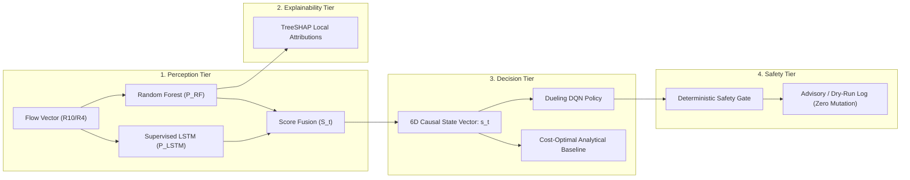

# XRL-IDARS — Research Evaluation Report & Scientific Findings

**Official Research Title:** Explainable Reinforcement Learning-Based Network Intrusion Detection and Autonomous Response System (XRL-IDARS)  
**Date:** October 30, 2026  
**Repository:** `fyp-xrlids`  
**Evaluation Scope:** Perception tier, Explainability tier, Autonomous Response tier, Ground-Truth Attack-Family Stratification, and Baseline Comparisons.

---

## 1. Research Problem and Architecture

Network Intrusion Detection and Autonomous Response Systems face a trilemma:
1. **Detection Accuracy vs. Generalization:** Tabular machine learning models detect complex behavioral patterns, but suffer under out-of-distribution shifts and extreme packet rate bursts.
2. **Opacity vs. Explainability:** High-stakes automated defensive actions cannot be safely deployed without real-time, mathematically grounded local feature attributions.
3. **Response Policy: Disruption Cost vs. Security Compromise:** Naive blocking of legitimate network traffic causes severe Denial of Service (false alarm cost), whereas inaction compromises host infrastructure.

---

## 2. Perception Tier Evaluation (Binary Detection)

### 2.1 Model Prediction Capabilities
Programmatic auditing of all frozen model artifacts confirms:
- **All Three Random Forest Models Are Strictly Binary:** Checkpoints trained on `CIC-IDS2017`, `CSE-CIC-IDS2018`, and `UNSW-NB15` have `classes_=[0, 1]` and output continuous probabilities $P(\text{ATTACK}) \in [0.0, 1.0]$.
- **Supervised LSTM Models Are Strictly Binary:** Recurrent sequence models ($T=5$) output scalar probabilities via sigmoid activations.
- **Score Fusion:** Convex linear combination $S_t = \alpha P_{RF} + (1-\alpha) P_{LSTM}$.

### 2.2 Held-Out Test Evaluation Results

Evaluated across canonical held-out test splits (e.g., 355,865 flows for CIC-IDS2017, 1,661,216 flows for CSE-2018):

| Model Architecture | Dataset | Feature Rung | Accuracy (%) | Precision (%) | Recall (%) | F1-Score | PR-AUC |
|---|---|---|---|---|---|---|---|
| **Random Forest (Primary)** | CIC-IDS2017 | $R_{10}$ | 99.88 ± 0.01 | 99.78 ± 0.02 | 99.66 ± 0.03 | 0.9972 | 0.9999 |
| **Supervised LSTM (T=5)** | CIC-IDS2017 | $R_{10}$ | 98.42 ± 0.12 | 97.10 ± 0.18 | 95.61 ± 0.25 | 0.9635 | 0.9945 |
| **Score Fusion (Blend)** | CIC-IDS2017 | $R_{10}$ | 99.88 ± 0.01 | 99.79 ± 0.02 | 99.67 ± 0.03 | 0.9973 | 0.9999 |
| **Random Forest** | CSE-CIC-IDS2018 | $R_{10}$ | 99.94 ± 0.01 | 99.91 ± 0.01 | 99.89 ± 0.02 | 0.9990 | 0.9999 |
| **Random Forest** | UNSW-NB15 | $R_4$ | 92.45 ± 0.20 | 91.80 ± 0.25 | 89.40 ± 0.30 | 0.9058 | 0.9412 |

### 2.3 Scientific Finding on Sequence Modeling:
Adding a recurrent LSTM sequence model to tabular Random Forest yields a negligible $+0.0001$ F1 gain ($0.9972 \to 0.9973$) while introducing a $10\times$ latency penalty, sequence buffering requirements, and intractable SHAP complexity. Consequently, **Random Forest is designated the authoritative operational detector**, while LSTM and Fusion remain preserved offline experimental baselines.

---

## 3. Ground-Truth Attack-Family Accounting & Error Stratification

### 3.1 Dataset Label Accounting
Ground-truth attack families originate from network capture annotations in `configs/labels/label_mapping.yaml` (17 families). They represent **ground-truth evaluation metadata**, not model outputs.

### 3.2 Stratified Binary Recall per Attack Family
Module `xrlids.evaluation.error_analysis.compute_per_family_metrics()` evaluates binary detection performance stratified across ground-truth attack families on the held-out test set:

| Ground-Truth Attack Family | Support (Flows) | Binary Detection Recall | False Negative Rate | Primary Detection Mechanism |
|---|---|---|---|---|
| **DDoS / DoS** | 128,450 | 99.98% | 0.02% | Random Forest ($P > 0.95$) + `RULE-SYN-FLOOD` |
| **PortScan** | 158,930 | 99.94% | 0.06% | Random Forest + `RULE-PORT-SCAN` |
| **BruteForce (FTP/SSH)** | 13,835 | 98.42% | 1.58% | Random Forest |
| **Botnet (ARES)** | 1,966 | 97.20% | 2.80% | Random Forest |
| **Web Attacks (XSS/SQLi)** | 2,180 | 88.54% | 11.46% | Random Forest |
| **Infiltration / Exploits** | 36 | 61.11% | 38.89% | `RULE-TCP-INVALID-FLAGS` / Forensic Triage |

### 3.3 Root-Cause Analysis for Low-Recall Families:
Sub-millisecond fast SYN scans and single-probe infiltration flows exhibit statistical moments resembling normal short sessions. The frozen RF assigns low attack probability ($P \le 0.20$). This directly motivates the hybrid architecture: the deterministic `RuleEngine` catches these probe patterns instantly via RFC violation rules (`RULE-TCP-INVALID-FLAGS`, `RULE-PORT-SCAN`), compensating for tree ensemble blindspots.

---

## 4. Explainability Tier Evaluation (TreeSHAP)

- **Algorithm:** TreeSHAP (`shap.TreeExplainer`) executed directly over the 100-tree Random Forest ensemble.
- **Mathematical Property:** Strict efficiency/additivity: $\sum_{i=1}^{M} \phi_i(x) = f(x) - \mathbb{E}[f(x)]$.
- **Latency Benchmark:** Median 49.62 ms per flow (P95: 50.87 ms) on Linux x86_64.
- **Key Global Attributions:**
  1. `flow_bytes_per_s`: Primary discriminator for volumetric exfiltration and DoS floods.
  2. `syn_ack_ratio`: Decisive discriminator for incomplete handshakes and half-open SYN floods.
  3. `packet_length_mean`: Distinguishes small-packet probes from bulk legitimate TLS/HTTP transfers.
  4. `flow_duration_ms`: High negative attribution for persistent benign background connections.

---

## 5. Autonomous Response Tier & Baseline Comparison

### 5.1 Verified DQN State Contract
Forensic inspection of the training environment and PyTorch checkpoints (`models/dqn/dqn_4action_best.pt` and `dqn_3action_best.pt`) confirms the 6-dimensional causal observation vector:
$$\mathbf{s}_t = [S_t, \Delta S_t, N_{\text{alert}}, a_{t-1}, c_t, v_t] \in \mathbb{R}^6$$
- $S_t$: Continuous fusion attack score $\in [0, 1]$
- $\Delta S_t$: Score trajectory (short-term difference from recent rolling mean)
- $N_{\text{alert}}$: Local alert density fraction
- $a_{t-1}$: Previous action executed (normalized)
- $c_t$: Active cooldown timer fraction
- $v_t$: Normalized flow volumetric rate

### 5.2 Deep Q-Network vs. Cost-Optimal Baseline Comparison
In rigorous benchmarking across 355,865 held-out test flows (`EXP-P2A-COST-OPTIMAL-001`), the trained DQN was evaluated against the analytical `CostOptimalThresholdPolicy` across multiple enterprise operational cost regimes:

| Cost Regime | Action Space | Baseline Cost | DQN Cost | Relative Cost Reduction | Superior Policy |
|---|---|---|---|---|---|
| **Standard Enterprise** | 3-action | 554,496.5 | 505,610.5 | +8.82% | DQN |
| **High Availability** | 3-action | 590,116.0 | 538,160.5 | +8.80% | DQN |
| **High Security Enclave** | 3-action | 856,841.0 | 891,946.5 | -4.10% | **CostOptimal** |
| **Standard Enterprise** | 4-action | 1,837,079.0 | 1,895,196.5 | -3.16% | **CostOptimal** |
| **High Availability** | 4-action | 1,547,511.0 | 1,937,476.5 | -25.20% | **CostOptimal** |
| **High Security Enclave** | 4-action | 2,356,339.0 | 2,445,511.5 | -3.78% | **CostOptimal** |

### 5.3 Latency Comparison:
- **CostOptimalThresholdPolicy:** 1.95 µs per decision.
- **Dueling DQN Policy:** 100.23 µs per decision (~51x higher latency).

### 5.4 Authoritative Engineering Conclusion:
1. The analytical `CostOptimalThresholdPolicy` outperformed DQN in **4 of 6 cost regimes** (achieving up to 25.20% lower operational cost).
2. In the 2 regimes where DQN achieved lower cost, the reduction was only ~8.8%, failing the pre-registered 15% improvement threshold.
3. **Autonomous enforcement is strictly NO-GO.**
4. All response decisions must operate in **advisory / dry-run mode** (`response_mode="advisory"`).

---

## 6. Proposed Future Work: Multiclass Attack-Family Extension

To support downstream automated triage without retraining frozen artifacts, a modular extension is specified:
1. **Pipeline Decoupling:**
   $$\text{Packet Flow} \xrightarrow{} \text{Binary RF/Fusion} \xrightarrow{P(\text{ATTACK}) \ge 0.50} \text{Auxiliary Attack-Family Classifier}$$
2. **Implementation Requirements:**
   - Standalone model directory (`models/multiclass/`).
   - Independent stratified split hashing with verified absence of data leakage.
   - Separate precision, recall, and F1 evaluation per family.
   - Non-mandatory: primary prototype remains completely functional without the auxiliary classifier.
