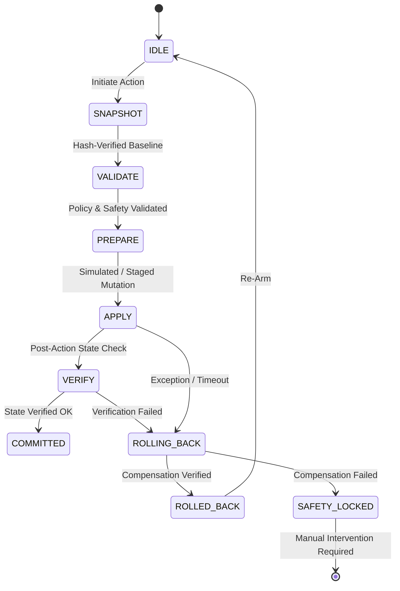

# XRL-IDARS — Deterministic Safety Gate & Controlled Autonomous Response

**Modules:**
- `src/xrlids/response/safety.py` (`DeterministicSafetyGate`)
- `src/xrlids/response/transaction.py` (`ControlledResponseTransactionManager`, `TransactionWatchdog`)

---

## 1. Safety Architecture & Non-Bypassable Invariants

Autonomous response mechanisms can cause severe service degradation if an ML model experiences an adversarial evasion or a transient false alarm.

To prevent unintended collateral disruption, **all** policy action proposals from the DQN policy must pass through the **Deterministic Safety Gate** prior to execution:

$$\pi(s_t) \longrightarrow \text{Proposed Action } a_{\text{prop}} \longrightarrow \left[\mathbf{Deterministic\ Safety\ Gate}\right] \longrightarrow a_{\text{enforced}}$$

### 5 Inviolable Safety Invariants

1. **Critical Infrastructure Exemption:**
   - Designated critical servers (Default Gateway `192.168.10.1`, Core DNS/DC `192.168.10.50`, NTP `192.168.10.2`) can **NEVER** be isolated.
   - Any proposed `ISOLATE` targeting a critical endpoint is deterministically clamped to `ALERT`.
2. **Mandatory Action Cooldown:**
   - Once a disruptive action (`RATE_LIMIT` or `ISOLATE`) is applied to an endpoint, it cannot rapidly toggle back to `ALLOW` within $T_{\text{cool}} = 30$ decision steps ($30.0$ seconds).
   - Prevents oscillation and high-frequency flapping.
3. **Blast Radius Circuit Breaker:**
   - The system tracks the global proportion of currently quarantined hosts.
   - If active isolated hosts exceed $5.0\%$ of known network hosts, all subsequent `ISOLATE` actions are automatically throttled to `ALERT`.
4. **Action Space Clamping:**
   - In 3-action operational mode (`ALLOW`, `ALERT`, `RATE_LIMIT`), any proposed `ISOLATE` is deterministically clamped to `RATE_LIMIT`.
5. **Deterministic Audit Log:**
   - Every proposal, gate override, timestamp, and justification is permanently recorded in an immutable audit log.

---

## 2. Controlled Transaction Lifecycle & Atomic Rollback

For environments with authorized response execution, the `ControlledResponseTransactionManager` enforces atomic state transitions:

### Safety Protections:
- **Default State:** Advisory / dry-run only. Real kernel mutations (`iptables`, `nftables`, `tc`) are disabled by design.
- **Heartbeat & TTL Watchdog:** Actions have a strict Time-to-Live (TTL); if an automated heartbeat fails, the watchdog triggers an automatic compensation rollback.
- **Safety Lock:** Any rollback verification failure permanently locks the system into `SAFETY_LOCKED` until cleared by an administrator.
