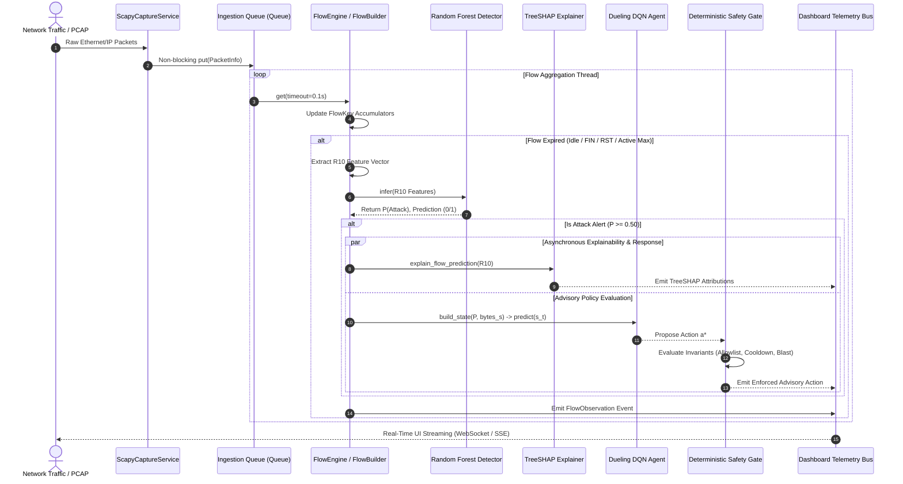

# XRL-IDARS — Component Interactions & Threading Model

**Document ID:** `DOC-ARCH-INTERACTIONS-001`  
**Version:** 1.0.0  
**Status:** COMPLETE & AUTHORITATIVE  
**Date:** October 30, 2026  
**Architect:** Principal Systems Architect  

---

## 1. Executive Summary

This document details the inter-component protocol, sequence timing, threading topology, and concurrency isolation governing XRL-IDARS. The system operates with asynchronous decouple points to ensure high-speed packet ingestion is never blocked by deep ML inference or TreeSHAP attributions.

---

## 2. End-to-End Sequence Diagram



---

## 3. Concurrency & Threading Architecture

XRL-IDARS utilizes a multi-threaded, queue-decoupled architecture to isolate kernel socket capture from computational ML inference:

```
[Packet Ingestion Thread]  ---(bounded Queue, maxsize=10,000)--->  [Flow & Inference Worker Thread]
(Scapy sniff / AF_PACKET)                                         (FlowBuilder -> RF -> SHAP -> DQN)
                                                                                  |
                                                                         (Ring Buffer / Deque)
                                                                                  |
                                                                                  v
                                                                      [HTTP/WebSocket Server Thread]
                                                                        (dashboard/server.py:8000)
```

### Thread Safety Principles:
1. **Bounded Queue Ingestion**: The capture thread pushes raw `PacketInfo` dataclasses into a thread-safe `queue.Queue(maxsize=10000)`. If ML inference slows down, queue backpressure drops excess packets rather than unbounded memory growth.
2. **Stateless Model Scoring**: The Random Forest classifier and TreeSHAP explainer operate as read-only evaluators on local thread stacks, permitting concurrent evaluation across multiple worker threads.
3. **Isolated Host History**: The `DeterministicSafetyGate` protects its host state dictionary (`last_mitigated_step`) with thread-safe atomic operations.
4. **WebSocket Fan-Out**: The dashboard server buffers the latest 500 flow events and 200 alert records in thread-safe `collections.deque` structures with ring-buffer eviction.

---

## 4. Failure Modes & Graceful Degradation

| Failure Mode | Trigger Condition | System Behavior | Recovery Mechanism |
| :--- | :--- | :--- | :--- |
| **Ingestion Queue Overflow** | Packet arrival rate exceeds ML evaluation capacity ($> 5,000\,\text{pps}$) | Ingestion thread drops incoming packets; increments `packets_dropped` telemetry metric | Queue drains automatically as burst subsides; zero memory leak |
| **Corrupted / Truncated Packet** | Malformed IP/TCP headers in network traffic | Packet dissector catches exception, logs debug notice, discards packet | Flow engine continues uninterrupted; malformed bytes ignored |
| **Missing Feature Key** | Custom replay stream lacks expected feature | Preprocessor schema validator raises explicit `ValueError` | Flow logged as `CORRUPTED_SCHEMA`; alert skipped without crashing runner |
| **DQN Model File Missing** | `dqn_4action_best.pt` unreadable or removed | Safety gate falls back to hardcoded `NO_ACTION` baseline | System continues detection and alerting with advisory policy disabled |
| **TreeSHAP Timeout** | Heavy background CPU contention slows attribution | Background worker completes attribution asynchronously; flow logging not blocked | Waterfall plot streams to UI once ready |
