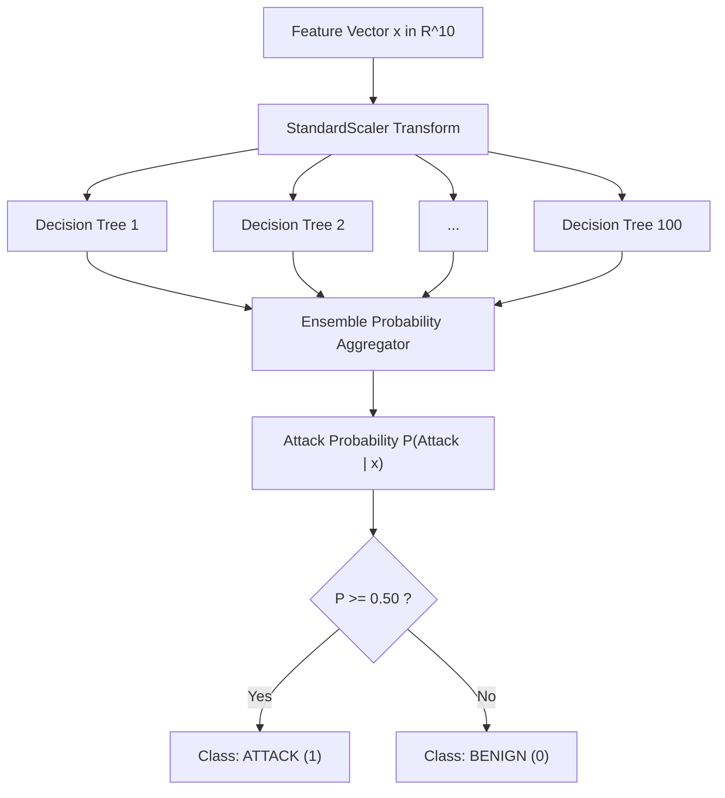
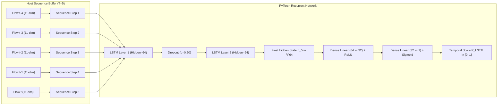
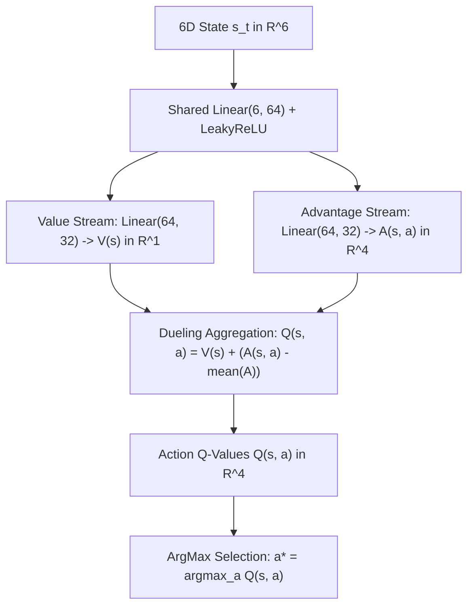

# XRL-IDARS — Model Architecture & Machine Learning Contracts

**Document ID:** `DOC-ARCH-MODEL-001`  
**Version:** 1.0.0  
**Status:** COMPLETE & AUTHORITATIVE  
**Date:** October 30, 2026  
**Architect:** Principal Machine Learning Engineer  

---

## 1. Executive Summary

XRL-IDARS maintains a clean separation of concerns between its machine learning models:
1. **Primary Operational Detector**: **Random Forest (RF)** is the sole operational intrusion classifier, trained on tabular flow vectors ($X \in \mathbb{R}^{10}$) for sub-millisecond per-flow scoring.
2. **Experimental Sequence Detector**: **PyTorch LSTM** is an independent research model evaluating temporal multi-flow sequences ($X \in \mathbb{R}^{5 \times 11}$) for comparative academic analysis.
3. **Autonomous Response Policy**: **Dueling Deep Q-Network (DQN)** learns proactive mitigation strategies over a 6D causal state space.

---

## 2. Primary Operational Model: Random Forest (Scikit-Learn)

### Hyperparameters & Configuration:
- **Estimator**: `sklearn.ensemble.RandomForestClassifier`
- **Number of Estimators ($n_{\text{trees}}$)**: 100 trees
- **Split Criterion**: Gini Impurity ($\text{Gini} = 1 - \sum p_i^2$)
- **Maximum Depth**: Unconstrained (natural leaf stopping at pure node or minimum split)
- **Minimum Samples Split**: 2
- **Class Weighting**: Balanced (`class_weight='balanced'`) to adjust for class imbalance
- **Input Dimension**: $X \in \mathbb{R}^{10}$ (R10 Canonical Features)
- **Output**: Calibrated posterior probability $P(\text{Attack} \mid x) \in [0.0, 1.0]$

---

## 3. Experimental Research Model: Temporal PyTorch LSTM

### Network Architecture:
- **Input Shape**: $(B, T, F) = (B, 5, 11)$ where $B$ is batch size, $T=5$ consecutive flows, and $F=11$ features (R10 features + inter-flow arrival delta $\Delta t$).
- **Recurrent Backbone**: 2-layer stacked LSTM:
  - Layer 1: $\text{LSTM}(\text{input\_size}=11, \text{hidden\_size}=64, \text{batch\_first}=\text{True})$
  - Dropout: $p = 0.20$
  - Layer 2: $\text{LSTM}(\text{input\_size}=64, \text{hidden\_size}=64, \text{batch\_first}=\text{True})$
- **Dense Head**:
  - Linear layer: $\text{Linear}(64, 32)$ with $\text{ReLU}$ activation
  - Output projection: $\text{Linear}(32, 1)$ with $\text{Sigmoid}$ activation
- **Loss Function**: Binary Cross Entropy with Logits (`BCEWithLogitsLoss`)
- **Optimizer**: Adam ($\text{lr} = 0.001$, weight decay $10^{-4}$)

---

## 4. Autonomous Response Policy: Dueling Deep Q-Network (DQN)

### Architecture Formulation:
Standard Q-networks suffer from overestimating action values in states where action choice does not affect the outcome. The Dueling DQN architecture decouples state-value estimation from action-advantage estimation:
$$Q(s, a; \theta, \alpha, \beta) = V(s; \theta, \beta) + \left( A(s, a; \theta, \alpha) - \frac{1}{|\mathcal{A}|} \sum_{a' \in \mathcal{A}} A(s, a'; \theta, \alpha) \right)$$

### Network Specifications:
- **Input Dimension**: $s_t \in \mathbb{R}^6$
- **Feature Extractor**: Linear(6, 64) $\to$ LayerNorm $\to$ LeakyReLU(0.01)
- **Value Stream ($V$)**: Linear(64, 32) $\to$ LeakyReLU $\to$ Linear(32, 1)
- **Advantage Stream ($A$)**: Linear(64, 32) $\to$ LeakyReLU $\to$ Linear(32, $|\mathcal{A}|$)
- **Action Dimension ($|\mathcal{A}|$)**: 4 actions (3-action configuration also supported):
  - $a=0$: `NO_ACTION`
  - $a=1$: `RATE_LIMIT`
  - $a=2$: `QUARANTINE_IP`
  - $a=3$: `DEEP_INSPECTION`

