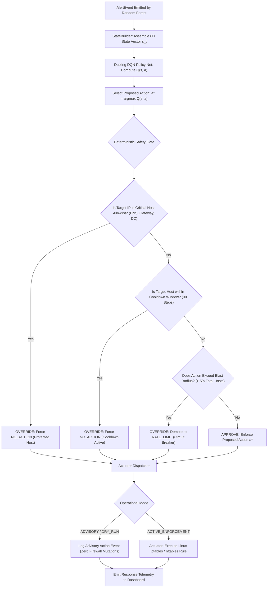

# XRL-IDARS — Autonomous Response & Safety Architecture

**Document ID:** `DOC-ARCH-RESPONSE-001`  
**Version:** 1.0.0  
**Status:** COMPLETE & AUTHORITATIVE  
**Date:** October 30, 2026  
**Architect:** Senior Network Security Systems Engineer  

---

## 1. Executive Summary

Autonomous response in security systems carries severe risk: an unconstrained reinforcement learning policy could isolate critical domain controllers, induce broadcast storms, or cause self-inflicted Denial of Service (DoS) due to false-positive reward drift.

To eliminate these risks, XRL-IDARS enforces a **strict architectural decoupling**:
1. **Detection is Independent**: Random Forest detects intrusions based purely on flow semantics.
2. **Response Policy is Advisory**: The Dueling DQN policy recommends mitigation actions based on system state.
3. **Safety Gate is Deterministic**: Every proposed action must pass through non-negotiable deterministic security constraints.
4. **Advisory / Dry-Run by Default**: Zero host network firewall mutation occurs unless explicitly authorized in controlled testbeds.

---

## 2. Response Decision & Safety Gate Flowchart

---

## 3. Four Deterministic Safety Gate Invariants

The `DeterministicSafetyGate` (`src/xrlids/rules/` and `src/xrlids/response/safety.py`) evaluates every proposed action against four mathematical invariants before dispatching:

### Invariant 1: Critical Infrastructure Allowlist
- **Rule**: If `host_ip` $\in \mathcal{S}_{\text{critical}}$, any quarantine or blocking action is instantly overridden to `NO_ACTION`.
- **Protected Entities**: Default gateway, core DNS resolvers (`1.1.1.1`, `8.8.8.8`), DHCP servers, monitoring collectors, and local loopback (`127.0.0.1`).
- **Failure Mode Prevented**: Policy agent accidentally isolating network infrastructure during a spoofed flood attack.

### Invariant 2: Host Cooldown Hysteresis
- **Rule**: A host that undergoes an active mitigation action ($a \in \{1, 2\}$) cannot undergo another disruptive action until $T_{\text{cooldown}} = 30$ subsequent flow steps have elapsed.
- **State Tracking**: `last_mitigated_step[host_ip]` maintained in an eviction-safe dictionary.
- **Failure Mode Prevented**: Flapping responses and oscillating state transitions that cause TCP socket degradation.

### Invariant 3: Blast-Radius Circuit Breaker
- **Rule**: The fraction of concurrently quarantined hosts must not exceed $5\%$ of total monitored endpoints:
  $$\frac{|\mathcal{H}_{\text{quarantined}}|}{|\mathcal{H}_{\text{active}}|} \le 0.05$$
- **Action on Violation**: If a proposed `QUARANTINE_IP` violates this limit, it is automatically demoted to `RATE_LIMIT` with an audit event emitted.
- **Failure Mode Prevented**: Mass self-inflicted network blackout caused by distributed spoofing attacks.

### Invariant 4: Dry-Run / Advisory Isolation
- **Rule**: All execution calls route to the `AdvisoryActuator` by default.
- **Guarantee**: Zero invocation of `iptables -A INPUT -j DROP`, zero modification of `/etc/hosts.deny`, and zero socket manipulation.

---

## 4. DQN Reward Function Formulation

The reinforcement learning agent was trained in a simulated network defense environment with cost-penalized Markov Decision Process (MDP) dynamics:

$$R(s, a, s') = R_{\text{mitigation}}(s, a) - C_{\text{operational}}(a) - P_{\text{false\_alarm}}(s, a)$$

Where:
- **$R_{\text{mitigation}}$**: $+10.0$ for isolating confirmed high-confidence attacks ($P \ge 0.80$).
- **$C_{\text{operational}}$**: Cost penalty representing operational disruption:
  - `NO_ACTION`: $0.0$
  - `DEEP_INSPECTION`: $-0.5$
  - `RATE_LIMIT`: $-2.0$
  - `QUARANTINE_IP`: $-10.0$
- **$P_{\text{false\_alarm}}$**: Heavy penalty ($-50.0$) if quarantine or rate-limiting is applied to benign traffic ($P < 0.20$).

This reward structure naturally trains the agent to apply the minimal effective intervention rather than aggressively quarantining all suspicious hosts.
