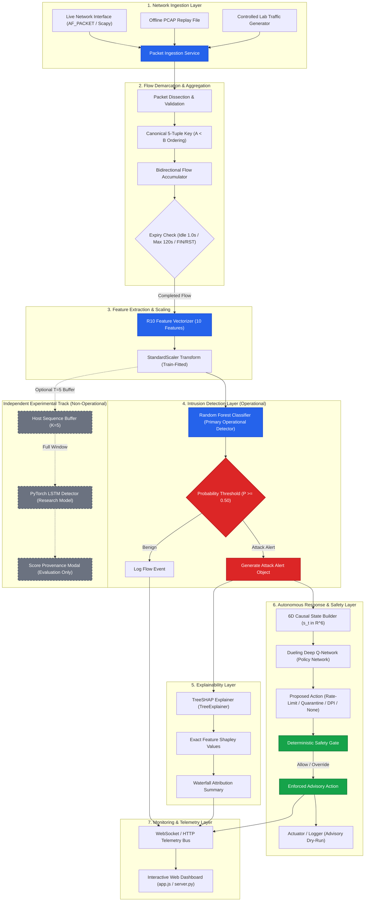

# XRL-IDARS — System Architecture Specification

**Document ID:** `DOC-ARCH-SYSTEM-001`  
**Version:** 1.0.0  
**Status:** COMPLETE & AUTHORITATIVE  
**Date:** October 30, 2026  
**Architect:** Principal Software & Network Security Architect  

---

## 1. Executive Overview

The **Explainable Reinforcement Learning-Based Intrusion Detection and Autonomous Response System (XRL-IDARS)** is an end-to-end, modular, real-time network defense platform. It ingests raw network packets, assembles bidirectional transport-layer flows, extracts deterministic statistical features, detects malicious behavior using a tabular Random Forest classifier, generates exact TreeSHAP feature attributions, proposes proactive mitigation actions via a Dueling Deep Q-Network (DQN), enforces safety constraints through a deterministic gate, and streams real-time telemetry to an interactive web dashboard.

---

## 2. High-Level System Architecture Diagram

---

## 3. Fourteen Core Execution Layers

1. **Network Packet Capture**: Multi-backend packet listener supporting Scapy sniffers, raw Linux sockets (`AF_PACKET`), and offline `.pcap` streams with bounded queues.
2. **Packet Parsing**: Strict protocol decoders extracting IPv4/IPv6 headers, TCP sequence/acknowledgment numbers, window sizes, flags, UDP lengths, and microsecond packet timestamps.
3. **Flow Identification & Lifecycle**: Bidirectional 5-tuple canonicalization ensuring $(A \to B)$ and $(B \to A)$ map to the same `FlowKey`. Expiry handled by idle timeout ($1.0\,\text{s}$), maximum active duration ($120.0\,\text{s}$), and TCP teardown flags (`FIN`, `RST`).
4. **Flow Feature Computation**: Mathematical feature vectorizer computing duration, flow rates (packets/s, bytes/s), packet length moments ($\mu, \sigma$ with population $\text{ddof}=0$), TCP flag binary indicators, and SYN/ACK ratios.
5. **Feature Validation & Preprocessing**: Schema validator enforcing the 10-feature R10 contract, rejecting `NaN`/`Inf`, and applying frozen `StandardScaler` transformations.
6. **Random Forest Inference**: 100-tree Scikit-Learn forest producing calibrated binary attack probabilities within $< 1.0\,\text{ms}$.
7. **Attack Classification**: Threshold comparator evaluating $P(\text{attack}) \ge 0.50$, labeling flows as `BENIGN` or `ATTACK`.
8. **Explainability Generation**: Exact TreeSHAP game-theoretic feature attribution identifying top positive and negative drivers of the detection score.
9. **Alert Event Creation**: Cryptographically serializable `AlertEvent` packaging flow 5-tuple, timestamp, prediction score, detection source, and top SHAP drivers.
10. **DQN Response Recommendation**: Dueling DQN model evaluating the 6D causal system state vector and proposing cost-optimal mitigation actions.
11. **Deterministic Safety Validation**: Multi-invariant safety gate enforcing cooldown timers, blast-radius circuit breakers, and protected infrastructure IP whitelists.
12. **Response Execution (Advisory / Dry-Run)**: Simulated actuator logging host containment actions without mutating local kernel firewall tables.
13. **Event Persistence & Telemetry**: Bounded ring-buffer logger preserving flow observations and alerts for REST retrieval and session replay.
14. **Dashboard Presentation**: Single-page web interface providing real-time traffic charts, flow logs, TreeSHAP waterfall graphs, and policy audit logs.
