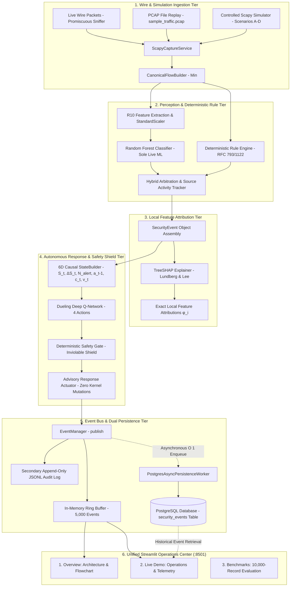

# XRL-IDARS — Final System Workflow & Architecture Specification

## 1. End-to-End Operational Architecture

---

## 2. Invariant Separation of Responsibilities

1. **Perception (Random Forest Champion)**:
   - Evaluates the standardized continuous threat posterior $P(\text{ATTACK}) \in [0.0, 1.0]$.
   - Operates statelessly on the canonical $R_{10}$ statistical contract.
   - Evaluates completed flows in $< 0.80\,\text{ms}$ CPU latency.
   - **Sole operational ML detector**.

2. **Explainability (TreeSHAP Engine)**:
   - Computes exact local Shapley attributions explaining which flow features drove the Random Forest score higher (positive attribution) or lower (negative attribution).
   - $\sum_{i=1}^{10} \phi_i = f(x) - E[f(x)]$.
   - **TreeSHAP explains the Random Forest detector, not the DQN policy**.

3. **Autonomous Response (Dueling DQN)**:
   - Evaluates expected cumulative returns (Q-values) across four discrete mitigation actions: `ALLOW`, `ALERT`, `RATE_LIMIT`, `ISOLATE`.
   - Driven by a causal 6-dimensional state vector $\mathbf{s}_t = [S_t, \Delta S_t, N_{\text{alert}}, a_{t-1}, c_t, v_t]$.
   - Q-values represent expected return, **not classification probabilities**.

4. **Safety Shielding (Deterministic Safety Gate)**:
   - Critical host protection: Exempted hosts (gateway, DNS, active directory) can never be quarantined or isolated.
   - 30-second cooldown: Prevents rapid re-triggering on the same host.
   - Blast-radius circuit breaker: Maximum 5% of network hosts quarantined simultaneously.
   - **Advisory dry-run mode**: Default mode performs zero host kernel/firewall mutations.

5. **Event Persistence (Asynchronous PostgreSQL & JSONL)**:
   - Bounded queue with 10,000-event capacity.
   - Off the critical packet detection path: $O(1)$ submission via `put_nowait()`.
   - Outage isolation: Automatically fails over to `memory` mode with JSONL append logging if PostgreSQL is unreachable.
   - Restart recovery: Automatically queries PostgreSQL when the memory ring buffer is empty after application restart.

---

## 3. Supported Traffic & Attack Scenarios

All demonstration scenarios execute through the **same canonical operational detection pipeline**:

| Scenario ID | Name | Protocol Signature | Expected Rule | RF Decision | DQN Action | Safety Gate |
| :--- | :--- | :--- | :--- | :--- | :--- | :--- |
| `scenario_a_benign` | Normal Traffic & Ping | Normal TCP 3-way handshake, HTTP 200 OK, ordinary ICMP Echo/Reply | None | `BENIGN` ($P \le 0.15$) | `ALLOW` | Approved |
| `scenario_b_port_scan` | Port Scan Simulation | Rapid SYN probes across ports 21, 22, 80, 443, 8080 | `RULE-PORT-SCAN` | `ATTACK` | `ALERT` / `RATE_LIMIT` | Approved |
| `scenario_c_syn_burst` | Volumetric TCP SYN Burst | High-frequency SYN flood to port 80, zero ACKs, high asymmetry | `RULE-SYN-FLOOD` | `ATTACK` ($P \ge 0.85$) | `ISOLATE` | `ISOLATE` / `ALERT` (if exempt) |
| `scenario_d_icmp_burst` | Controlled ICMP Flood | Bounded ICMP echo flood burst targeting loopback/lab | `RULE-ICMP-FLOOD` | `ATTACK` / `RULE` | `RATE_LIMIT` | Approved |
| `pcap_replay` | Wire Stream Replay | `sample_traffic.pcap` authentic wire frames | Dynamic | Flow-specific | Adaptive | Verified Advisory |

---

## 4. Offline Benchmark Track

The benchmark track is strictly decoupled from operational live detection:

- **10,000-Record Authoritative Evaluation**: Evaluates 10,000 genuine flow records sampled deterministically from CIC-IDS2017 with exact raw CSV provenance.
- **Random Forest**: $85.42\%$ accuracy, $97.18\%$ precision, $0.8334$ F1-score across 10,000 mixed flows.
- **PyTorch LSTM FlowSeq (5-Flow Causal Sequence)**: $77.77\%$ accuracy, $98.59\%$ precision, $0.7163$ F1-score across 9,969 valid sequence flows. (Note: On specific DDoS flood windows, LSTM achieves $99.96\%$).
- **Convex RF–LSTM Fusion ($\alpha=0.70$)**: $82.79\%$ accuracy, $99.76\%$ precision, $0.7919$ F1-score.
- **Scientific Finding**: Demonstrates why Random Forest was selected as the sole operational detector: it maintains consistent generalizability across diverse multi-class attack families statelessly without cold-start sequence buffering delay.
