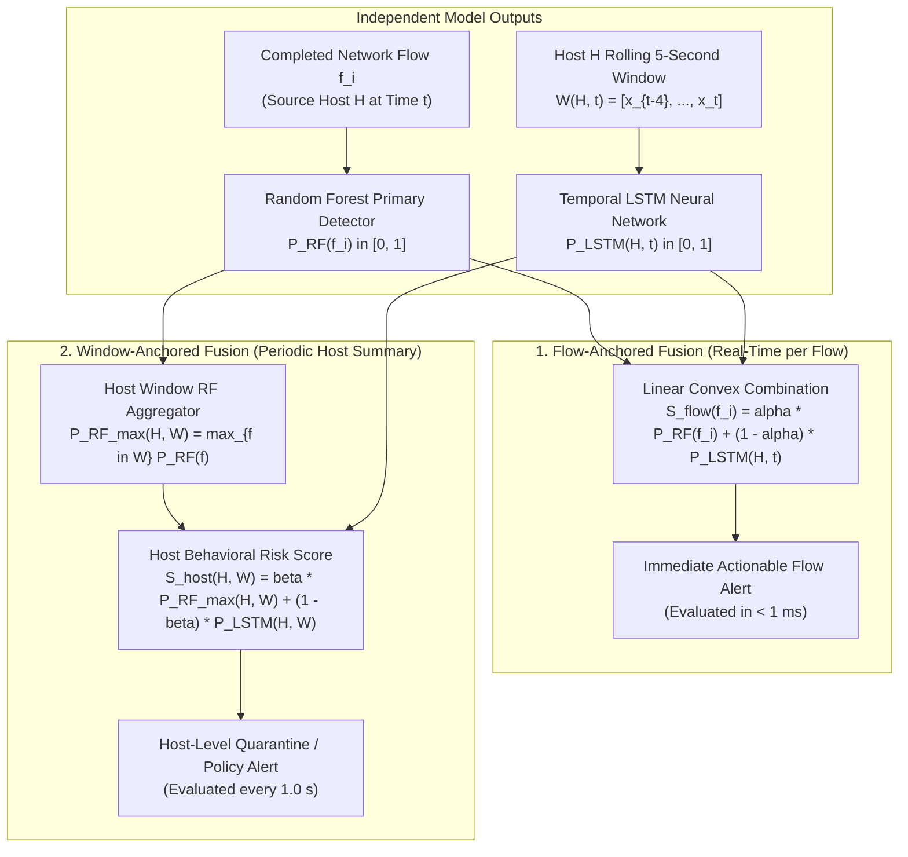
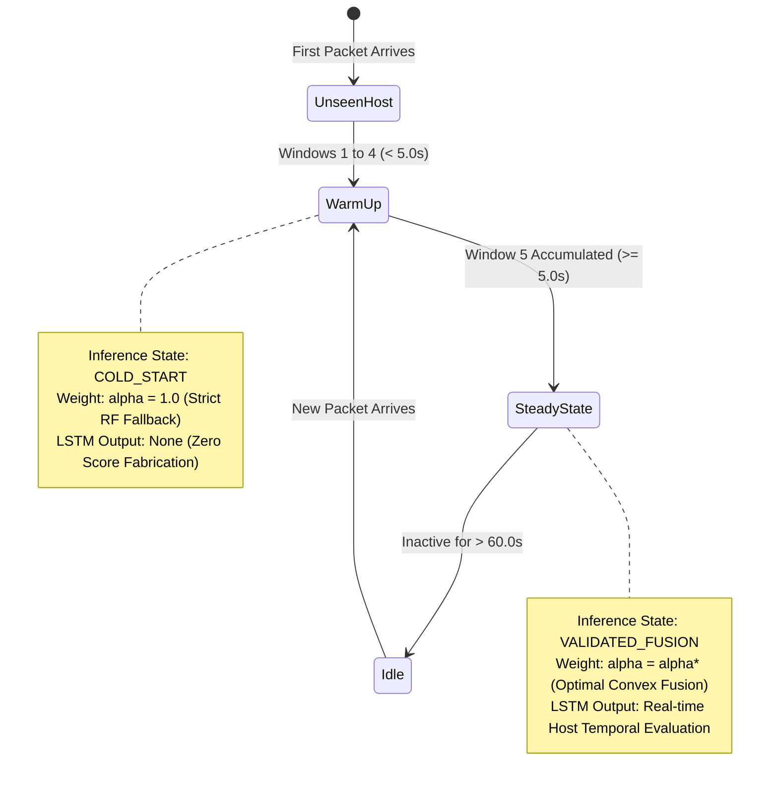

# XRL-IDARS — Multi-Model Score Fusion & Alignment Methodology

**Document ID:** `RESEARCH-DOC-2026-FUS-003`  
**Version:** 1.0.0  
**Phase:** Phase 1 — Temporal Architecture and Dataset Feasibility  
**Date:** October 30, 2026  
**Author:** Senior Network Security ML Architect  
**Status:** COMPLETE & AUTHORITATIVE  
**Repository:** `/home/rishikesh/Desktop/fyp-xrlids`  

---

## 1. Executive Summary & The Granularity Mismatch Problem

### 1.1 Plain-Language Overview
In XRL-IDARS, we combine two very different kinds of artificial intelligence:
1. **Random Forest (Flow-Level):** Evaluates a single network conversation as soon as it ends. It is fast ($< 1\,\text{ms}$) and highly accurate on individual connection attributes.
2. **Temporal LSTM (Host-Level):** Evaluates a rolling 5-second history of an entire host computer's behavior.

A fundamental scientific challenge arises: **How do you mathematically combine a score for a single flow with a score for an entire 5-second host window?**
If a computer opens 10 connections in a single second, does the LSTM predict 10 times? Or does it predict once per second? If an isolated DNS query finishes, how does it combine with the host's 5-second activity history?

This methodology defines the formal mathematical alignment, calibration protocol, cold-start fallback rules, and dashboard integration mechanics.

---

## 2. Mathematical Score Aggregation Models

We define two mathematically sound fusion paradigms: **Flow-Anchored Fusion** (for real-time packet processing) and **Window-Anchored Fusion** (for periodic host risk auditing).



### 2.1 Model 1: Flow-Anchored Fusion (Real-Time Ingestion)
When network flow $f_i$ terminates for host $H$ at wall-clock time $t$:
1. The Random Forest immediately evaluates the canonical R10 feature vector of flow $f_i$:
   $$P_{\text{RF}}(f_i) = \text{RF.predict\_proba}(\mathbf{x}_{R10}(f_i)) \in [0, 1]$$
2. The pipeline queries the host's most recently computed temporal LSTM probability from the thread-safe `HostRiskCache`:
   $$P_{\text{LSTM}}(H, t) = \text{HostRiskCache.get}(H, \text{default}=\text{None})$$
3. If $P_{\text{LSTM}}(H, t)$ is available and validated (host history $\ge 5$ windows):
   $$S_{\text{flow}}(f_i) = \alpha \cdot P_{\text{RF}}(f_i) + (1 - \alpha) \cdot P_{\text{LSTM}}(H, t), \quad \alpha \in [0, 1]$$
4. If the host is in warm-up ($< 5$ windows), fallback is enforced:
   $$S_{\text{flow}}(f_i) = P_{\text{RF}}(f_i) \quad (\alpha = 1.0)$$

### 2.2 Model 2: Window-Anchored Fusion (Host Risk Aggregation)
At the end of each 1-second window $W_k(H) = [t_k, t_k + 1.0\,\text{s})$:
1. All flows terminating within window $W_k(H)$ are queried: $\mathcal{F}_k(H) = \{f_{i} \mid \text{end\_time}(f_i) \in W_k(H)\}$.
2. The peak flow threat is extracted:
   $$P_{\text{RF, max}}(W_k) = \begin{cases} \max_{f \in \mathcal{F}_k(H)} P_{\text{RF}}(f) & \text{if } \mathcal{F}_k(H) \neq \emptyset \\ 0.0 & \text{otherwise} \end{cases}$$
3. The Temporal LSTM evaluates the 5-second host activity sequence:
   $$P_{\text{LSTM}}(W_k) = \sigma(f_{\theta}(\mathbf{S}(H, k)))$$
4. The window-level host security threat is computed:
   $$S_{\text{host}}(W_k) = \beta \cdot P_{\text{RF, max}}(W_k) + (1 - \beta) \cdot P_{\text{LSTM}}(W_k), \quad \beta \in [0, 1]$$

---

## 3. Calibration & Weight Tuning Protocol

### 3.1 Why the Old Fusion Weights ($\alpha = 0.5$) Must Be Discarded
In [`models/fusion/fusion_weights.json`](file:///home/rishikesh/Desktop/fyp-xrlids/models/fusion/fusion_weights.json), the fusion weight is set to $\alpha = 0.5$.
Our Phase 0 empirical audit demonstrated why this weight is scientifically invalid for live deployment:
- $\alpha = 0.5$ was tuned on an offline test set where the LSTM was artificially inflated by CSV row-order burst clustering.
- In live operation, the old LSTM is out-of-distribution. Giving an uncalibrated, out-of-distribution LSTM $50\%$ voting weight directly pulls down the high-precision Random Forest ($99.01\%$ recall), causing false negatives and degraded detection.

### 3.2 Calibration Procedure for New Temporal Models
1. **Probability Calibration (Platt / Isotonic Scaling)**:
   Raw outputs from both Random Forest and LSTM are calibrated on the **Validation Split** using Isotonic Regression or Platt Temperature Scaling so that:
   $$\mathbb{P}(Y = 1 \mid \hat{P} = p) \approx p$$
2. **Convex Weight Optimization ($\alpha$)**:
   Using the calibrated probabilities on the held-out temporal validation split, $\alpha$ is optimized via bounded grid search over $\alpha \in [0.0, 1.0]$ in increments of $0.05$:
   $$\alpha^* = \arg\max_{\alpha \in [0, 1]} \text{PR-AUC}\left( \alpha \cdot \hat{P}_{\text{RF}} + (1 - \alpha) \cdot \hat{P}_{\text{LSTM}}, \, Y_{\text{val}} \right)$$
3. **Safety Constraint**:
   If the optimized fusion does not statistically outperform Random Forest alone on the validation set ($\text{PR-AUC}_{\text{fusion}} \le \text{PR-AUC}_{\text{RF}}$), the system defaults to $\alpha = 1.0$ (Random Forest primary, LSTM informative only).

---

## 4. Cold-Start & Warm-Up Fallback Invariant

Network traffic is bursty and ephemeral. A host may connect for 2 seconds, send a single DNS query, and disconnect.



### Fallback Invariant Rules:
1. **Zero Score Fabrication**: Under no circumstances will the system substitute synthetic probabilities, mean imputation, or neutral defaults ($0.5$) for unaccumulated LSTM sequences.
2. **Deterministic Fallback**: If $\text{len}(\text{Buffer}(H)) < 5$, `UnifiedInferenceService` returns:
   - `model_used`: `"RANDOM_FOREST_FALLBACK"`
   - `attack_score`: $P_{\text{RF}}(f_i)$
   - `lstm_score`: `None`
   - `fusion_weight_rf`: $1.0$

---

## 5. Dashboard Defect D-01: Smallest Safe Correction

### 5.1 Defect Mechanism Analysis
In [`dashboard/server.py` line 1266](file:///home/rishikesh/Desktop/fyp-xrlids/dashboard/server.py#L1266):
```python
# CURRENT CODE (Defect D-01)
session_key = f"{src_ep}->{dst_ep}"
```
In dataset exhibition stream mode, `src_ep` is generated as `192.0.2.{10 + (flow_id % 200)}:{40000 + flow_id}`.
Because each flow has a unique client port (`40000 + flow_id`), every single flow is assigned a unique `session_key`. The buffer length for every key is permanently $1$. The LSTM buffer never reaches $T=5$, and the dashboard permanently falls back to Random Forest.

### 5.2 Why Stripping Port Alone Does NOT Solve Temporal Semantics
If we simply change line 1266 to:
```python
# NAIVE FIX: Stripping port alone
src_ip = src_ep.split(":")[0]
dst_ip = dst_ep.split(":")[0]
session_key = f"{src_ip}->{dst_ip}"
```
This naive fix causes 5 flows between that IP pair to accumulate, triggering the LSTM.
**HOWEVER**, in dataset exhibition mode, those 200 flows were sampled randomly from the offline held-out test split (166 benign, 34 attacks across different times and files). They are **NOT** contiguous chronological flows!
Feeding 5 randomly sampled flows into an LSTM and presenting the output to an examiner as "temporal sequence detection" would be a severe scientific integrity violation during project viva defense.

### 5.3 The Authoritative Smallest Safe Correction
To correct Defect D-01 safely and honestly without compromising academic integrity, apply the following minimal three-part patch:

1. **Code Correction**: Group by host IP in `dashboard/server.py`:
   ```python
   # Smallest safe grouping
   src_ip = src_ep.split(":")[0] if ":" in src_ep else src_ep
   dst_ip = dst_ep.split(":")[0] if ":" in dst_ep else dst_ep
   session_key = f"{src_ip}->{dst_ip}"
   ```
2. **Telemetry Metadata Annotation**:
   In the emitted WebSocket telemetry payload, add an explicit semantic mode tag:
   ```json
   {
     "fusion_status": "DEMONSTRATION_BUFFER_SYNTHETIC",
     "temporal_parity_valid": false,
     "disclaimer": "Exhibition stream flows are sampled from offline splits. Displayed LSTM sequence demonstrates pipeline buffer mechanics, not operational temporal classification."
   }
   ```
3. **UI Transparency**:
   In [`dashboard/index.html`](file:///home/rishikesh/Desktop/fyp-xrlids/dashboard/index.html), when the LSTM fires in Dataset Stream mode, display an informational badge:
   `"LSTM Buffer: Demonstration Mode (Unordered Split Data)"`
   while maintaining **Random Forest** as the certified primary operational detector.
