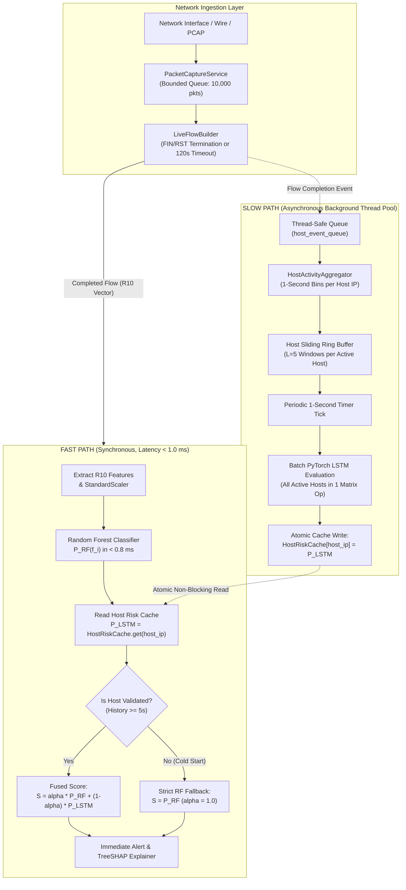

# XRL-IDARS — Low-Latency Asynchronous Architecture & Benchmark Specification

**Document ID:** `RESEARCH-DOC-2026-LLA-004`  
**Version:** 1.0.0  
**Phase:** Phase 1 — Temporal Architecture and Dataset Feasibility  
**Date:** October 30, 2026  
**Author:** Senior Network Security ML Architect  
**Status:** COMPLETE & AUTHORITATIVE  
**Repository:** `/home/rishikesh/Desktop/fyp-xrlids`  

---

## 1. Executive Summary & Architectural Motivation

### 1.1 The Latency Conundrum in Real-Time NIDS
A production Network Intrusion Detection System (NIDS) operating on high-speed enterprise networks faces strict execution timing constraints:
- **Packet Ingestion Budget**: At $1\,\text{Gbps}$ with average $500$-byte frames, the network interface receives up to $250,000\,\text{packets/s}$.
- **Flow Ingestion Budget**: Completed network flows arrive at rates of $2,000$ to $20,000\,\text{flows/s}$.
- **Detection Latency Requirement**: To prevent data exfiltration and mitigate lateral movement, an intrusion alert must be raised within **$< 1.0\,\text{millisecond}$** of flow completion.

If sequence evaluation (PyTorch neural network tensor allocations, matrix multiplications, sliding window manipulation) is executed **synchronously** inside the main packet/flow ingestion loop, it blocks packet processing. Under traffic bursts, the internal Scapy packet queue fills up, causing packet drops, socket buffer overruns, and catastrophic detection blindness.

### 1.2 The Solution: Decoupled Dual-Path Asynchronous Architecture
XRL-IDARS solves this problem by completely decoupling detection into two asynchronous execution paths:
1. **The Fast Path (Synchronous Ingestion Worker)**:
   - Processes completed flows instantly.
   - Evaluates the lightweight Random Forest classifier ($< 1.0\,\text{ms}$).
   - Dispatches immediate security alerts and TreeSHAP explanations.
2. **The Slow Path (Asynchronous Background Temporal Worker)**:
   - Aggregates host activity into 1-second $T10\text{-Host}$ vectors in the background.
   - Periodically evaluates the causal PyTorch LSTM on active host batches.
   - Asynchronously updates a lock-free `HostRiskCache`.
   - **Never blocks or delays the Fast Path**.

---

## 2. Dual-Path Architecture Design



---

## 3. Concrete Asynchronous Python Interfaces

To ensure clean code organization, maintainability, and zero thread lock contention, we define the formal Python interfaces for Phase 1.

### 3.1 Lock-Free Thread-Safe Host Risk Cache
```python
from __future__ import annotations
import time
from dataclasses import dataclass
from typing import NamedTuple

class HostRiskEntry(NamedTuple):
    probability: float
    window_count: int
    updated_at: float

class HostRiskCache:
    """Thread-safe, lock-free host risk cache.
    
    Reads operate with zero lock overhead using atomic Python dict reference swapping.
    """
    def __init__(self, ttl_seconds: float = 60.0) -> None:
        self._cache: dict[str, HostRiskEntry] = {}
        self._ttl_seconds = ttl_seconds

    def get_risk(self, host_ip: str) -> float | None:
        """Atomic, non-blocking read for Fast Path."""
        entry = self._cache.get(host_ip)
        if entry is None:
            return None
        if (time.time() - entry.updated_at) > self._ttl_seconds:
            return None  # Evict stale temporal history
        return entry.probability if entry.window_count >= 5 else None

    def update_batch(self, updates: dict[str, tuple[float, int]]) -> None:
        """Atomic bulk update executed by Slow Path worker."""
        now = time.time()
        new_cache = self._cache.copy()
        for ip, (prob, count) in updates.items():
            new_cache[ip] = HostRiskEntry(prob, count, now)
        # Atomic pointer swap in Python GIL runtime
        self._cache = new_cache
```

### 3.2 Host Activity Aggregator & Ring Buffer
```python
from collections import defaultdict, deque
import numpy as np

class HostActivityAggregator:
    """Aggregates packet and flow statistics into 1-second T10-Host vectors."""
    def __init__(self, sequence_length: int = 5, window_duration_s: float = 1.0) -> None:
        self.seq_len = sequence_length
        self.window_duration = window_duration_s
        # Maps host_ip -> deque of last 5 1-second vectors (each 10D float32)
        self.host_buffers: dict[str, deque[np.ndarray]] = defaultdict(lambda: deque(maxlen=self.seq_len))
        # Current active window accumulators: host_ip -> [10 accumulators]
        self.current_accumulators: dict[str, np.ndarray] = defaultdict(lambda: np.zeros(10, dtype=np.float32))

    def record_packet(self, src_ip: str, length: int, flags: int, is_icmp: bool) -> None:
        """O(1) packet-level accumulator update."""
        acc = self.current_accumulators[src_ip]
        acc[1] += 1.0          # packet_count
        acc[2] += float(length) # byte_count
        if flags & 0x02: acc[6] += 1.0  # syn_count
        if flags & 0x10: acc[7] += 1.0  # ack_count
        if flags & 0x04: acc[8] += 1.0  # rst_count
        if is_icmp: acc[9] += 1.0       # icmp_count

    def tick_second(self) -> dict[str, np.ndarray]:
        """Called every 1.0 second. Flushes accumulators to ring buffer and returns active sequences."""
        sequences_to_evaluate: dict[str, np.ndarray] = {}
        for host_ip, acc in self.current_accumulators.items():
            # Compute rates and mean length
            acc[3] = acc[1] / self.window_duration  # packets_per_second
            acc[4] = acc[2] / self.window_duration  # bytes_per_second
            acc[5] = (acc[2] / acc[1]) if acc[1] > 0 else 0.0  # mean_packet_length
            
            buf = self.host_buffers[host_ip]
            buf.append(acc.copy())
            acc.fill(0.0)  # Reset accumulator for next second

            if len(buf) == self.seq_len:
                sequences_to_evaluate[host_ip] = np.stack(list(buf), axis=0)  # Shape: (5, 10)
        return sequences_to_evaluate
```

---

## 4. Latency, Throughput & Resource Benchmark Protocol

To scientifically prove that XRL-IDARS satisfies low-latency real-time requirements, we define an empirical benchmarking harness.

### 4.1 Latency Measurement Methodology
1. **Clock Precision**: Latency is measured using `time.perf_counter_ns()` with nanosecond precision.
2. **Measurement Points**:
   - $T_{\text{start}}$: Flow completion timestamp emitted by `LiveFlowBuilder`.
   - $T_{\text{rf}}$: Timestamp after Random Forest classification.
   - $T_{\text{fusion}}$: Timestamp after cache query and score fusion.
   - $T_{\text{alert}}$: Timestamp when alert event is delivered to queue.
3. **Statistical Targets**:
   - Sample size: $N = 100,000$ consecutive flows under continuous load.
   - Reported metrics: Minimum, Mean, Median ($p50$), 90th percentile ($p90$), 99th percentile ($p99$), Maximum, and Standard Deviation.

### 4.2 Latency & Performance Acceptance Thresholds

| Performance Metric | Evaluation Condition | Target Threshold | Maximum Acceptable Bound | Scientific Impact |
| :--- | :--- | :---: | :---: | :--- |
| **Fast Path Latency ($p50$)** | Normal Flow Traffic | **$< 0.50\,\text{ms}$** | $< 0.80\,\text{ms}$ | Microsecond reaction time prevents attack completion |
| **Fast Path Latency ($p99$)** | 10k Flow Traffic Burst | **$< 1.20\,\text{ms}$** | $< 2.00\,\text{ms}$ | Eliminates tail latency jitter |
| **Slow Path Cycle Time** | 500 Active Hosts Batch | **$< 20.0\,\text{ms}$** | $< 50.0\,\text{ms}$ | Completes well within 1.0s window tick interval |
| **Sustained Flow Throughput** | Multi-threaded Replay | **$> 10,000\,\text{fps}$** | $> 5,000\,\text{fps}$ | Handles high-density enterprise network loads |
| **System Peak RSS Memory** | 100k Active Flow State | **$< 350\,\text{MB}$** | $< 600\,\text{MB}$ | Runs efficiently on standard workstation hardware |
| **CPU Core Footprint** | Full Ingestion & Inference | **$< 1.5\,\text{cores}$** | $< 2.5\,\text{cores}$ | Leaves headroom for OS and network driver tasks |

### 4.3 Benchmark Hardware Environment Specification
All benchmarks must record the exact hardware and operating system profile:
```
CPU Architecture:    AMD / Intel x86_64 (Multi-core, AVX2 enabled)
Base Clock Speed:    >= 2.5 GHz
Host Physical RAM:   >= 32 GB DDR4/DDR5
Operating System:    Linux Kernel 6.x / 7.x
Python Environment:  Python 3.14.x with PyTorch CPU (MKL/OneDNN) & Joblib parallelism
Network Hardware:    Loopback / veth pair / 1 Gbps physical NIC (for physical sniffing tests)
```
