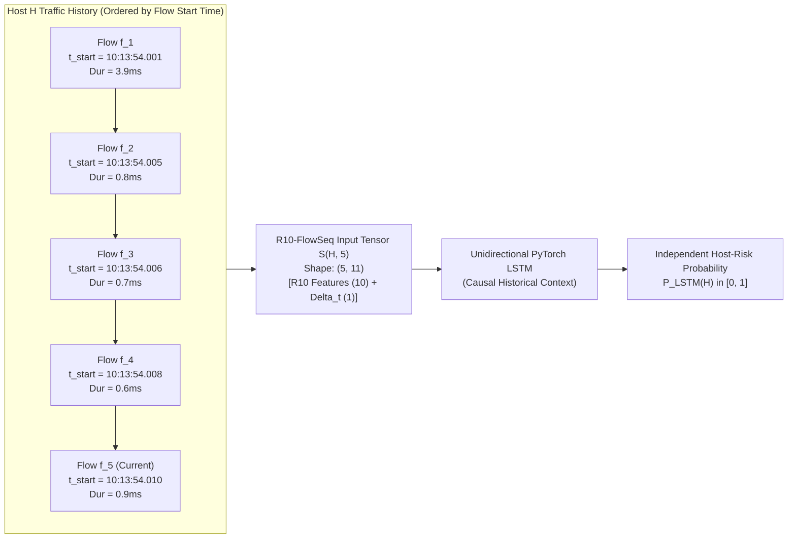
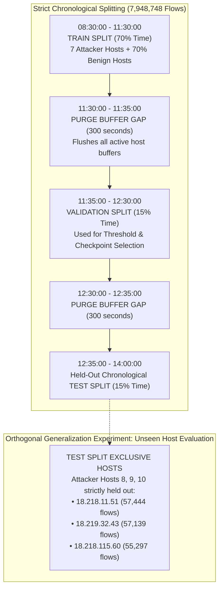
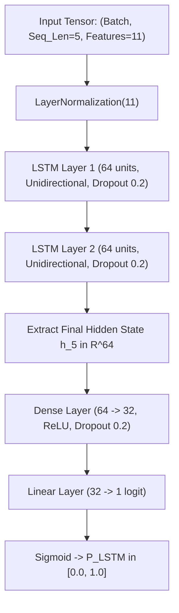

# XRL-IDARS — R10-FlowSeq Final Architecture & Sequence Specification

**Document ID:** `SPEC-2026-R10-FLOWSEQ-001`  
**Version:** 1.0.0  
**Phase:** Phase 1C — Temporal Architecture Finalization  
**Date:** October 30, 2026  
**Author:** Principal Network Security Architect & ML Systems Engineer  
**Status:** APPROVED ARCHITECTURAL SPECIFICATION (Implementation Ready)  
**Repository:** `/home/rishikesh/Desktop/fyp-xrlids`  

---

## 1. Executive Summary & Plain-Language Guide

### 1.1 The Plain-Language Concept
In Phase 1B, we proved that slicing network flow CSVs into artificial 1-second packet windows requires inventing fake packet arrival timings because $90.9\%$ of attack flows last longer than 1 second.

In response, the Project Lead approved **Option A: R10-FlowSeq (Chronological, Host-Aware Flow Sequences)**:
- Instead of pretending we have microsecond packet arrival data, we look at **completed network conversations (flows)**.
- For each source host computer (IP address), we watch a sequence of **5 consecutive completed flows** in the exact order they occurred.
- We evaluate whether the host’s sequence of network actions indicates an intrusion (e.g., an automated attack tool rapidly firing repeated HTTP requests).

### 1.2 Five Flows Does NOT Equal Five Seconds
A vital scientific truth that must be understood by the project lead, engineers, and viva examiners:
- In an automated DDoS attack (like LOIC), an attacker can fire **5 flows in 3 milliseconds**.
- In normal background desktop browsing, a user might initiate **5 flows over 15 minutes** (e.g., checking email, browsing a web page, syncing a clock).
- Therefore, **a sequence of 5 flows measures behavioral transaction count, NOT wall-clock elapsed time**.
- To give the neural network awareness of real physical time, we add an 11th feature: the **inter-flow arrival delta ($\Delta t_{\text{inter-flow}}$)**, which measures the elapsed seconds between the start of flow $i$ and flow $i-1$.

---

## 2. Finalized Sequence Semantics

### 2.1 The Sequence Definition
For any source host IP $H$, a valid sequence at step $k$ consists of $K=5$ consecutive completed flows:
$$\mathbf{S}(H, k) = \left[ \mathbf{v}_{k-4}, \mathbf{v}_{k-3}, \mathbf{v}_{k-2}, \mathbf{v}_{k-1}, \mathbf{v}_{k} \right] \in \mathbb{R}^{5 \times 11}$$
where each vector $\mathbf{v}_i = [\mathbf{x}_{R10}(f_i), \, \Delta t_i]$ consists of the 10 canonical R10 features plus the inter-flow arrival delta.

### 2.2 Sequence Ordering: Start Timestamp vs. Completion Timestamp
1. **Offline Training Ordering**: In the dataset, flows are sorted strictly by `Timestamp` (the arrival of the first packet in the flow). Ties are resolved deterministically using `(Flow Duration, Src Port, Dst Port)`.
2. **Live Streaming Ordering**: In live network capture, flows terminate when a TCP FIN/RST is seen or after a 120s idle timeout. A short flow ($10\,\text{ms}$) may finish *before* a long flow ($30\,\text{s}$) that started earlier.
   - *Live Resolution Invariant*: Each host sequence buffer maintains flows ordered by `flow.start_time`. When a flow completes, it is inserted into the host's rolling buffer at its chronological start time. If a completed flow is older than the oldest flow in the active 5-flow buffer, it is dropped from the temporal buffer without blocking its immediate Random Forest flow evaluation.

### 2.3 Sequence Ground-Truth Label Semantics
- **The Decision Rule: Current Flow Label**:
  $$y(\mathbf{S}(H, k)) = y(f_k) = \begin{cases} 1 & \text{if Flow } f_k \text{ is an Attack} \\ 0 & \text{if Flow } f_k \text{ is Benign} \end{cases}$$
- *Scientific Rationale*: In causal online detection, the question asked at step $k$ is: *"Given the historical context of the past 4 flows, is this current flow an attack?"*
- *Empirical Consistency*: In `Thuesday-20-02-2018`, all 10 attacker IPs sent $100\%$ attack flows, and benign hosts sent $100\%$ benign flows. Thus, $y(f_k) = y(f_{k-1}) = \dots = y(f_{k-4})$. In mixed scenarios, this formulation ensures the model detects the exact transition point where a benign host becomes compromised.

### 2.4 Cold-Start & Insufficient History Invariant
When a host $H$ connects for the first time, it has $N < 5$ flows in its buffer:
- **Operational Policy**: The LSTM **does not predict** and returns `status="WARMING_UP"`, `lstm_score=None`.
- **System Integrity**: Random Forest evaluates flow $f_i$ independently in $< 1.0\,\text{ms}$. Zero synthetic scores or fake averages are produced.

### 2.5 Inactivity Gap & Session Reset Invariant
If the elapsed time between two consecutive flows from the same host exceeds **$300.0\,\text{seconds}$ ($5\,\text{minutes}$)**:
$$\Delta t = t_{\text{start}}(f_i) - t_{\text{start}}(f_{i-1}) > 300.0\,\text{s}$$
- The buffer **flushes and resets**.
- *Rationale*: A flow occurring 2 hours after a previous connection belongs to an entirely separate user session. Treating them as consecutive events would produce invalid temporal correlations.

---

## 3. Live vs. Offline Feature Parity Mapping

To prevent feature drift between training and live deployment, we specify the exact 1-to-1 mapping between offline CSV columns, the R10 contract, and live Scapy-derived features.

| Feature Index | Canonical Feature Name | Offline CSV Column (`Thuesday-20-02`) | Live Scapy Extraction (`src/xrlids/demo/flow.py`) | Physical Units | Mathematical Invariant |
| :---: | :--- | :--- | :--- | :---: | :--- |
| **0** | `flow_duration_ms` | `Flow Duration` ($\mu\text{s} / 1000.0$) | `(flow.last_time - flow.start_time) * 1000.0` | Milliseconds | $\ge 0.0$ |
| **1** | `flow_packets_per_s` | `Flow Pkts/s` | `(fwd_pkts + bwd_pkts) / max(duration_s, 1e-6)` | Packets/sec | $\ge 0.0$ |
| **2** | `flow_bytes_per_s` | `Flow Byts/s` | `(fwd_bytes + bwd_bytes) / max(duration_s, 1e-6)` | Bytes/sec | $\ge 0.0$ |
| **3** | `packet_length_mean` | `Pkt Len Mean` | `total_bytes / max(total_pkts, 1)` | Bytes | $[0.0, 65535.0]$ |
| **4** | `packet_length_std` | `Pkt Len Std` | Population std dev (`ddof=0`) of packet lengths | Bytes | $\ge 0.0$ |
| **5** | `syn_count` | `SYN Flag Cnt` (Binary $\{0, 1\}$) | Clamped indicator: $\min(\text{flow.syn\_count}, 1.0)$ | Indicator | $\{0.0, 1.0\}$ |
| **6** | `ack_count` | `ACK Flag Cnt` (Binary $\{0, 1\}$) | Clamped indicator: $\min(\text{flow.ack\_count}, 1.0)$ | Indicator | $\{0.0, 1.0\}$ |
| **7** | `rst_count` | `RST Flag Cnt` (Binary $\{0, 1\}$) | Clamped indicator: $\min(\text{flow.rst\_count}, 1.0)$ | Indicator | $\{0.0, 1.0\}$ |
| **8** | `fin_count` | `FIN Flag Cnt` (Binary $\{0, 1\}$) | Clamped indicator: $\min(\text{flow.fin\_count}, 1.0)$ | Indicator | $\{0.0, 1.0\}$ |
| **9** | `syn_ack_ratio` | $\frac{\text{SYN}}{\max(\text{ACK}, 1.0)}$ | `syn_count / max(ack_count, 1.0)` | Ratio | $[0.0, 1.0]$ |
| **10**| `inter_flow_delta_s` | $t_{\text{start}}(f_i) - t_{\text{start}}(f_{i-1})$ | `current_flow.start_time - prev_flow.start_time` | Seconds | Clamped to $[0.0, 300.0]$ |

### Parity Audit Findings & Resolutions (Phase 1D):
1. **Flow Duration Unit Consistency**: Offline CSV is stored in microseconds ($\mu\text{s}$); it is strictly divided by $1,000.0$ to produce canonical milliseconds (`flow_duration_ms`), matching the live Scapy flow builder.
2. **Directionality Preservation**: In both offline and live pipelines, `fwd` represents packets from the connection initiator (`Src IP`), and `bwd` represents response packets from the server (`Dst IP`).
3. **Critical Offline/Live TCP Flag Parity Resolution**:
   - *Empirical Discovery*: In CICFlowMeter CSVs (both CIC-IDS2017 and CSE-CIC-IDS2018), `SYN Flag Cnt`, `ACK Flag Cnt`, `RST Flag Cnt`, and `FIN Flag Cnt` are binary indicators taking values in $\{0, 1\}$, **not** accumulated packet counts. In `preprocessor.joblib`, `ack_count` has mean $\mu \approx 0.215$ and standard deviation $\sigma \approx 0.411$, matching a Bernoulli distribution with $p = 0.215$ ($\sqrt{p(1-p)} = 0.4108$).
   - *Distribution Risk*: If a live flow extractor supplies raw packet counts (e.g., a connection with 50 ACK packets), passing 50 to `StandardScaler` produces a z-score of $(50 - 0.215) / 0.411 = +121.1$, an extreme out-of-distribution outlier that destabilizes neural network layers.
   - *Defensible Invariant*: The R10 contract specifies binary flow indicators for TCP flags:
     $$\text{flag\_indicator} = \min(\text{flow.flag\_count}, 1.0)$$
     When clamped to $\{0.0, 1.0\}$, live features have z-scores in $[-0.523, +1.911]$, guaranteeing exact in-distribution scaling.
4. **Packet Length Standard Deviation Semantics**:
   - `Flow.to_features()` and `src/xrlids/features/definitions.py` compute population standard deviation ($\text{ddof}=0$, using `numpy.std`).
   - CICFlowMeter calculates sample standard deviation ($\text{ddof}=1$), but also contains a known legacy bug where the first packet is double-counted upon flow instantiation.
   - Rather than simulating an engine-specific bug in live extraction, using population standard deviation ($\text{ddof}=0$) on observed packet lengths is mathematically rigorous, deterministic, and self-consistent across the codebase.
5. **Automated Parity Verification**:
   - Automated unit tests in `tests/unit/test_r10_flowseq_parity.py` verify independent manual flow feature calculations, $[0, 300]$ inter-flow delta clamping, and scaler z-score compatibility for all clamped flag values against `preprocessor.joblib`. All tests pass.

---

## 4. Leakage-Resistant Evaluation Protocol

### 4.1 Chronological Time-Blocked Partitions
- **Train Split (70%)**: $08:30:00 \to 11:30:00$. Preprocessor (`StandardScaler`) is fitted **strictly on this partition**.
- **Purge Gap 1 (300s)**: Discards all sequences spanning across the $11:30:00$ boundary to eliminate recurrent state leakage.
- **Validation Split (15%)**: $11:35:00 \to 12:30:00$. Used for early stopping, learning rate decay, and decision threshold selection.
- **Purge Gap 2 (300s)**: Eliminates sequence overlap into the test partition.
- **Held-Out Test Split (15%)**: $12:35:00 \to 14:00:00$. **Untouched until final evaluation**.

### 4.2 Attacker Host-Disjoint Evaluation (Unseen Host Test)
To prove that the LSTM learns general attack behavior rather than memorizing attacker IP subnets:
- **Attacker Hosts 1 through 7**: Present in Train/Val splits.
- **Attacker Hosts 8, 9, 10 (`18.218.11.51`, `18.219.32.43`, `18.218.115.60`)**: **Strictly isolated into the Test Split**.
- *Evaluation Question*: Does the model accurately detect LOIC-HTTP bursts from a completely unseen AWS host?

### 4.3 Scientific Bounds: What Can and Cannot Be Claimed
- **What Can Be Claimed**: Proven chronological and unseen-host detection of **HTTP application-layer volumetric DDoS attacks** (LOIC-HTTP) in an enterprise cloud environment.
- **What CANNOT Be Claimed**: The Tuesday dataset contains **only LOIC-HTTP**. It cannot claim generalization to multi-attack families (e.g. Infiltration, PortScan, SSH-Patator) because those attack types were not present in this capture.

---

## 5. Unidirectional LSTM Model Specification

### 5.1 Architecture Parameters
- **Input Dimensions**: `(batch_size, 5, 11)`.
- **Causal Guarantee**: `bidirectional=False`. Strictly unidirectional to preserve real-time causality.
- **Recurrent Core**: 2-layer PyTorch LSTM, 64 hidden units per layer, dropout = 0.2.
- **Head**: Linear projection ($64 \to 32$) with ReLU and 0.2 dropout, followed by a 1-logit linear layer.
- **Loss Function**: `BCEWithLogitsLoss(pos_weight=w)` where $w = \frac{N_{\text{benign}}}{N_{\text{attack}}}$ to address class imbalance without artificial downsampling.
- **Optimizer**: AdamW ($\text{lr} = 1.0 \times 10^{-3}$, $\text{weight\_decay} = 1.0 \times 10^{-4}$) with Cosine Annealing.
- **Stopping Criterion**: Monitored on **Validation PR-AUC** (patience = 10 epochs).
- **Reproducibility**: Fixed random seeds: 42 (primary), 123, 456 for confidence interval estimation.

### 5.2 Memory-Efficient Full-Dataset Execution
To process all 7,948,748 rows ($4.05\,\text{GB}$) without exceeding host RAM:
1. **Pass 1 (Pre-Sorting & Grouping)**: Stream CSV in 500,000-row chunks into DuckDB / Polars, sort by `(Src IP, Timestamp)`, and export to partitioned Parquet (`data/processed/cse2018_r10_flowseq.parquet`).
2. **Pass 2 (Memory-Mapped Dataset)**: Store continuous float32 feature arrays in memory-mapped numpy arrays (`np.memmap`).
3. **On-the-Fly Indexing**: PyTorch `Dataset` indexes sequence windows of length 5 using integer pointer offsets, reducing memory overhead to $< 1.5\,\text{GB}$ during training.
