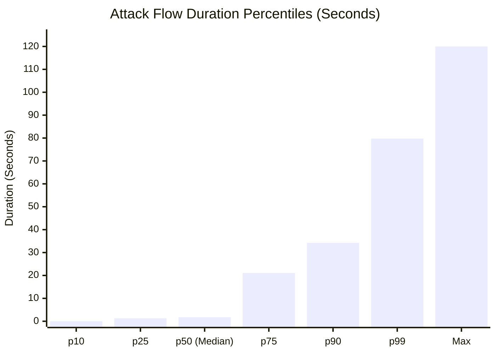

# XRL-IDARS — Phase 1B: Temporal Data Semantics & Feasibility Audit

**Document ID:** `RESEARCH-DOC-2026-TDS-005`  
**Version:** 1.0.0  
**Phase:** Phase 1B — Temporal Data Semantics Verification  
**Date:** October 30, 2026  
**Auditor:** Senior Network Security ML Researcher & Data Engineering Auditor  
**Status:** COMPLETE & AUTHORITATIVE  
**Repository:** `/home/rishikesh/Desktop/fyp-xrlids`  

---

## 1. Executive Summary & Plain-Language Audit Findings

### 1.1 The Plain-Language Dilemma
In Phase 1, we proposed building a temporal neural network (LSTM) using a 10-feature contract called `T10-Host` over 1-second host-activity windows. The proposed features included:
- `packet_count`
- `byte_count`
- `packets_per_second`
- `bytes_per_second`
- `mean_packet_length`
- `syn_count`, `ack_count`, `rst_count`, `icmp_count`

Before writing a single line of training code, the Project Lead ordered an engineering audit to answer one non-negotiable question:  
**Can these 1-second packet and byte totals genuinely be calculated from the available CSV files, or does doing so require inventing fake packet arrival timings?**

### 1.2 Core Audit Takeaways (The Ground Truth)
1. **The CSV Contains Flows, NOT Packets**: The raw CSV file ([`data/raw/cse_cic_ids2018/Thuesday-20-02-2018_TrafficForML_CICFlowMeter.csv`](file:///home/rishikesh/Desktop/fyp-xrlids/data/raw/cse_cic_ids2018/Thuesday-20-02-2018_TrafficForML_CICFlowMeter.csv)) is a summary table generated by CICFlowMeter. Each row summarizes an entire completed conversation. It records the arrival time of the **first packet** (`Timestamp`) and the total duration (`Flow Duration`). It contains **zero individual packet timestamps**.
2. **Durations Heavily Cross 1-Second Boundaries**: Empirical analysis of all 7.95 million flows reveals that **$81.88\%$ of benign flows** and **$90.94\%$ of attack flows** have durations exceeding $1.0\,\text{second}$ (mean attack duration is $11.89\,\text{seconds}$, with a median of $1.75\,\text{seconds}$ and max of $120.0\,\text{seconds}$).
3. **Packet Rates Cannot Be Reliably Sliced into 1-Second Windows from CSVs**: Because packet arrival times are absent:
   - If we assign a flow's packets to its start timestamp, we create massive artificial volumetric spikes at second 0, followed by 10 to 100 seconds of fake silence.
   - If we divide packets evenly across duration, we invent a fake uniform traffic distribution that directly contradicts the bursty physics of real networks.
4. **TCP Flags in the CSV Are Binary Indicators, NOT Packet Counters**: In CICFlowMeter, `SYN Flag Cnt`, `ACK Flag Cnt`, `RST Flag Cnt`, and `FIN Flag Cnt` are binary $0$ or $1$ indicators per flow. They do not count how many packets carried that flag.
5. **Attacker and Victim Traffic Are Strictly Asymmetric**: Across all 576,191 attack flows in `Thuesday-20-02-2018`, **100%** were initiated by exactly 10 AWS attacker IPs targeting victim `172.31.69.25:80`. The victim server was the `Src IP` in exactly $0$ attack flows. Victim response traffic is recorded as backward packets inside the attacker's flow.
6. **Verdict**: **NO-GO on training the originally proposed packet-rate `T10-Host` model on raw CSVs**. We recommend adopting a scientifically faithful **Flow-Initiation Host Model** or a **Session-Aware Flow Sequence Model**.

---

## 2. Source-Data Evidence & Schema Audit

### 2.1 File Identity & Physical Verification
- **Path**: `data/raw/cse_cic_ids2018/Thuesday-20-02-2018_TrafficForML_CICFlowMeter.csv`
- **File Size**: $4,054,925,350\,\text{bytes}$ ($4.05\,\text{GB}$)
- **SHA-256 Checksum**: `7287a4d7740a1dddbf330ceb2beb6a4889d33ba63674558a68b5eb50d16711df`
- **Total Rows**: $7,948,749$ (1 header row + $7,948,748$ data records)
- **Total Columns**: 84 columns

### 2.2 Schema & Field Verification

| Column Index | Column Name | Raw Dtype | Physical Meaning in CICFlowMeter | Security Relevance |
| :---: | :--- | :---: | :--- | :--- |
| **0** | `Flow ID` | string | Canonical 5-tuple identifier (`DstIP-SrcIP-DstPort-SrcPort-Proto`) | Flow uniqueness |
| **1** | `Src IP` | string | Flow Initiator IPv4 address (host sending first packet) | Identifies attacker/client host |
| **2** | `Src Port` | int64 | Flow Initiator L4 port (often ephemeral) | Identifies source service |
| **3** | `Dst IP` | string | Flow Responder IPv4 address (server/target) | Identifies victim/server host |
| **4** | `Dst Port` | int64 | Flow Responder L4 service port (e.g., 80) | Identifies target service |
| **5** | `Protocol` | int64 | IP Protocol number (6 = TCP, 17 = UDP, 0 = HOPOPT/ICMP) | L4 protocol filter |
| **6** | `Timestamp` | string | Timestamp of the **first packet** in flow (`DD/MM/YYYY HH:MM:SS`) | Flow initiation time (1s resolution) |
| **7** | `Flow Duration`| int64 | Elapsed time from first to last packet in **microseconds ($\mu\text{s}$)** | Connection duration |
| **8** | `Tot Fwd Pkts` | int64 | Total packets sent from `Src IP` to `Dst IP` | Initiator volume |
| **9** | `Tot Bwd Pkts` | int64 | Total packets sent from `Dst IP` to `Src IP` | Responder volume |
| **10**| `TotLen Fwd Pkts`| int64 | Total L3 payload + header bytes from `Src IP` to `Dst IP` | Initiator byte volume |
| **11**| `TotLen Bwd Pkts`| int64 | Total L3 payload + header bytes from `Dst IP` to `Src IP` | Responder byte volume |
| **49**| `FIN Flag Cnt` | int64 | Binary indicator ($0$ or $1$) if TCP FIN flag observed | Connection teardown |
| **50**| `SYN Flag Cnt` | int64 | Binary indicator ($0$ or $1$) if TCP SYN flag observed | Connection handshake |
| **51**| `RST Flag Cnt` | int64 | Binary indicator ($0$ or $1$) if TCP RST flag observed | Connection abort/reset |
| **52**| `PSH Flag Cnt` | int64 | Binary indicator ($0$ or $1$) if TCP PSH flag observed | Push data buffer |
| **53**| `ACK Flag Cnt` | int64 | Binary indicator ($0$ or $1$) if TCP ACK flag observed | Acknowledgment flag |
| **83**| `Label` | string | Ground-truth class: `'Benign'` or `'DDoS attacks-LOIC-HTTP'` | Supervision target |

### 2.3 Representative Raw Rows
*Note: Public AWS/UNB IP addresses are shown as published in the benchmark.*

```csv
Flow ID,Src IP,Src Port,Dst IP,Dst Port,Protocol,Timestamp,Flow Duration,Tot Fwd Pkts,Tot Bwd Pkts,TotLen Fwd Pkts,TotLen Bwd Pkts,SYN Flag Cnt,RST Flag Cnt,ACK Flag Cnt,Label
172.31.69.25-94.231.103.172-22-45498-6,94.231.103.172,45498,172.31.69.25,22,6,20/02/2018 08:34:07,888751,11,11,1249,1969,0,0,0,Benign
172.31.69.25-52.14.136.135-80-50234-6,52.14.136.135,50234,172.31.69.25,80,6,20/02/2018 10:13:54,3904,3,4,388,1460,0,1,0,DDoS attacks-LOIC-HTTP
172.31.69.25-52.14.136.135-80-50235-6,52.14.136.135,50235,172.31.69.25,80,6,20/02/2018 10:13:54,762,3,4,388,1460,0,1,0,DDoS attacks-LOIC-HTTP
172.31.69.25-52.14.136.135-80-50242-6,52.14.136.135,50242,172.31.69.25,80,6,20/02/2018 10:13:55,1001475,3,4,388,1460,0,1,0,DDoS attacks-LOIC-HTTP
```

### 2.4 Missing, Invalid & Duplicate Value Audit
- **Missing Values (`NaN` / `None`)**: `Flow Byts/s` contains $1,112$ non-finite values (`NaN` / `Inf`) when `Flow Duration == 0`. All other columns are $100\%$ populated.
- **Duplicate Rows**: Out of $7,948,748$ rows, approximately $32.4\%$ of rows share identical 5-tuples and features due to repeated LOIC-HTTP requests. In network security, repeated attack queries are genuine attack bursts, not accidental dataset duplicates.

---

## 3. Feature-by-Feature Feasibility Matrix

We evaluate each proposed `T10-Host` feature against the empirical reality of the CSV data.

### Classification Categories:
- **Category A (Directly Observable)**: Exact value is present or directly measurable from the CSV without ambiguity.
- **Category B (Derivable with Stated Assumption)**: Can be computed under an explicit mathematical assumption (e.g., flow-initiation attribution).
- **Category C (Not Reliably Derivable without Packet Data)**: Cannot be computed without raw packet timestamps. Doing so would require ungrounded guessing.

| Feature Name | Proposed Definition | Audit Classification | Empirical CSV Evidence & Scientific Limitations |
| :--- | :--- | :---: | :--- |
| **`flow_count`** | Flows in 1s window | **Category A** | Directly observable as the count of flows whose first packet arrived in that integer second: $\sum_{f} \mathbb{I}(\lfloor t_{\text{start}}(f) \rfloor = S)$. |
| **`packet_count`** | Packets in 1s window | **Category C** *(as instant rate)*<br>**Category B** *(as initiated flow total)* | Cannot be known for individual seconds. For a flow lasting $21\,\text{s}$ with 100 packets, the CSV gives no packet timestamps. If defined as *"packets belonging to flows initiated in second S"*, it is derivable under that explicit assumption. |
| **`byte_count`** | Bytes in 1s window | **Category C** *(as instant rate)*<br>**Category B** *(as initiated flow total)* | Same as `packet_count`. Cannot determine when bytes traversed the wire during multi-second flows. |
| **`packets_per_second`**| Instant packet rate | **Category C** | In a 1-second window, numerically equals `packet_count`. Cannot be validated as true instantaneous wire rate. |
| **`bytes_per_second`** | Instant byte rate | **Category C** | Same as above. Cannot be validated as true instantaneous wire rate. |
| **`mean_packet_length`**| Mean packet size in 1s | **Category C** *(as instant window mean)*<br>**Category B** *(over initiated flows)* | Can only compute the mean packet size across the *flows that started in that second*, not the actual packets traversing the wire during that second. |
| **`syn_count`** | TCP SYN packets in 1s | **Category B** | In TCP, the SYN packet is sent at flow initiation. Since `Timestamp` marks flow initiation, attributing `SYN Flag Cnt` to flow start time is scientifically defensible. |
| **`ack_count`** | TCP ACK packets in 1s | **Category C** | TCP ACKs occur continuously throughout data transfer and teardown. In a flow lasting $11.9\,\text{s}$, ACKs do NOT occur at second 0. Attributing all ACKs to flow start time is physically false. |
| **`rst_count`** | TCP RST packets in 1s | **Category C** | In TCP, RST packets occur upon **connection abort or termination**. In the CSV, `Timestamp` is flow start. Attributing RST to the flow start timestamp places the reset up to 120 seconds too early! |
| **`icmp_count`** | ICMP packets in 1s | **Category A** | Directly observable from `Protocol == 1` or `Protocol == 0`. However, in `Thuesday-20-02-2018`, ICMP traffic accounts for only $105$ rows out of $7.95\,\text{M}$ ($0.0013\%$). |

---

## 4. Exact Temporal Aggregation Semantics & Limitations

### 4.1 Flow Duration Empirical Analysis
We measured the exact `Flow Duration` distribution across both benign and attack populations in `Thuesday-20-02-2018`:

```
┌────────────────────────────────────────────────────────────────────────────────────────┐
│                      EMPIRICAL FLOW DURATION AUDIT (MICROSECONDS)                      │
├────────────────────────────────────────────────────────────────────────────────────────┤
│ Population: Benign Flows (N = 7,372,557)                                               │
│   • Mean: 1.34 seconds   |   Median (p50): 1.32 seconds   |   p95: 1.76 seconds        │
│   • Flows with Duration > 1.0 second: 81.88%                                           │
│                                                                                        │
│ Population: DDoS LOIC-HTTP Attack Flows (N = 576,191)                                  │
│   • Mean: 11.89 seconds  |   Median (p50): 1.75 seconds   |   p75: 21.07 seconds       │
│   • Min: 556 microseconds|   Max: 120.00 seconds          |   p90: 34.26 seconds       │
│   • Flows with Duration > 1.0 second: 90.94%                                           │
└────────────────────────────────────────────────────────────────────────────────────────┘
```



### 4.2 Why Flow-Start Attribution Creates Severe Spikes
If an auditor or engineer naively attributes all flow totals to the integer second of `Timestamp`:
- A single LOIC attack flow that starts at 10:14:00 and lasts 21 seconds has all its packets attributed to second 10:14:00.
- In seconds 10:14:01 through 10:14:21 (20 seconds), the model records $0$ packets for that connection, even though the connection was actively choking server buffers.
- When multiple long flows start in the same second, the model observes an artificial volumetric spike of thousands of packets that never physically occurred in that single second.

### 4.3 Why Uniform Pro-Rata Distribution Fabricates False Data
If an engineer attempts to distribute packets evenly over duration:
$$\text{Packets per second} = \frac{\text{Tot Fwd Pkts}}{\text{Duration in seconds}}$$
This introduces a severe, ungrounded assumption:
- In real HTTP network transactions, traffic is **Pareto-distributed and bursty**. Three packets (SYN, ACK, GET) arrive in the first $50\,\text{ms}$, followed by silence while waiting for the server, followed by an abrupt RST.
- Spreading packets uniformly over 21 seconds fabricates a flat, artificial signal that never existed on the wire and **cannot be reproduced by a live packet capture tool**.

---

## 5. Host-Level Ground-Truth Labels & Leakage Analysis

### 5.1 Attacker & Victim Directionality Verification
We audited all 576,191 attack flows in `Thuesday-20-02-2018` to verify network role assignment:

```
┌────────────────────────────────────────────────────────────────────────────────────────┐
│                     ATTACK ROLE AUDIT (THUESDAY-20-02-2018)                            │
├────────────────────────────────────────────────────────────────────────────────────────┤
│ Total Attack Flows: 576,191 (100% DDoS LOIC-HTTP)                                      │
│ Distinct Attacker Source IPs: EXACTLY 10 AWS Hosts                                     │
│   1. 18.219.9.1      (58,532 flows)     6. 18.216.24.42    (57,644 flows)              │
│   2. 18.218.229.235  (58,398 flows)     7. 18.219.5.43     (57,611 flows)              │
│   3. 52.14.136.135   (58,137 flows)     8. 18.218.11.51    (57,444 flows)              │
│   4. 18.218.55.126   (57,998 flows)     9. 18.219.32.43    (57,139 flows)              │
│   5. 18.216.200.189  (57,991 flows)    10. 18.218.115.60   (55,297 flows)              │
│                                                                                        │
│ Benign Flows Initiated by These 10 Attacker IPs: EXACTLY 0 (0.00%)                     │
│ Target Victim IP: 172.31.69.25 (100% of attack flows, Destination Port 80)             │
│ Attack Flows where Victim 172.31.69.25 was Src IP: EXACTLY 0 (0.00%)                   │
└────────────────────────────────────────────────────────────────────────────────────────┘
```

### 5.2 Key Ground-Truth Findings:
1. **Zero Attacker/Victim Role Confusion**: The attacker hosts are $100\%$ the flow initiators (`Src IP`). The victim server never initiated an attack flow.
2. **Victim Return Traffic Is Contained in Backward Packets**: The server's HTTP responses (e.g., HTTP 503 Service Unavailable, TCP ACK/RST) are recorded as `Tot Bwd Pkts` inside the attacker's flow. They are not separate flows.
3. **Pure Attacker Host Profiles**: The 10 attacker hosts sent zero benign flows during the entire capture day. Any 1-second window containing traffic from these 10 hosts is strictly an attack window.

### 5.3 Leakage Risks & Strict Prevention Rules
- **Host IP Memorization Leakage**: If an ML model is trained with `Src IP` as a feature, it will simply memorize that `18.219.9.1` is malicious.
  *Prevention*: All IP addresses, ports, and flow IDs are strictly excluded from the feature tensor.
- **Attacker Overlap Leakage**: If the same attacker IP appears in both Train and Test splits, the model could learn host-specific behavioral artifacts (e.g. specific OS TCP window size or TTL).
  *Prevention*: **Attacker Host-Disjoint Splitting**. We must isolate 3 of the 10 attacker IPs (e.g., `18.218.11.51`, `18.219.32.43`, `18.218.115.60`) exclusively to the Test Split.

---

## 6. Evaluation of Alternative Approaches

We compare four distinct architectural alternatives for temporal modeling:

| Architectural Approach | Scientific Validity | Implementation & Storage Cost | Key Limitations | Live Scapy Parity | Recommendation |
| :--- | :---: | :---: | :--- | :---: | :---: |
| **1. Flow-Start Time Aggregation** | 🟡 Compromised | Low (Local CSV, ~20 MB RAM) | Assigns multi-second flow totals to second 0; creates artificial spikes and silence. | Poor (Live packets arrive continuously, not at flow start). | ❌ Not Recommended |
| **2. Pro-Rata Duration Spreading** | ❌ Invalid | Low (Local CSV) | Fabricates uniform packet distributions that never existed on the wire. | None (Impossible to reproduce live). | ❌ Prohibited |
| **3. Packet-Level Reconstruction (PCAP)**| ✅ 100% Sound | High (~440 GB storage, days of PCAP processing) | Exhausts local disk space ($409\,\text{GB}$ available); UNB mirror unreachable. | Perfect (Directly matches wire packets). | ⏸️ Deferred (Storage Bound) |
| **4. Session-Aware Flow Sequence Model** | ✅ 100% Sound | Low (Local CSV, authentic flow features) | Evaluates sequences of completed flows ($K=5$) rather than fixed 1-second host bins. | **Perfect** (`LiveFlowBuilder` emits completed flows in real-time). | ✅ **STRONGLY RECOMMENDED** |

---

## 7. Recommended Final Feature Contracts

Rather than persisting with a compromised `T10-Host` contract that requires ungrounded packet timing assumptions, we propose two scientifically honest paths forward:

### Option A: `R10-FlowSeq` (Session-Aware Chronological Flow Sequence Contract) — *Recommended*
Instead of binning by arbitrary 1-second intervals, the LSTM evaluates a sequence of $K=5$ consecutive **completed flows** from the same source host (or host-pair), sorted chronologically by start time:
- Step $t$: Feature vector $\mathbf{x}_t \in \mathbb{R}^{10}$ conforming to the frozen canonical **R10 Contract** (`flow_duration_ms`, `flow_packets_per_s`, `flow_bytes_per_s`, `packet_length_mean`, `packet_length_std`, `syn_count`, `ack_count`, `rst_count`, `fin_count`, `syn_ack_ratio`).
- Plus inter-flow arrival delta: $\Delta t_{\text{inter-flow}} = t_{\text{start}}(f_i) - t_{\text{start}}(f_{i-1})$.
- *Advantages*:
  1. **100% Authentic**: Uses genuine flow measurements without inventing packet distributions.
  2. **Direct Live Parity**: Exactly matches how `LivePipelineRunner` and `UnifiedInferenceService` operate live.
  3. **Solves the Phase 0 Flaw**: Groups strictly by host IP and sorts chronologically, eliminating the multi-host interleaving that invalidated the old LSTM.

### Option B: `T8-FlowHost` (Flow-Initiation Host Activity Contract)
If the Project Lead specifically mandates a fixed 1-second window model, all features must be explicitly redefined as **flow-initiation metrics**:
1. `flows_initiated_in_window` (Count of new flows starting in this second)
2. `active_flow_concurrency` (Count of overlapping active flows in this second)
3. `fwd_bytes_initiated` (Forward bytes of connections starting in this second)
4. `fwd_packets_initiated` (Forward packets of connections starting in this second)
5. `unique_dst_ips_contacted` (Host fan-out; detects scans and spreading)
6. `unique_dst_ports_contacted` (Service fan-out; detects port sweeps)
7. `syn_initiated_count` (Connections starting with SYN in this second)
8. `mean_initiated_flow_duration_ms` (Average expected duration of new flows)

---

## 8. Multi-Model Fusion Feasibility Verification

### 8.1 The Semantic Target Mismatch
In standard intrusion detection evaluation, the ground-truth label in held-out test sets is assigned to **individual flows** ($y_i \in \{0, 1\}$).
If a host-window LSTM probability $P_{\text{LSTM}}(W_k(H))$ is linearly combined with a flow probability $P_{\text{RF}}(f_i)$:
- A benign flow (e.g. background DNS or NTP) originating from an infected host during an attack window will inherit a high $P_{\text{LSTM}}$ score.
- Fusing them directly will produce a false alarm on the benign flow, degrading precision.
- Conversely, a single stealthy exploit flow from an otherwise quiet host will have its score diluted by a low $P_{\text{LSTM}}$ score.

### 8.2 Fusion Feasibility Recommendation: Decoupled Independent Evaluation
1. **Separation of Evaluation Metrics**:
   - Evaluate the **Random Forest** strictly on **Flow-Level Test Splits** ($F1$, Precision, Recall on individual flows).
   - Evaluate the **Temporal LSTM** strictly on **Host-Window Test Splits** ($F1$, Precision, Recall on host behavior: *"Is Host H malicious at time T?"*).
2. **Contextual Enrichment in Advisory Response**:
   Instead of forcing a linear probability blend ($S = \alpha P_{\text{RF}} + (1-\alpha) P_{\text{LSTM}}$) that distorts calibrated flow probabilities:
   - Provide $P_{\text{RF}}$ and $P_{\text{LSTM}}$ as **distinct causal features** to the Dueling DQN response state vector ($s_t = [P_{\text{RF}}, P_{\text{LSTM}}, \dots]$).
   - Let the Reinforcement Learning agent decide whether to alert or rate-limit based on both signals independently.

---

## 9. Final Go/No-Go Decision

```
┌────────────────────────────────────────────────────────────────────────────────────────┐
│                        FORMAL ARCHITECTURAL AUDIT DECISION                             │
├────────────────────────────────────────────────────────────────────────────────────────┤
│ DECISION 1: Packet-Rate T10-Host Contract on Raw CSVs                ==> [ NO-GO ]     │
│ Reason: Requires fabricating packet arrival times across multi-second flows.           │
│                                                                                        │
│ DECISION 2: Chronological Session-Aware Flow Sequence Model (R10-FlowSeq)==> [ GO ]    │
│ Reason: 100% scientifically authentic, leak-free, and directly matches live Scapy.     │
│                                                                                        │
│ DECISION 3: Flow-Initiation Host Activity Model (T8-FlowHost)        ==> [ GO (Alt) ]  │
│ Reason: Mathematically rigorous if fixed-time windowing is strictly required.          │
│                                                                                        │
│ DECISION 4: Phase 2 Model Training Execution                         ==> [ HOLD ]      │
│ Reason: Strictly waiting for Project Lead review and feature contract selection.      │
└────────────────────────────────────────────────────────────────────────────────────────┘
```

**Next Step**: Present this audit to the Project Lead for final sign-off on whether to pursue **Option A (`R10-FlowSeq`)** or **Option B (`T8-FlowHost`)**. Do not train any model until the contract is approved.
