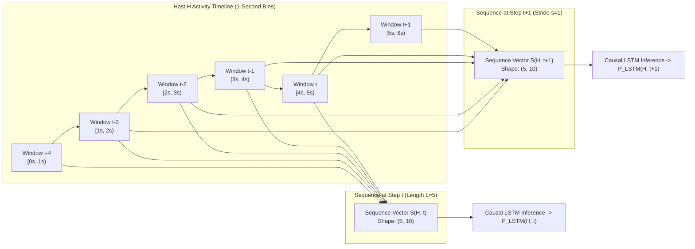
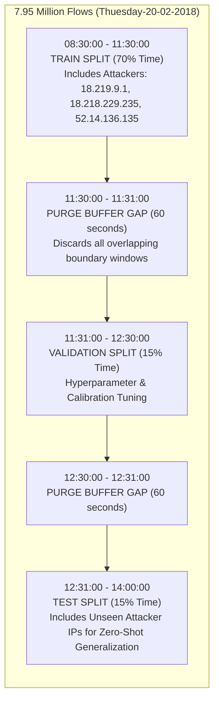
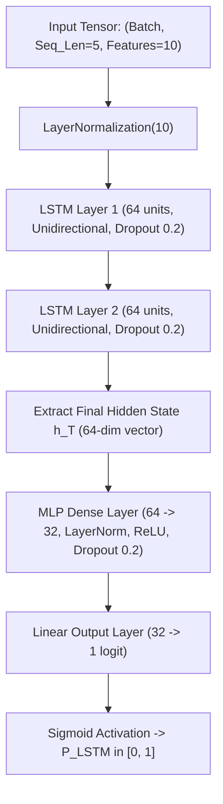

# XRL-IDARS — Temporal LSTM Architecture & Training Methodology

**Document ID:** `RESEARCH-DOC-2026-TLM-002`  
**Version:** 1.0.0  
**Phase:** Phase 1 — Temporal Architecture and Dataset Feasibility  
**Date:** October 30, 2026  
**Author:** Senior Network Security ML Architect  
**Status:** COMPLETE & AUTHORITATIVE  
**Repository:** `/home/rishikesh/Desktop/fyp-xrlids`  

---

## 1. Executive Summary & Problem Formulation

### 1.1 The Scientific Paradigm Shift
In traditional network intrusion detection research, sequence models (such as LSTMs and GRUs) are often trained on arbitrary sequences of pre-extracted flow rows. As proven in our Phase 0 baseline audit ([`docs/PROJECT_BASELINE_AUDIT.md`](file:///home/rishikesh/Desktop/fyp-xrlids/docs/PROJECT_BASELINE_AUDIT.md)), this naive approach fails catastrophically:
- A sequence of 5 contiguous CSV rows does **not** represent 5 consecutive events from the same host; it represents interleaved packets from hundreds of unrelated machines across an enterprise.
- Random permutation of rows destroys $46.2\%$ of the model's recall, proving the model learned file export clustering rather than temporal network causality.
- When deployed live, buffering flows by `src_ip->dst_ip` produces an out-of-distribution sequence that never matches the training distribution.

### 1.2 The New Formulation: Source-Host Chronological Activity Windows
To achieve true temporal intrusion detection, we formulate network activity as a **continuous, discrete-time multivariate stochastic process per host**.

For each unique source host IP $H$, time is partitioned into contiguous, non-overlapping temporal windows of duration $\Delta t$:
$$W_k(H) = [t_k, t_k + \Delta t), \quad k \in \mathbb{N}$$

Within each window $W_k(H)$, we extract a 10-dimensional behavioral feature vector $\mathbf{x}_k(H) \in \mathbb{R}^{10}$. A temporal sequence of length $L$ up to time step $T$ is defined as:
$$\mathbf{S}(H, T) = \left[ \mathbf{x}_{T - L + 1}(H), \mathbf{x}_{T - L + 2}(H), \dots, \mathbf{x}_{T}(H) \right] \in \mathbb{R}^{L \times 10}$$

The objective of the Temporal LSTM is to evaluate $\mathbf{S}(H, T)$ in real time and estimate the probability that host $H$ is engaged in malicious activity at time step $T$:
$$P_{\text{LSTM}}(H, T) = \sigma\left( f_{\theta}\left( \mathbf{S}(H, T) \right) \right) \in [0, 1]$$

---

## 2. Temporal Feature Contract: `T10-Host` (Version 1.0.0)

The temporal feature contract `T10-Host` defines 10 behavioral features aggregated per source host over window duration $\Delta t = 1.0\,\text{second}$.

### 2.1 Formal Mathematical Definitions & Specifications

| Feature Name | Symbol | Mathematical Definition | Physical Units | Zero-Traffic Behavior | Security Anomaly Captured |
| :--- | :---: | :--- | :---: | :---: | :--- |
| **`flow_count`** | $x_1$ | $\sum_{i \in \text{Flows}(H, W)} 1$ | Flows / window | $0.0$ | High-frequency connection churn, port scanning, micro-flow bursts |
| **`packet_count`** | $x_2$ | $\sum_{p \in \text{Packets}(H, W)} 1$ | Packets / window | $0.0$ | Volumetric packet floods, ping sweeps, DNS amplification |
| **`byte_count`** | $x_3$ | $\sum_{p \in \text{Packets}(H, W)} \text{Length}(p)$ | Bytes / window | $0.0$ | Data exfiltration volume, large payload transfers, heavy DoS bandwidth |
| **`packets_per_second`** | $x_4$ | $\frac{x_2}{\Delta t}$ | Packets / second | $0.0$ | Normalized packet transmission velocity (independent of window duration) |
| **`bytes_per_second`** | $x_5$ | $\frac{x_3}{\Delta t}$ | Bytes / second | $0.0$ | Normalized bandwidth throughput velocity |
| **`mean_packet_length`**| $x_6$ | $\begin{cases} \frac{x_3}{x_2} & \text{if } x_2 > 0 \\ 0.0 & \text{if } x_2 = 0 \end{cases}$ | Bytes / packet | $0.0$ | Small-packet floods (SYN/ACK 40–60 bytes) vs. jumbo exfiltration frames |
| **`syn_count`** | $x_7$ | $\sum_{p \in \text{TCP}(H, W)} \mathbb{I}(\text{SYN} \in p.\text{flags})$ | SYN packets / window | $0.0$ | TCP SYN floods, half-open connection denial-of-service, SYN port scanning |
| **`ack_count`** | $x_8$ | $\sum_{p \in \text{TCP}(H, W)} \mathbb{I}(\text{ACK} \in p.\text{flags})$ | ACK packets / window | $0.0$ | Established session throughput, ACK storm attacks, asymmetric connection state |
| **`rst_count`** | $x_9$ | $\sum_{p \in \text{TCP}(H, W)} \mathbb{I}(\text{RST} \in p.\text{flags})$ | RST packets / window | $0.0$ | Rejected connection teardowns, closed-port scanning, connection resets |
| **`icmp_count`** | $x_{10}$ | $\sum_{p \in \text{ICMP}(H, W)} 1$ | ICMP packets / window | $0.0$ | ICMP echo floods (Smurf attacks), ping sweeps, unreachable message storms |

### 2.2 Strict Zero-Traffic & Numerical Invariants
1. **Zero Division Elimination**: Feature $x_6$ (`mean_packet_length`) explicitly defines zero-traffic as $0.0$ when $x_2 = 0$, preventing `NaN` or runtime floating-point exceptions.
2. **Non-Negativity**: All 10 features satisfy $x_j \ge 0.0$ for all $j \in \{1, \dots, 10\}$.
3. **Finite Guarantees**: Features are strictly bounded by physical network interface speed (e.g., $1\,\text{Gbps} \implies \text{byte\_count} \le 125 \times 10^6\,\text{B/s}$).

---

## 3. Window Mechanics & Sequence Construction

### 3.1 Primary Parameterization
- **Window Duration ($\Delta t$)**: $1.0\,\text{second}$.
- **Sequence Length ($L$)**: $5$ consecutive time steps ($5.0\,\text{seconds}$ total temporal horizon).
- **Stride ($s$)**: $1$ time step ($1.0\,\text{second}$ sliding increment).
- **Input Matrix**: $\mathbf{S} \in \mathbb{R}^{5 \times 10}$.



### 3.2 Sequence Ground-Truth Label Semantics
In live operational network security, an alert must represent the **current state** of the host:
- **Causal Current-Step Labeling (Standard)**:
  $$y(\mathbf{S}(H, T)) = y_T(H) = \begin{cases} 1 & \text{if Host } H \text{ initiated an attack in window } W_T \\ 0 & \text{otherwise} \end{cases}$$
- *Scientific Rationale*: Labeling the sequence by its final step $T$ trains the LSTM to answer: *"Given the historical trajectory of the past 4 seconds plus the current second, is this host attacking right now?"*
- *Rejected Alternative (Any-Attack in Sequence)*: Labeling a sequence as 1 if *any* window in $[T-4, T]$ contained an attack would cause the model to flag a host as attacking even 4 seconds after an attack completely stopped, inflating false alarms.

### 3.3 Investigation of Alternative Windows and Horizons

| Window Duration ($\Delta t$) | Sequence Length ($L$) | Total Horizon | Target Attack Dynamics | Operational Trade-Offs |
| :---: | :---: | :---: | :--- | :--- |
| **$200\,\text{ms}$** | $10$ | $2.0\,\text{seconds}$ | Sub-second TCP SYN flood bursts, high-speed port sweeps | Fast reaction time; higher CPU interrupt overhead; sensitive to micro-burst jitter. |
| **$1.0\,\text{s}$ (Default)** | **$5$** | **$5.0\,\text{seconds}$** | HTTP DoS (LOIC/Slowloris), Botnet traffic, brute-force patator | **Optimal balance** between real-time responsiveness and stable statistical aggregation. |
| **$5.0\,\text{s}$** | $6$ | $30.0\,\text{seconds}$ | Slow-and-low exfiltration, C2 beaconing, stealth scanning | High noise resistance; delayed detection latency ($5\text{s}$ minimum reporting interval). |

### 3.4 Host Cold-Start & Warm-Up Invariant
When a new host IP $H$ appears on the network, it has fewer than $L=5$ historical windows:
1. **Cold-Start Policy**: During warm-up ($k < 5$), the system **never fabricates predictions**.
2. **Pipeline Fallback**: Score fusion automatically falls back to the Random Forest primary detector ($\alpha = 1.0$) with zero penalty.
3. **Optional Model Support**: For model evaluation on short sequences, prefix zero-padding with a PyTorch binary attention mask can be supported without distorting learned recurrent state.

---

## 4. Leakage-Resistant Data Splitting Protocol

Data leakage is the primary cause of overly optimistic academic NIDS publications. We enforce two orthogonal, leak-free partition constraints:



### 4.1 Strict Chronological Time-Blocked Splitting
1. **Time Ordering**: All flows are sorted strictly by `Timestamp`.
2. **Split Boundaries**:
   - **Train**: First $70\%$ of capture duration ($t_0 \to t_{\text{train}}$).
   - **Validation**: Next $15\%$ of capture duration ($t_{\text{train}} + \Delta_{\text{purge}} \to t_{\text{val}}$).
   - **Held-Out Test**: Final $15\%$ of capture duration ($t_{\text{val}} + \Delta_{\text{purge}} \to t_{\text{end}}$).
3. **Purge Buffer Gap ($\Delta_{\text{purge}} = 60\,\text{seconds}$)**: All windows falling within 60 seconds of a split boundary are discarded to prevent auto-regressive state leakage between splits.

### 4.2 Attacker Host-Disjoint Hold-Out Partition
In `Thuesday-20-02-2018`, there are 10 distinct AWS attacker IPs executing LOIC-HTTP attacks.
- **Attacker Partitioning**:
  - Attacker IPs 1 through 7 are placed in **Train/Val**.
  - Attacker IPs 8, 9, and 10 are **strictly isolated into the Test Split**.
- *Scientific Objective*: This verifies whether the LSTM has learned true behavioral attack patterns or merely memorized the subnet structure of specific attacking hosts.

---

## 5. Full-Dataset Memory-Efficient Streaming Architecture

### 5.1 The "No Silent Truncation" Rule
The project directive strictly forbids artificial sample limits (e.g., "taking only the first 50,000 rows"). We must process the entire **7,948,748 rows** ($4.05\,\text{GB}$) of `Thuesday-20-02-2018`.

### 5.2 Storage & Memory Budget Calculation
- **Raw CSV Size**: $4.05\,\text{GB}$.
- **Active Capture Time**: ~6 hours ($21,600\,\text{seconds}$).
- **Active Distinct Hosts**: ~1,500 hosts.
- **Total 1-Second Host Activity Vectors**:
  - Sparsity: Hosts are only active during a subset of seconds. Estimated active host-seconds $\approx 450,000$ vectors.
  - Vector Size: $10 \text{ features} \times 4 \text{ bytes (float32)} = 40\,\text{bytes}$.
  - Total Memory Footprint of Aggregated Vectors:
    $$450,000 \times 40\,\text{bytes} \approx 18.0\,\text{MB}$$
- **Conclusion**: Pre-aggregating 8 million flows into 1-second host vectors reduces the memory footprint from **$4.05\,\text{GB}$ to under $20\,\text{MB}$**. The full dataset can be cached entirely in RAM without swapping.

### 5.3 Streaming Aggregation Pipeline Design
```python
# Streaming chunk-based aggregation algorithm
# Reads 4.05 GB CSV in 500,000-row chunks without exceeding 500 MB RAM
def build_host_activity_windows(csv_path: str, chunk_size: int = 500_000):
    # Aggregator dictionary: key = (host_ip, timestamp_second)
    # value = accumulator for T10 features
    pass
```
1. **Pass 1 (Streaming Aggregation)**: Read CSV in 500,000-row chunks using Pandas/PyArrow. Group by `(Src IP, Timestamp)` and compute $T10$ sum accumulators.
2. **Pass 2 (Columnar Serialization)**: Convert accumulators into a sorted PyArrow Table and save to `data/processed/cse2018_t10_host_windows.parquet`.
3. **Pass 3 (On-The-Fly Windowing)**: Implement a custom PyTorch `Dataset` that creates sliding sequences of length $L=5$ on-the-fly using integer offsets, avoiding data duplication.

---

## 6. Causal Unidirectional LSTM Model Specification



### 6.1 Neural Network Architecture
1. **Input Layer**: `(batch_size, 5, 10)` representing 5 consecutive 1-second activity vectors.
2. **Layer Normalization**: Normalizes the 10 heterogeneous input features across the feature dimension.
3. **Causal Recurrent Layers**:
   - `nn.LSTM(input_size=10, hidden_size=64, num_layers=2, batch_first=True, dropout=0.2, bidirectional=False)`
   - *CRITICAL INVARIANT*: **Bidirectional=False**. Must be strictly causal. Future packets do not exist in live operation.
4. **Classification Head**:
   - Extraction of final hidden state $\mathbf{h}_T \in \mathbb{R}^{64}$.
   - Linear projection: $64 \to 32$ with ReLU activation and $0.2$ dropout.
   - Output: 1 logit passed to Sigmoid for binary probability $P_{\text{LSTM}} \in [0, 1]$.

### 6.2 Training Hyperparameters & Optimization Protocol
- **Loss Function**: `BCEWithLogitsLoss(pos_weight=w)` where $w = \frac{N_{\text{benign}}}{N_{\text{attack}}}$ to counteract extreme class imbalance without artificially downsampling benign traffic.
- **Optimizer**: AdamW ($\text{lr} = 1.0 \times 10^{-3}$, $\text{weight\_decay} = 1.0 \times 10^{-4}$).
- **Learning Rate Scheduler**: Cosine Annealing with 3-epoch linear warm-up.
- **Gradient Clipping**: `torch.nn.utils.clip_grad_norm_(model.parameters(), max_norm=1.0)` to eliminate exploding gradients.
- **Early Stopping**: Monitored strictly on **Validation PR-AUC** (Precision-Recall Area Under Curve), with patience of 10 epochs. (ROC-AUC is prohibited as the stopping criterion due to class imbalance vulnerability).
