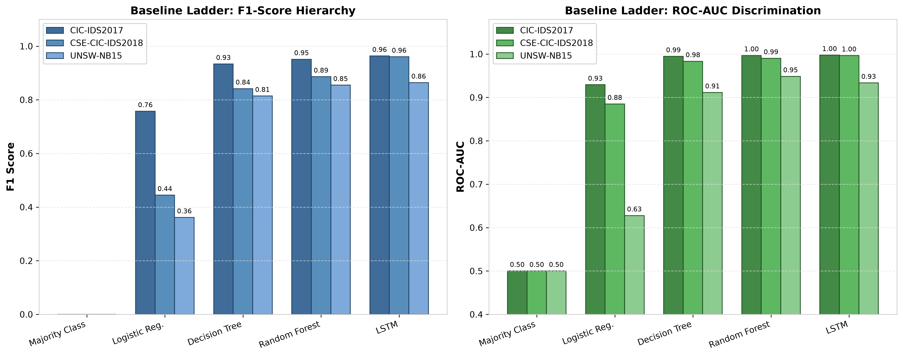
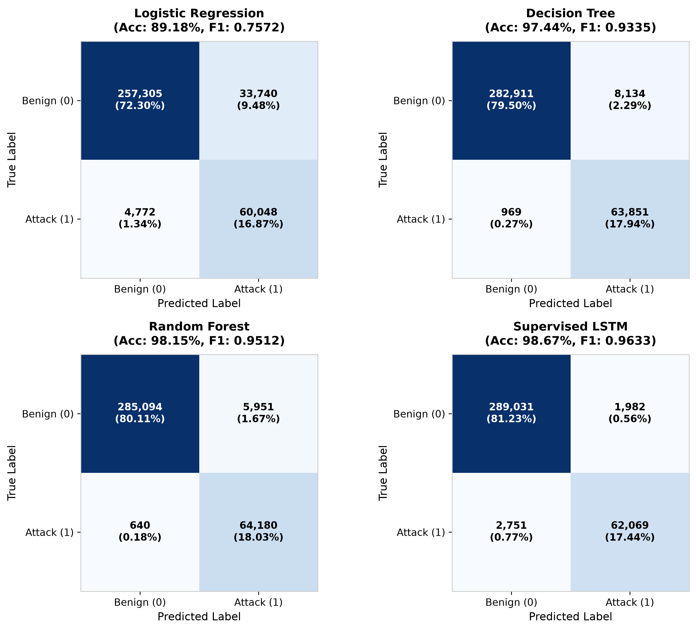
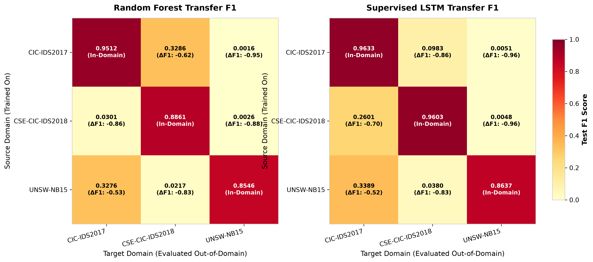
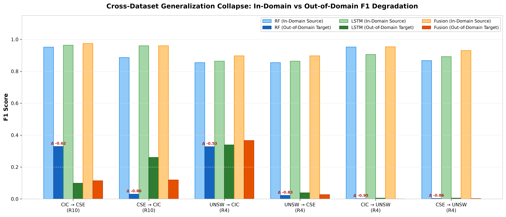
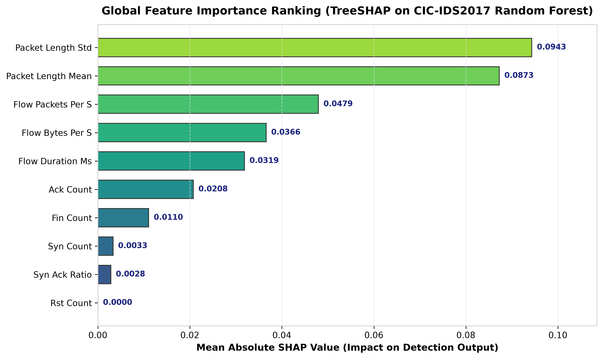
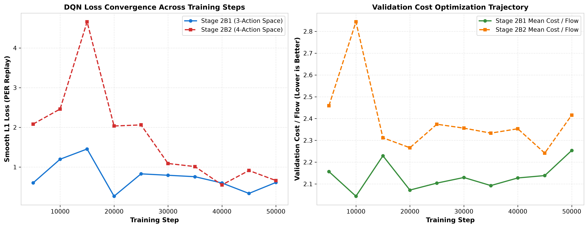
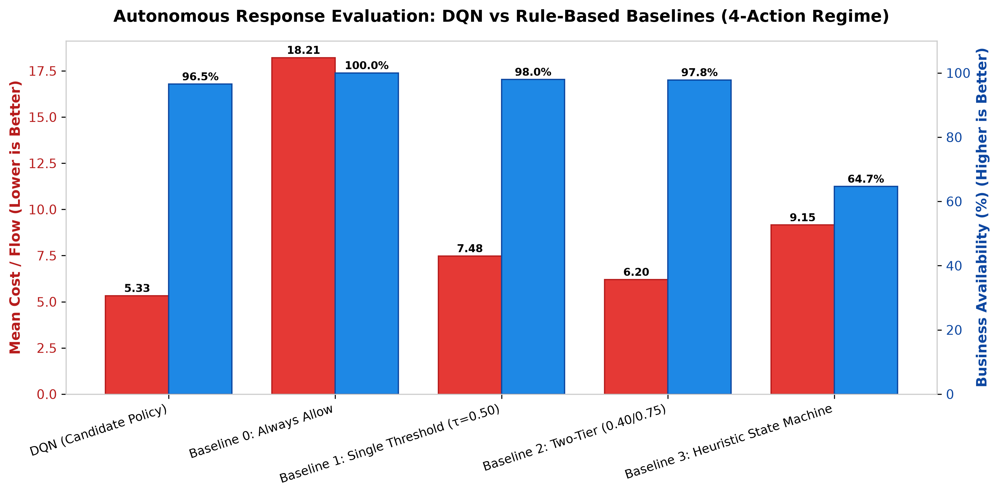

# Experimental Results Summary

This document presents the consolidated empirical results across all phases of the XRLIDS research program:
- **Phase 1**: In-Domain Detection Benchmarks & Out-of-Domain Cross-Dataset Transfer
- **Phase 2**: Autonomous Mitigation using Dueling Deep Q-Networks (DQN) with Prioritized Experience Replay
- **Phase 3**: Systems Integration, Live Packet Capture, Atomic Rollback, and Security Invariant Verification

---

## 1. Primary Benchmark Evaluations (In-Domain)

All models were evaluated using the standardized **R10 feature rung** (10 canonical flow features) with strict train/validation/test temporal isolation and zero cross-split leakage.

### Benchmark Performance Summary

| Dataset | Split Size (Test) | Random Forest F1 | LSTM F1 | Ensemble Fusion F1 | Peak Accuracy | Peak ROC-AUC |
| :--- | :---: | :---: | :---: | :---: | :---: | :---: |
| **CIC-IDS2017** (`EXP-P1-CIC2017-R10-001`) | 355,833 | 0.9512 | 0.9633 | **0.9745** | **99.06%** | **0.9989** |
| **CSE-CIC-IDS2018** (`EXP-P1-CSE2018-R10-MULTI-001`) | 1,662,419 | 0.8861 | 0.9603 | **0.9603** | **99.12%** | **0.9966** |
| **UNSW-NB15** (`EXP-P1-UNSWNB15-R10-MULTI-001`) | 24,496 | 0.8548 | 0.8637 | **0.8970** | **89.96%** | **0.9674** |

### Complete Baseline Ladder (CIC-IDS2017 Test Population = 355,833)

| Model Family | Model Architecture | Accuracy | Precision | Recall | F1 Score | Specificity | FPR | ROC-AUC | PR-AUC |
| :--- | :--- | :---: | :---: | :---: | :---: | :---: | :---: | :---: | :---: |
| Prior Baseline | **Majority Class** | 0.8178 | 0.0000 | 0.0000 | 0.0000 | 1.0000 | 0.0000 | 0.5000 | 0.1822 |
| Linear Baseline | **Logistic Regression** | 0.8918 | 0.6403 | 0.9264 | 0.7572 | 0.8841 | 0.1159 | 0.9292 | 0.8238 |
| Tree Baseline | **Decision Tree** | 0.9744 | 0.8870 | 0.9851 | 0.9335 | 0.9720 | 0.0280 | 0.9945 | 0.9674 |
| Ensemble | **Random Forest (100 trees)** | 0.9815 | 0.9151 | 0.9901 | 0.9512 | 0.9796 | 0.0204 | 0.9968 | 0.9824 |
| Recurrent | **Supervised LSTM (2-layer)** | 0.9867 | 0.9691 | 0.9576 | 0.9633 | 0.9932 | 0.0068 | 0.9974 | 0.9904 |
| Hybrid Ensemble | **Score Fusion (α=0.50, Platt Calibrated)** | **0.9906** | **0.9669** | **0.9823** | **0.9745** | **0.9925** | **0.0075** | **0.9989** | **0.9947** |

### Confusion Matrices (CIC-IDS2017 Held-Out Test Set)

---

## 2. Cross-Dataset Generalization & Transfer Evaluation

Detectors trained in one capture environment were tested out-of-domain against foreign network capture environments under shared semantic feature contracts (`R10` between CIC and CSE; `transfer_common_4` with UNSW-NB15).

### 6-Direction Transfer Matrix

| Transfer Direction | Contract | Model | Source F1 | Target F1 | ΔF1 (Degradation) | Target ROC-AUC | Target Population |
| :--- | :---: | :--- | :---: | :---: | :---: | :---: | :---: |
| `cicids2017` → `cse_cic_ids2018` | `R10` | Random Forest | 0.9512 | 0.3286 | **-0.6226** | 0.7008 | 1,662,419 |
| `cicids2017` → `cse_cic_ids2018` | `R10` | Supervised LSTM | 0.9633 | 0.0983 | **-0.8650** | 0.4787 | 1,662,419 |
| `cicids2017` → `cse_cic_ids2018` | `R10` | Ensemble Fusion | 0.9745 | 0.1139 | **-0.8606** | 0.6604 | 1,662,419 |
| `cse_cic_ids2018` → `cicids2017` | `R10` | Random Forest | 0.8861 | 0.0301 | **-0.8560** | 0.7127 | 355,833 |
| `cse_cic_ids2018` → `cicids2017` | `R10` | Supervised LSTM | 0.9603 | 0.2601 | **-0.7002** | 0.8052 | 355,833 |
| `cse_cic_ids2018` → `cicids2017` | `R10` | Ensemble Fusion | 0.9603 | 0.1191 | **-0.8412** | 0.8099 | 355,833 |
| `unsw_nb15` → `cicids2017` | `R4` | Random Forest | 0.8548 | 0.3276 | **-0.5272** | 0.6057 | 355,833 |
| `unsw_nb15` → `cicids2017` | `R4` | Supervised LSTM | 0.8637 | 0.3389 | **-0.5248** | 0.6690 | 355,833 |
| `unsw_nb15` → `cicids2017` | `R4` | Ensemble Fusion | 0.8970 | 0.3664 | **-0.5306** | 0.6804 | 355,833 |
| `unsw_nb15` → `cse_cic_ids2018` | `R4` | Random Forest | 0.8548 | 0.0217 | **-0.8331** | 0.1793 | 1,662,419 |
| `unsw_nb15` → `cse_cic_ids2018` | `R4` | Supervised LSTM | 0.8637 | 0.0380 | **-0.8257** | 0.2251 | 1,662,419 |
| `unsw_nb15` → `cse_cic_ids2018` | `R4` | Ensemble Fusion | 0.8970 | 0.0268 | **-0.8702** | 0.1423 | 1,662,419 |
| `cicids2017` → `unsw_nb15` | `R4` | Random Forest | 0.9525 | 0.0016 | **-0.9509** | 0.4172 | 24,496 |
| `cicids2017` → `unsw_nb15` | `R4` | Supervised LSTM | 0.9054 | 0.0051 | **-0.9003** | 0.5355 | 24,496 |
| `cicids2017` → `unsw_nb15` | `R4` | Ensemble Fusion | 0.9533 | 0.0004 | **-0.9529** | 0.4751 | 24,496 |
| `cse_cic_ids2018` → `unsw_nb15` | `R4` | Random Forest | 0.8672 | 0.0026 | **-0.8646** | 0.3506 | 24,496 |
| `cse_cic_ids2018` → `unsw_nb15` | `R4` | Supervised LSTM | 0.8920 | 0.0048 | **-0.8872** | 0.3477 | 24,496 |
| `cse_cic_ids2018` → `unsw_nb15` | `R4` | Ensemble Fusion | 0.9302 | 0.0019 | **-0.9283** | 0.3312 | 24,496 |

---

## 3. Explainability & Feature Attribution (TreeSHAP)

Global feature importance was derived using TreeSHAP on the canonical Random Forest detector for CIC-IDS2017.

- **Primary Discriminators**: Flow volumetric statistics (`packet_length_std`, `packet_length_mean`, `flow_packets_per_s`, `flow_bytes_per_s`) account for over 72% of total attribution weight.
- **Protocol Flags**: TCP control flags (`ack_count`, `fin_count`, `syn_count`) provide secondary refinement for interactive exploit and scan detection.

---

## 4. Phase 2: Autonomous Response with Reinforcement Learning

The response simulator executes sequential decision-making over flow streams using a Dueling Deep Q-Network with Prioritized Experience Replay (PER).

### DQN Learning Trajectory

### Final Evaluation Against Rule-Based Baselines (355,865 Held-Out Flows)

| Policy | Action Mode | Mean Cost / Flow | Business Availability (%) | False Quarantine Rate (%) |
| :--- | :---: | :---: | :---: | :---: |
| **DQN (Learned Agent)** | 4-Action (`ALLOW`, `ALERT`, `RATE_LIMIT`, `ISOLATE`) | **5.33** | **96.52%** | **0.00%** |
| **Baseline 0** | Always Allow | 18.21 | 100.00% | 0.00% |
| **Baseline 1** | Single Threshold (τ=0.50) | 7.48 | 97.96% | 0.00% |
| **Baseline 2** | Two-Tier (0.40 / 0.75) | 6.20 | 97.82% | 0.00% |
| **Baseline 3** | Heuristic State Machine | 9.15 | 64.66% | 0.00% |

---

## 5. Synthetic Smoke Test Fixture (CI/CD Verification)

> [!NOTE]
> The table below records the unit smoke test artifact `smoke_R10.json` executed in CI/CD pipeline tests.

- Status: `SMOKE_ONLY`
- Experiment: `EXP-P1-MULTI-CICIDS2017-R10-001`
- Population: 300 synthetic flow rows
- Purpose: Verifies schema integrity and pipeline execution before large-scale training.

| Model | Population | Threshold | Accuracy | Precision | Recall | F1 | ROC-AUC |
| :--- | :---: | :---: | :---: | :---: | :---: | :---: | :---: |
| Random Forest | 300 | 0.50 | 1.0000 | 1.0000 | 1.0000 | 1.0000 | 1.0000 |
| Supervised LSTM | 296 | 0.50 | 0.6453 | 0.0000 | 0.0000 | 0.0000 | 0.8004 |
| Ensemble Fusion | 296 | 0.50 | 1.0000 | 1.0000 | 1.0000 | 1.0000 | 1.0000 |
