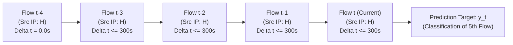
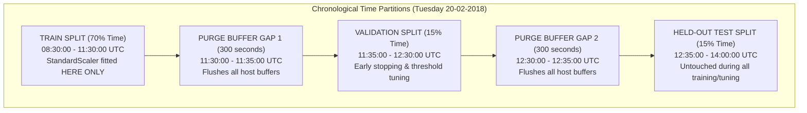

# Sequence Construction Methodology & Leakage Prevention Protocol

**Experiment ID:** EXP-P2-LSTM-VALID-001  
**Dataset:** CSE-CIC-IDS2018 (Tuesday 20-02-2018, LOIC-HTTP volumetric DDoS)  
**Contract:** R10-FlowSeq (11 Features)  
**Date:** 2026-10-30  

---

## 1. Sequence Semantics & Mathematical Invariants

### Invariants:
1. **Source-Host Isolation**: Every flow in the sequence must share the identical `Src IP`. No flows from different hosts are ever interleaved.
2. **Chronological Ordering**: Flows within each host buffer are ordered by flow start timestamp:
   $$t_{\text{start}}(f_1) \le t_{\text{start}}(f_2) \le t_{\text{start}}(f_3) \le t_{\text{start}}(f_4) \le t_{\text{start}}(f_5)$$
3. **Session Reset Boundary**:
   If the arrival gap between consecutive completed flows from host $H$ exceeds 300.0 seconds ($5.0\,\text{minutes}$ idle):
   $$\Delta t = t_{\text{start}}(f_i) - t_{\text{start}}(f_{i-1}) > 300.0\,\text{s}$$
   The active sequence buffer for host $H$ is purged immediately. A sequence can **never** span across inactive sessions.
4. **Inter-Flow Arrival Delta**:
   Feature index 10 represents the normalized arrival delta:
   $$\text{inter\_flow\_delta\_s} = \min(\max(t_{\text{start}}(f_i) - t_{\text{start}}(f_{i-1}), 0.0), 300.0)$$
   For the first flow of a sequence session, $\Delta t = 0.0\,\text{s}$.
5. **Warm-Up Policy**:
   If host $H$ has fewer than 5 completed flows in the current session ($K < 5$), the model is in a warm-up state and returns `None`. No partial sequences are evaluated.
6. **Prediction Target**:
   The label of the sequence is strictly the ground-truth label of the current fifth flow ($y = y_5$).

---

## 2. Feature Contract: 11-Dimensional R10-FlowSeq Vector

Every flow $f_i$ in the sequence is represented by an 11-dimensional feature vector:

| Index | Canonical Feature Name | Formula / Invariant | Units |
| :---: | :--- | :--- | :---: |
| **0** | `flow_duration_ms` | $(t_{\text{last}} - t_{\text{start}}) \times 1000.0$ | $\text{ms} \ge 0.0$ |
| **1** | `flow_packets_per_s` | $\frac{N_{\text{pkts}}}{\max(t_{\text{duration\_s}}, 10^{-6})}$ | $\text{pkts/s} \ge 0.0$ |
| **2** | `flow_bytes_per_s` | $\frac{B_{\text{bytes}}}{\max(t_{\text{duration\_s}}, 10^{-6})}$ | $\text{bytes/s} \ge 0.0$ |
| **3** | `packet_length_mean` | $\frac{\sum L_i}{\max(N, 1)}$ | Bytes |
| **4** | `packet_length_std` | Population standard deviation ($\text{ddof}=0$) | Bytes |
| **5** | `syn_count` | $\min(\text{flow.syn\_count}, 1.0)$ (binary indicator) | $\{0.0, 1.0\}$ |
| **6** | `ack_count` | $\min(\text{flow.ack\_count}, 1.0)$ (binary indicator) | $\{0.0, 1.0\}$ |
| **7** | `rst_count` | $\min(\text{flow.rst\_count}, 1.0)$ (binary indicator) | $\{0.0, 1.0\}$ |
| **8** | `fin_count` | $\min(\text{flow.fin\_count}, 1.0)$ (binary indicator) | $\{0.0, 1.0\}$ |
| **9** | `syn_ack_ratio` | $\frac{\text{syn\_count}}{\max(\text{ack\_count}, 1.0)}$ | $[0.0, 1.0]$ |
| **10**| `inter_flow_delta_s` | $\min(\max(t_{\text{start}}(f_i) - t_{\text{start}}(f_{i-1}), 0.0), 300.0)$ | $[0.0, 300.0]$ |

---

## 3. Leakage-Resistant Chronological Split Protocol

### Unseen Attacker Generalization Evaluation:
To prove whether the LSTM learns genuine volumetric attack dynamics or merely overfits to specific attacker IP addresses:
- **Attacker Hosts 1 to 7**: Included in Train / Val partitions.
- **Attacker Hosts 8, 9, 10** (`18.218.11.51`, `18.219.32.43`, `18.218.115.60`): **Held out strictly in the Test split**.
